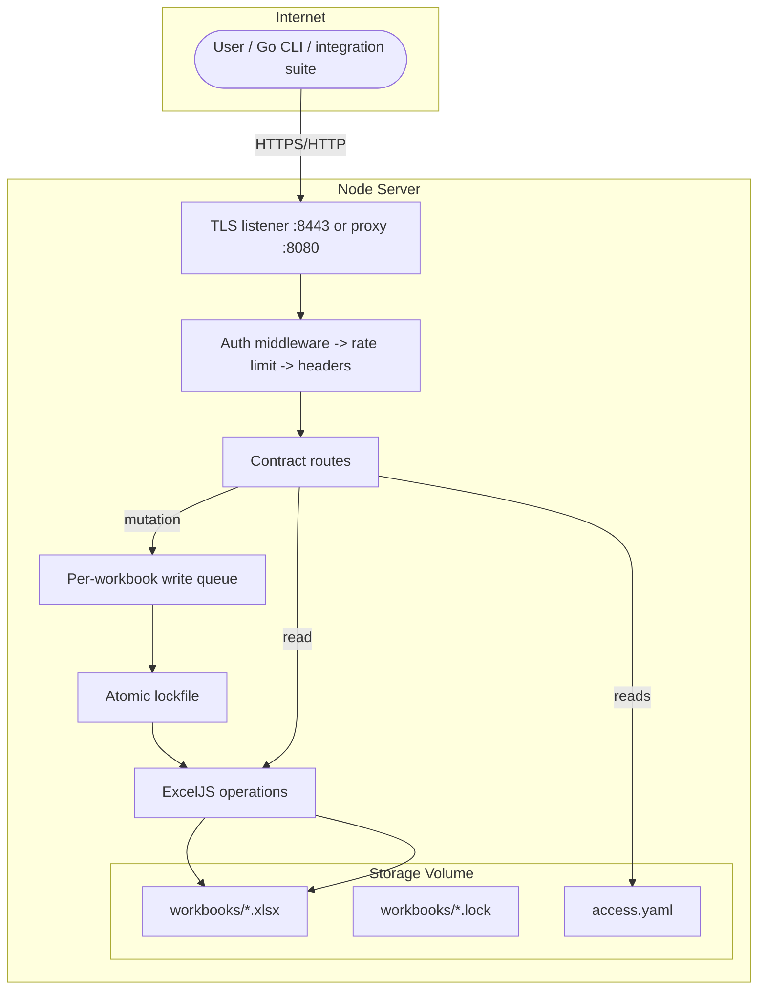
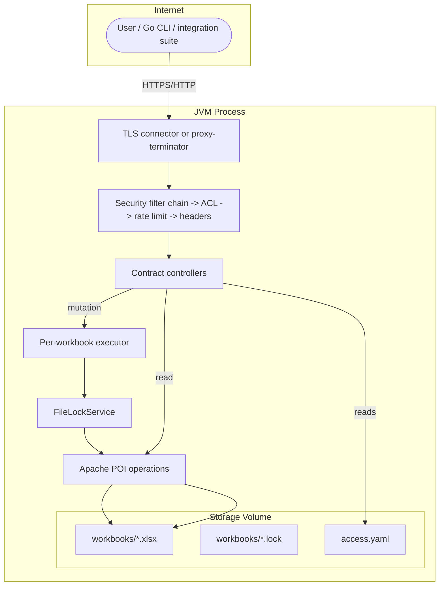
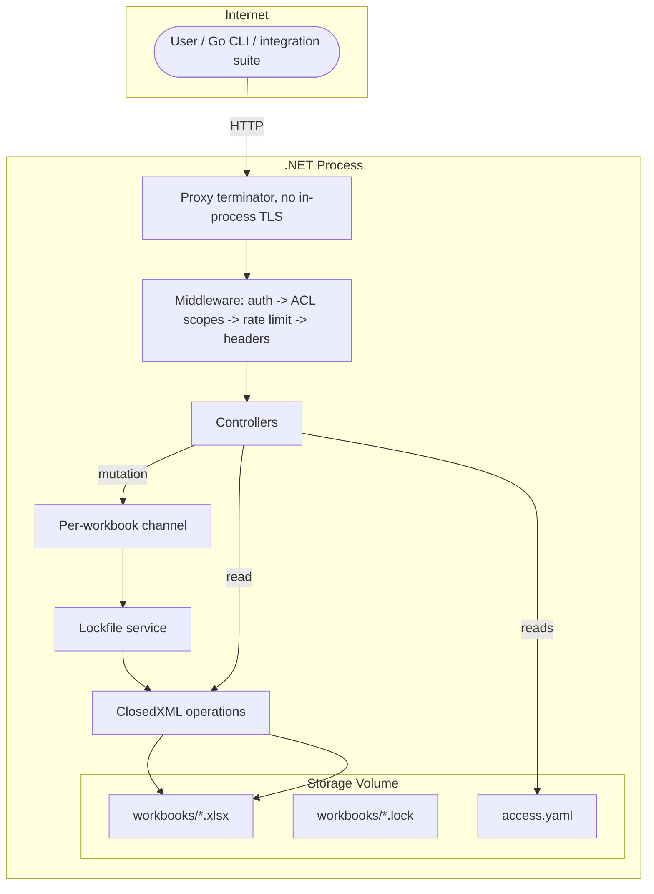
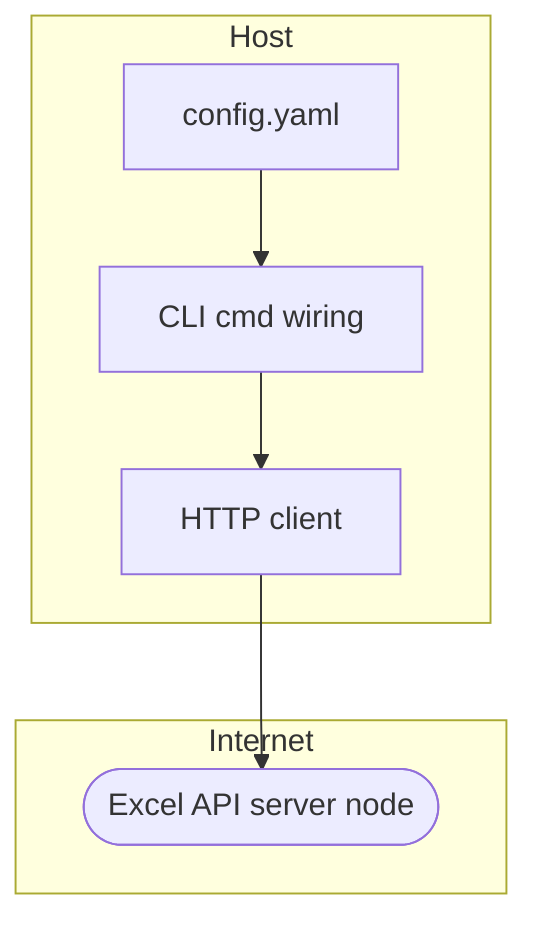
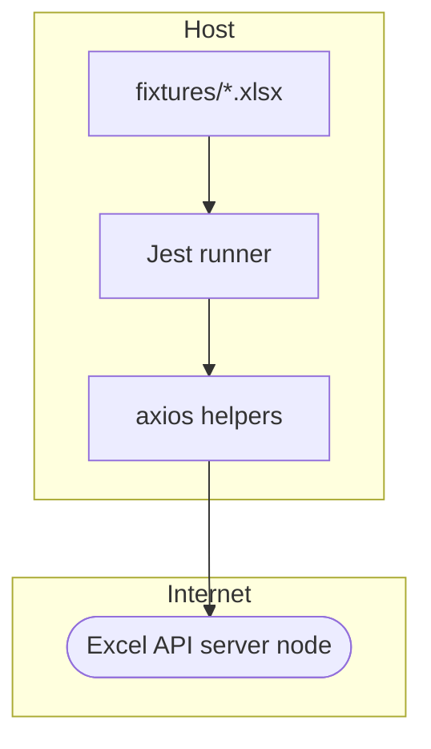

# excel-api Software Audit Report

## Document Information

|                    |                                                                                  |
|--------------------|----------------------------------------------------------------------------------|
| Report Revision    | 1.2                                                                              |
| Report Date        | 2026-09-30                                                                       |
| Detail Level       | Detailed                                                                         |
| Evaluation Scale   | 1-10                                                                             |
| Language           | English                                                                          |
| Audit Purpose      | Engineering improvement                                                          |
| Target Environment | Containerized deployment via Docker and Docker Compose                           |
| Verification Scope | source-only                                                                      |
| Subject Revision   | `5b27254f8786ca6612f0109b61ea30f106fbaef7`                                       |
| Skill Version      | 1.8                                                                              |
| Time taken         | 6:32:47                                                                          |
| Previous Report    | `docs/report/audit/0.0.2/AUDIT-1.1.md`, revision 1.1, subject revision `df055f6` |
| Projects           | excel-api-node, excel-api-java, excel-api-csharp, excel-api-go, excel-api-test   |

## Audit Type Coverage & Assurance Matrix

|  | Report type                                                              | Status         | Rationale                                                                                                      |
|--|--------------------------------------------------------------------------|----------------|----------------------------------------------------------------------------------------------------------------|
|  | Software Architecture Review                                             | Covered        | Structure, layering, contract conformance, and data flow inspected from source                                 |
|  | Code Quality Audit                                                       | Covered        | All five projects inspected, no metric tooling executed                                                        |
|  | Security Vulnerability Assessment                                        | Covered        | Source-level review plus threat model, [CWE](#cwe-common-weakness-enumeration) classification where applicable |
|  | Open Source License Compliance Review                                    | Covered        | Manifest inventory and license pass executed per `docs/COPYRIGHTS.md` policy                                   |
|  | Penetration Test                                                         | Not done       | Source-only audit, live exploitation is a separately commissioned engagement                                   |
|  | Performance Audit                                                        | Partially      | Design-level scalability reviewed, no load or latency measurement performed                                    |
|  | Cloud Infrastructure Audit                                               | Partially      | Dockerfiles and Compose inspected, no live environment state                                                   |
|  | AI Governance Audit                                                      | Not Applicable | No AI or ML system is trained, served, or depended on                                                          |
|  | Technical Due Diligence                                                  | Partially      | Engineering and delivery dimensions covered, business inputs not supplied                                      |
|  | [SBOM](#sbom-software-bill-of-materials) / Software Composition Analysis | Covered        | Source-derived inventory produced from all manifests                                                           |
|  | [ISO/IEC](#glossary) 27001 Certification                                 | Not done       | Standard used as a scoring rubric only, no certification claim                                                 |
|  | SOC 2 Attestation Examination                                            | Not done       | Framework used as a coverage checklist only, no attestation claim                                              |

## Project Inventory

| Project          | Path               | Version | Description                                                                     |
|------------------|--------------------|---------|---------------------------------------------------------------------------------|
| excel-api-node   | `excel-api-node`   | 0.0.3   | Node.js/TypeScript [HTTP](#glossary) server implementing the Excel API contract |
| excel-api-java   | `excel-api-java`   | 0.0.3   | Java 21/Spring Boot 3.3 [HTTP](#glossary) server implementing the same contract |
| excel-api-csharp | `excel-api-csharp` | 0.0.3   | C#/.NET 8 ASP.NET Core HTTP server implementing the same contract               |
| excel-api-go     | `excel-api-go`     | 0.0.3   | Go CLI client that consumes the Excel API                                       |
| excel-api-test   | `excel-api-test`   | 0.0.3   | Jest integration suite that exercises a running server                          |

## Glossary

| Term                                           | Definition                                                                                                                                      |
|------------------------------------------------|-------------------------------------------------------------------------------------------------------------------------------------------------|
| ACL                                            | Access Control List, the scope-to-method rules in `access.yaml`                                                                                 |
| [API](#api-application-programming-interface)  | A callable boundary a service exposes to other software.                                                                                        |
| BCrypt                                         | Password-hashing function used for `password_hash` user credentials                                                                             |
| CI                                             | Continuous Integration                                                                                                                          |
| CI/CD                                          | Continuous Integration and Continuous Delivery                                                                                                  |
| CORS                                           | Cross-Origin Resource Sharing                                                                                                                   |
| CVSS                                           | Common Vulnerability Scoring System                                                                                                             |
| [CWE](#cwe-common-weakness-enumeration)        | A catalog of software weakness types maintained by MITRE.                                                                                       |
| [DORA](#dora-devops-research-and-assessment)   | The research program behind the delivery metrics used as Git-derived proxies.                                                                   |
| [EVD](#evd-evidence-identifier)                | The prefix for rows in the Verification And Evidence Ledger.                                                                                    |
| [FND](#fnd-finding-identifier)                 | The prefix for findings in Detailed Technical Findings.                                                                                         |
| HMAC                                           | Hash-based Message Authentication Code, the JWT HS256 signing primitive                                                                         |
| HTTP(S)                                        | HyperText Transfer Protocol, optionally over TLS                                                                                                |
| ISO                                            | International Organization for Standardization                                                                                                  |
| ISO/IEC                                        | Joint ISO and IEC standard identifiers such as ISO/IEC 25010                                                                                    |
| JSON                                           | JavaScript Object Notation                                                                                                                      |
| JWT                                            | JSON Web Token, the signed bearer token issued by `/auth/token`                                                                                 |
| LGPL                                           | GNU Lesser General Public License                                                                                                               |
| MIT                                            | MIT License, the permissive license of this repository                                                                                          |
| N/A                                            | Not Applicable, a fixed status token                                                                                                            |
| NFR                                            | Non-Functional Requirement                                                                                                                      |
| NIST                                           | National Institute of Standards and Technology                                                                                                  |
| OAuth2                                         | Authorization framework whose grants the token endpoint implements                                                                              |
| OWASP                                          | Open Worldwide Application Security Project                                                                                                     |
| P1-P4                                          | Recommendation priorities, P1 highest to P4 lowest                                                                                              |
| [PAR](#par-parity-identifier)                  | The prefix for rows of the Mandatory Core Checklist in `process/report-parity.md`.                                                              |
| POI                                            | Apache POI, the Java workbook library                                                                                                           |
| [REC](#rec-recommendation-identifier)          | The prefix for recommendations in the Actionable Remediation Roadmap.                                                                           |
| REST                                           | Representational State Transfer, the API style the contract follows                                                                             |
| [RPO](#rpo-recovery-point-objective)           | The maximum tolerable data loss expressed as time.                                                                                              |
| [RSK](#rsk-risk-identifier)                    | The prefix for entries in the Unified Risk Register.                                                                                            |
| [RTO](#rto-recovery-time-objective)            | The maximum tolerable time to restore service after a failure.                                                                                  |
| [SBOM](#sbom-software-bill-of-materials)       | An inventory of the components a system ships or depends on.                                                                                    |
| [SLO](#slo-service-level-objective)            | A measurable target for service quality.                                                                                                        |
| SPDX                                           | Software Package Data Exchange, a license identifier convention                                                                                 |
| SQALE                                          | Software Quality Assessment based on Lifecycle Expectations, a debt-cost model                                                                  |
| [STRIDE](#stride)                              | A threat-enumeration mnemonic covering Spoofing, Tampering, Repudiation, Information Disclosure, Denial of Service, and Elevation of Privilege. |
| [TDR](#tdr-technical-debt-register-identifier) | The prefix for entries in a Technical Debt Register.                                                                                            |
| TLS                                            | Transport Layer Security                                                                                                                        |
| URL                                            | Uniform Resource Locator                                                                                                                        |
| UUID                                           | Universally Unique Identifier, the workbook identifier format                                                                                   |
| YAML                                           | YAML Ain't Markup Language, the config and contract file format                                                                                 |

### API (Application Programming Interface)

A callable boundary a service exposes to other software.

In this report the term names the HTTP contract the three servers implement.

### CWE (Common Weakness Enumeration)

A catalog of software weakness types maintained by MITRE.

Security findings carry a CWE identifier when a fitting category exists.

### DORA (DevOps Research and Assessment)

The research program behind the delivery metrics used as Git-derived proxies.

Only two of the five metrics can be approximated from commit and tag history.

### EVD (Evidence Identifier)

The prefix for rows in the Verification And Evidence Ledger.

Each row anchors a claim to a source artifact, a command, or a documented limitation.

### FND (Finding Identifier)

The prefix for findings in Detailed Technical Findings.

The infix names the pillar, for example `FND-SEC` for Security & Compliance.

### PAR (Parity Identifier)

The prefix for rows of the Mandatory Core Checklist in `process/report-parity.md`.

Each row attests one cross-section consistency requirement.

### REC (Recommendation Identifier)

The prefix for recommendations in the Actionable Remediation Roadmap.

Every recommendation resolves exactly one finding.

### RPO (Recovery Point Objective)

The maximum tolerable data loss expressed as time.

No RPO target is documented in this repository.

### RSK (Risk Identifier)

The prefix for entries in the Unified Risk Register.

Every risk traces back to a finding.

### RTO (Recovery Time Objective)

The maximum tolerable time to restore service after a failure.

No RTO target is documented in this repository.

### SBOM (Software Bill of Materials)

An inventory of the components a system ships or depends on.

This report holds manifest-derived inventories, not shipped-artifact SBOMs.

### SLO (Service Level Objective)

A measurable target for service quality.

No SLO targets are documented in this repository.

### STRIDE

A threat-enumeration mnemonic covering Spoofing, Tampering, Repudiation, Information Disclosure, Denial of Service, and Elevation of Privilege.

The Threat Model sections apply it to the evidenced trust boundaries.

### TDR (Technical Debt Register Identifier)

The prefix for entries in a Technical Debt Register.

No register is emitted in this report, structural debt distinct from risks was not surfaced.

## Glossary

| Term                                           | Definition                                                                                                                                      |
|------------------------------------------------|-------------------------------------------------------------------------------------------------------------------------------------------------|
| [ACL](#glossary)                               | Access Control List, the scope-to-method rules in `access.yaml`                                                                                 |
| [API](#api-application-programming-interface)  | A callable boundary a service exposes to other software.                                                                                        |
| [BCrypt](#glossary)                            | Password-hashing function used for `password_hash` user credentials                                                                             |
| [CI](#glossary)                                | Continuous Integration                                                                                                                          |
| [CI/CD](#glossary)                             | Continuous Integration and Continuous Delivery                                                                                                  |
| [CORS](#glossary)                              | Cross-Origin Resource Sharing                                                                                                                   |
| [CVSS](#glossary)                              | Common Vulnerability Scoring System                                                                                                             |
| [CWE](#cwe-common-weakness-enumeration)        | A catalog of software weakness types maintained by MITRE.                                                                                       |
| [DORA](#dora-devops-research-and-assessment)   | The research program behind the delivery metrics used as Git-derived proxies.                                                                   |
| [EVD](#evd-evidence-identifier)                | The prefix for rows in the Verification And Evidence Ledger.                                                                                    |
| [FND](#fnd-finding-identifier)                 | The prefix for findings in Detailed Technical Findings.                                                                                         |
| [HMAC](#glossary)                              | Hash-based Message Authentication Code, the JWT HS256 signing primitive                                                                         |
| [HTTP(S)](#glossary)                           | HyperText Transfer Protocol, optionally over [TLS](#glossary)                                                                                   |
| [ISO](#glossary)                               | International Organization for Standardization                                                                                                  |
| [ISO/IEC](#glossary)                           | Joint ISO and IEC standard identifiers such as [ISO/IEC](#glossary) 25010                                                                       |
| [JSON](#glossary)                              | JavaScript Object Notation                                                                                                                      |
| [JWT](#glossary)                               | JSON Web Token, the signed bearer token issued by `/auth/token`                                                                                 |
| [LGPL](#glossary)                              | GNU Lesser General Public License                                                                                                               |
| [MIT](#glossary)                               | MIT License, the permissive license of this repository                                                                                          |
| [N/A](#glossary)                               | Not Applicable, a fixed status token                                                                                                            |
| [NFR](#glossary)                               | Non-Functional Requirement                                                                                                                      |
| [NIST](#glossary)                              | National Institute of Standards and Technology                                                                                                  |
| [OAuth2](#glossary)                            | Authorization framework whose grants the token endpoint implements                                                                              |
| [OWASP](#glossary)                             | Open Worldwide Application Security Project                                                                                                     |
| [P1-P4](#glossary)                             | Recommendation priorities, [P1](#glossary) highest to [P4](#glossary) lowest                                                                    |
| [PAR](#par-parity-identifier)                  | The prefix for rows of the Mandatory Core Checklist in `process/report-parity.md`.                                                              |
| [POI](#glossary)                               | Apache POI, the Java workbook library                                                                                                           |
| [REC](#rec-recommendation-identifier)          | The prefix for recommendations in the Actionable Remediation Roadmap.                                                                           |
| [REST](#glossary)                              | Representational State Transfer, the [API](#api-application-programming-interface) style the contract follows                                   |
| [RPO](#rpo-recovery-point-objective)           | The maximum tolerable data loss expressed as time.                                                                                              |
| [RSK](#rsk-risk-identifier)                    | The prefix for entries in the Unified Risk Register.                                                                                            |
| [RTO](#rto-recovery-time-objective)            | The maximum tolerable time to restore service after a failure.                                                                                  |
| [SBOM](#sbom-software-bill-of-materials)       | An inventory of the components a system ships or depends on.                                                                                    |
| [SLO](#slo-service-level-objective)            | A measurable target for service quality.                                                                                                        |
| [SPDX](#glossary)                              | Software Package Data Exchange, a license identifier convention                                                                                 |
| [SQALE](#glossary)                             | Software Quality Assessment based on Lifecycle Expectations, a debt-cost model                                                                  |
| [STRIDE](#stride)                              | A threat-enumeration mnemonic covering Spoofing, Tampering, Repudiation, Information Disclosure, Denial of Service, and Elevation of Privilege. |
| [TDR](#tdr-technical-debt-register-identifier) | The prefix for entries in a Technical Debt Register.                                                                                            |
| [TLS](#glossary)                               | Transport Layer Security                                                                                                                        |
| [URL](#glossary)                               | Uniform Resource Locator                                                                                                                        |
| [UUID](#glossary)                              | Universally Unique Identifier, the workbook identifier format                                                                                   |
| [YAML](#glossary)                              | [YAML](#glossary) Ain't Markup Language, the config and contract file format                                                                    |

### API (Application Programming Interface)

A callable boundary a service exposes to other software.

In this report the term names the [HTTP](#glossary) contract the three servers implement.

### CWE (Common Weakness Enumeration)

A catalog of software weakness types maintained by MITRE.

Security findings carry a [CWE](#cwe-common-weakness-enumeration) identifier when a fitting category exists.

### DORA (DevOps Research and Assessment)

The research program behind the delivery metrics used as Git-derived proxies.

Only two of the five metrics can be approximated from commit and tag history.

### EVD (Evidence Identifier)

The prefix for rows in the Verification And Evidence Ledger.

Each row anchors a claim to a source artifact, a command, or a documented limitation.

### FND (Finding Identifier)

The prefix for findings in Detailed Technical Findings.

The infix names the pillar, for example `FND-SEC` for Security & Compliance.

### PAR (Parity Identifier)

The prefix for rows of the Mandatory Core Checklist in `process/report-parity.md`.

Each row attests one cross-section consistency requirement.

### REC (Recommendation Identifier)

The prefix for recommendations in the Actionable Remediation Roadmap.

Every recommendation resolves exactly one finding.

### RPO (Recovery Point Objective)

The maximum tolerable data loss expressed as time.

No [RPO](#rpo-recovery-point-objective) target is documented in this repository.

### RSK (Risk Identifier)

The prefix for entries in the Unified Risk Register.

Every risk traces back to a finding.

### RTO (Recovery Time Objective)

The maximum tolerable time to restore service after a failure.

No [RTO](#rto-recovery-time-objective) target is documented in this repository.

### SBOM (Software Bill of Materials)

An inventory of the components a system ships or depends on.

This report holds manifest-derived inventories, not shipped-artifact [SBOMs](#sbom-software-bill-of-materials).

### SLO (Service Level Objective)

A measurable target for service quality.

No [SLO](#slo-service-level-objective) targets are documented in this repository.

### STRIDE

A threat-enumeration mnemonic covering Spoofing, Tampering, Repudiation, Information Disclosure, Denial of Service, and Elevation of Privilege.

The Threat Model sections apply it to the evidenced trust boundaries.

### TDR (Technical Debt Register Identifier)

The prefix for entries in a Technical Debt Register.

No register is emitted in this report, structural debt distinct from risks was not surfaced.

## Executive Summary

Score bands for the 1-10 scale: `1-3 Poor · 4-6 Average · 7-8 Good · 9-10 Excellent`.

Excel API is a contract-first multi-language project exposing Excel workbooks over [HTTP](#glossary)
through three interchangeable server implementations, a Go CLI client, and a Jest
integration suite.

This re-audit inspected the 0.0.3 release at `5b27254` against the 0.0.2 baseline at
`df055f6`. 28 of the 33 prior findings are closed on current evidence, including every
CRITICAL security finding. Three stay open as accepted or residual constraints and two
as partial remediations.

| Project          | Score            | Lowest                                         | Top Risks | Readiness        |
|------------------|------------------|------------------------------------------------|-----------|------------------|
| excel-api-node   | 6.0/10 (Average) | Scalability 4/10                               | RSK-002   | Pending evidence |
| excel-api-java   | 5.9/10 (Average) | Scalability 4/10                               | RSK-002   | Pending evidence |
| excel-api-csharp | 5.9/10 (Average) | Scalability 4/10                               | RSK-002   | Pending evidence |
| excel-api-go     | 6.2/10 (Average) | Delivery & Continuity 4/10, AI Provenance 4/10 | RSK-001   | Pending evidence |
| excel-api-test   | 6.0/10 (Average) | Delivery & Continuity 4/10, AI Provenance 4/10 | RSK-001   | Pending evidence |

Overall condition: the codebase moved from Early development to Pre-production.

Authentication, authorization, [TLS](#glossary), [CORS](#glossary), rate limiting, security headers, interoperable
locking, batched write queues, request validation, Prometheus metrics, and
contract-conformant responses are now implemented on all three servers, and the
integration suite carries real assertions.

No finding was executed against a running system, so runtime verification and sign-off
stay pending.

This report covers the engineering audit types.

No penetration test or compliance certification was performed.

Contributor concentration is `High`, a single author accounts for all 21 inspected
commits.

One license-review exception remains open: the transitive `buffers@0.1.1` component of
`exceljs` declares no license and is recorded as a pending exception in
`docs/COPYRIGHTS.md`.

**Production Readiness Threshold**

Production-ready status for the documented Docker deployment requires at minimum:
closure evidence for the open Medium findings, runtime verification of the hardened
controls through the committed integration suite, and an owned verification assignment
for each gate.

Readiness cost: `INSUFFICIENT INFORMATION` - the roadmap carries qualitative effort
ratings only, and no rate or capacity data was provided to convert them into cost.

## Changes Since Previous Audit

### Report Parameters

| Field            | Previous report                        | Current report                         |
|------------------|----------------------------------------|----------------------------------------|
| File             | `docs/report/audit/0.0.2/AUDIT-1.1.md` | `docs/report/audit/0.0.3/AUDIT-1.2.md` |
| Revision         | 1.1                                    | 1.2                                    |
| Subject revision | `df055f6`                              | `5b27254`                              |
| Detail level     | Detailed                               | Detailed                               |
| Evaluation scale | 1-10                                   | 1-10                                   |
| Language         | English                                | English                                |

Parameters are unchanged, so scores compare directly.

### excel-api-node

Real security middleware ([CORS](#glossary), headers, rate limit), [TLS](#glossary) wiring, interoperable lockfile, write queue with `queue_depth`, Prometheus metrics, batch endpoints, `/ranges` path, header modes, `INVALID_REQUEST` validation, digest-pinned image, compose env fix.

| Dimension     | 0.0.2 audit | 0.0.3 audit | Driver                                                                   |
|---------------|-------------|-------------|--------------------------------------------------------------------------|
| Security      | 3/10        | 7/10        | Auth hardening, [TLS](#glossary), [CORS](#glossary), headers, rate limit |
| Observability | 3/10        | 6/10        | Prometheus exposition with `queue_depth`                                 |
| Deployability | 4/10        | 7/10        | Digest pin, non-root user, healthcheck                                   |
| Code Quality  | 5/10        | 7/10        | ESM fix, validation layer, header modes                                  |

All Node-applicable prior findings are closed on current evidence, and RSK-002 (plaintext transport) and RSK-001 (pipeline-free delivery) remain open.

### excel-api-java

[ACL](#glossary) authorization filter, bcrypt password verification, per-IP rate limit filter, [TLS](#glossary) via Spring `Ssl`, security headers, interoperable `FileLockService`, `RequestGuards` validation, [POI](#glossary) `AreaReference` range fix, Prometheus metrics, digest-pinned image.

| Dimension     | 0.0.2 audit | 0.0.3 audit | Driver                                                                 |
|---------------|-------------|-------------|------------------------------------------------------------------------|
| Security      | 3/10        | 7/10        | [ACL](#glossary) filter, bcrypt, [TLS](#glossary), headers, rate limit |
| Observability | 3/10        | 6/10        | Micrometer Prometheus exposition                                       |
| Deployability | 4/10        | 7/10        | Digest pin, non-root user, healthcheck                                 |

Both Java-specific security findings closed, and FND-INF-006 (no Maven lockfile) is new.

### excel-api-csharp

Real JWT issuance and validation, bcrypt verification, constant-time compares, scope enforcement, security headers, rate limiting, interoperable lockfile, write channel with `queue_depth`, prometheus-net metrics, batch endpoints, `/ranges` path, digest-pinned image.

| Dimension     | 0.0.2 audit | 0.0.3 audit | Driver                                        |
|---------------|-------------|-------------|-----------------------------------------------|
| Security      | 2/10        | 7/10        | Real JWT, bcrypt, scopes, headers, rate limit |
| Observability | 3/10        | 6/10        | prometheus-net exposition                     |
| Deployability | 4/10        | 7/10        | Digest pin, non-root user, healthcheck        |

The CRITICAL placeholder-auth finding is closed, and FND-SEC-004 (no in-process [TLS](#glossary)) and FND-INF-006 (no NuGet lockfile) are open or new.

### excel-api-go

Request composition updated to the corrected contract surface including `/ranges` and batch paths, error-envelope code propagation, version alignment.

| Dimension    | 0.0.2 audit | 0.0.3 audit | Driver                                             |
|--------------|-------------|-------------|----------------------------------------------------|
| Code Quality | 5/10        | 7/10        | Contract-conformant requests, envelope propagation |

FND-SEC-001 (https endpoint posture) and FND-INF-001 (no [CI](#glossary)) remain open.

### excel-api-test

Integration fixtures made writable, real contract assertions across eight test files covering auth, ranges, batch, locking, and header modes.

| Dimension   | 0.0.2 audit | 0.0.3 audit | Driver                                       |
|-------------|-------------|-------------|----------------------------------------------|
| Testability | 2/10        | 7/10        | Real assertions replace placeholder coverage |

The suite is substantive but unexecuted in this audit, and FND-INF-001 (no [CI](#glossary)) remains open.

## excel-api-node

### Executive Summary

Score bands for the 1-10 scale: `1-3 Poor · 4-6 Average · 7-8 Good · 9-10 Excellent`.

| Field          | Value                                                                     |
|----------------|---------------------------------------------------------------------------|
| System type    | Codebase under development                                                |
| Scope          | TypeScript/Fastify server at `5b27254`, source-only, Git history included |
| Source basis   | Inspected code, manifests, and Git history                                |
| Maturity level | Pre-production                                                            |
| Overall score  | 6.0/10 (Average)                                                          |

Lowest-scoring dimension: Scalability 4/10.

excel-api-node is the TypeScript/Fastify implementation of the shared Excel API contract.

Its condition is Average overall: the 0.0.3 hardening (auth, [TLS](#glossary), [CORS](#glossary), rate limiting,
locking, queues, validation, metrics) is implemented in source, while single-node storage,
single-author delivery, and a pending license exception keep it short of Good.

**Production Readiness Threshold**

Readiness requires [TLS](#glossary) or documented proxy termination (RSK-002), executed integration
suite evidence, and closure or acceptance records for the open Medium findings.

### System Context

| Aspect                 | Detail                                                                                                                                    |
|------------------------|-------------------------------------------------------------------------------------------------------------------------------------------|
| Functional description | [REST](#glossary) service exposing Excel workbooks over [HTTP](#glossary), interchangeable with the Java and C# servers                   |
| Architecture overview  | Fastify plugins and hooks front a route layer backed by ExcelJS storage and an interoperable lockfile                                     |
| Key components         | `src/server.ts`, `src/auth/`, `src/middleware/`, `src/routes/`, `src/excel/`, `src/storage/`, `src/lock/`, `src/queue/`, `src/metrics.ts` |
| External dependencies  | ExcelJS, Fastify, Zod, jsonwebtoken, bcrypt, prom-client, js-yaml, uuid                                                                   |
| Assumptions            | Operators deploy a single node against a local or mounted volume                                                                          |

### Technology Stack

| Layer            | Technology                                                                         |
|------------------|------------------------------------------------------------------------------------|
| Languages        | TypeScript `^5.9.3`                                                                |
| Frameworks       | Fastify `^5.6.1`                                                                   |
| Runtime/Platform | Node.js `>=22.0.0`, `node:22-alpine` container                                     |
| Build tooling    | `tsc`, ESLint `^9.24.0`                                                            |
| Test tooling     | Jest `^30.0.0` (boundary spec tests), external `excel-api-test` suite              |
| Package manager  | npm, `package-lock.json` committed                                                 |
| Key libraries    | ExcelJS, Zod, jsonwebtoken, bcrypt, prom-client, js-yaml                           |
| Data stores      | Local filesystem `.xlsx` workbooks and `.lock` files under `storage.workbooks_dir` |
| Target platforms | Docker container or local Node process                                             |

### Software Bill of Materials

This is a manifest-derived component list at `5b27254`, not a shipped-artifact [SBOM](#sbom-software-bill-of-materials)
and not an [SPDX](#glossary) or CycloneDX claim.

|  | Component    | Version | Ecosystem | Relationship         | License          | License Risk | Advisory Checked | Source File                               |
|--|--------------|---------|-----------|----------------------|------------------|--------------|------------------|-------------------------------------------|
|  | exceljs      | ^4.4.0  | pkg:npm   | direct               | [MIT](#glossary) | None flagged | N                | `package.json`                            |
|  | fastify      | ^5.6.1  | pkg:npm   | direct               | [MIT](#glossary) | None flagged | N                | `package.json`                            |
|  | js-yaml      | ^4.1.0  | pkg:npm   | direct               | [MIT](#glossary) | None flagged | N                | `package.json`                            |
|  | jsonwebtoken | ^9.0.2  | pkg:npm   | direct               | [MIT](#glossary) | None flagged | N                | `package.json`                            |
|  | bcrypt       | ^6.0.0  | pkg:npm   | direct               | [MIT](#glossary) | None flagged | N                | `package.json`                            |
|  | zod          | ^4.1.12 | pkg:npm   | direct               | [MIT](#glossary) | None flagged | N                | `package.json`                            |
|  | prom-client  | ^15.1.3 | pkg:npm   | direct               | Apache-2.0       | None flagged | N                | `package.json`                            |
|  | uuid         | ^11.0.0 | pkg:npm   | direct               | [MIT](#glossary) | None flagged | N                | `package.json`                            |
|  | typescript   | ^5.9.3  | pkg:npm   | direct (dev)         | Apache-2.0       | None flagged | N                | `package.json`                            |
|  | jest         | ^30.0.0 | pkg:npm   | direct (dev)         | [MIT](#glossary) | None flagged | N                | `package.json`                            |
|  | buffers      | 0.1.1   | pkg:npm   | transitive (exceljs) | Unknown          | Review       | N                | `package-lock.json`, `docs/COPYRIGHTS.md` |

Direct components: 10.

Transitive components: 1 flagged (`buffers@0.1.1`, license `Unknown`).

Manifest versus lockfile drift: `package-lock.json` present, manifest and lockfile agree.

### License & IP Compliance Review

|  | License class   | Components | Notes                                                      |
|--|-----------------|------------|------------------------------------------------------------|
|  | Permissive      | 10         | All direct components ([MIT](#glossary), Apache-2.0)       |
|  | Weak-copyleft   | 0          | None                                                       |
|  | Strong-copyleft | 0          | None                                                       |
|  | Proprietary     | 0          | None                                                       |
|  | Unknown         | 1          | `buffers@0.1.1` transitive of `exceljs`, pending exception |

No `Conflict` result exists, the only unresolved component is the documented `buffers` exception (FND-CPR-003).

The project's own licensing is consistent: root `LICENSE` carries the [MIT](#glossary) text and `docs/COPYRIGHTS.md` records the per-component pass.

One component's license is underivable from inspected sources: `buffers@0.1.1`. A maintained [SBOM](#sbom-software-bill-of-materials) or upstream license declaration would resolve it.

### Health Dashboard

**Risk Map**

| Impact   | LOW              | MEDIUM  | HIGH |
|----------|------------------|---------|------|
| CRITICAL |                  |         |      |
| HIGH     |                  | RSK-002 |      |
| MEDIUM   | RSK-004, RSK-005 | RSK-001 |      |
| LOW      | RSK-003          |         |      |

**Scorecard Summary**

Score bands for the 1-10 scale: `1-3 Poor · 4-6 Average · 7-8 Good · 9-10 Excellent`.

| Dimension               | Score | Notes                                                                  |
|-------------------------|-------|------------------------------------------------------------------------|
| Testability             | 6/10  | External suite exercises contract paths, thin in-repo unit suite       |
| Design Soundness        | 7/10  | Middleware/plugin separation, contract-driven routes                   |
| Code Quality            | 7/10  | Typed modules, ESM defect fixed                                        |
| Stack Alignment         | 8/10  | Fastify 5 on Node 22 LTS, idiomatic                                    |
| Dependency Health       | 6/10  | Lockfile present, one transitive license exception                     |
| Maintainability         | 6/10  | Small modules, manual schema parity                                    |
| Deployability           | 7/10  | Digest-pinned image, non-root user, healthcheck                        |
| Scalability             | 4/10  | Single-node file storage by recorded decision                          |
| Security                | 7/10  | Full auth stack, [TLS](#glossary) opt-in, proxy-keyed limiter residual |
| Compliance              | 6/10  | Policy and pass documented, notices not redistributed                  |
| Observability           | 6/10  | Prometheus metrics and structured logs, no tracing                     |
| Operational Safety      | 6/10  | Lock + queue protect data, no backup path                              |
| Delivery & Continuity   | 4/10  | Solo author, no [CI](#glossary)                                        |
| AI Provenance           | 4/10  | Convention documented, trailers absent                                 |
| Originality & Licensing | 6/10  | Inventory done, attribution bundle missing                             |

Omitted N/A dimensions: Skill Definition - the subject is not an agent skill, and API Compatibility - the subject is a service, not a reusable library.

**Team & Continuity**

100% of the 21 inspected commits trace to one author over a four-day window, rating `High`, with manual verification recorded as the accepted check (EVD-007, EVD-010).

### Delivery Practice & Team Continuity

**Delivery metrics**

|  | [DORA](#dora-devops-research-and-assessment) metric | Result          | Basis                                      |
|--|-----------------------------------------------------|-----------------|--------------------------------------------|
|  | Change lead time                                    | `NOT SPECIFIED` | No tags exist, commits are not deployments |
|  | Deployment frequency                                | `NOT SPECIFIED` | No tags exist, commits are not deployments |
|  | Failed deployment recovery time                     | `NOT SPECIFIED` | Requires incident and deployment data      |
|  | Change fail rate                                    | `NOT SPECIFIED` | Requires incident and rollback data        |
|  | Deployment rework rate                              | `NOT SPECIFIED` | Requires production incident data          |

**Contributor concentration**

Top-author commit share is 100% across the 21 inspected commits spanning 2026-09-25 to
2026-09-28, one active contributor, rating `High` (EVD-007).

Reviewer diversity is `NOT SPECIFIED`, pull-request reviews do not live in Git history.

`docs/GUIDELINES.md` records manual verification as the accepted alternative to hosted
[CI](#glossary), which is the documented continuity-relevant decision (FND-INF-001, RSK-001).

### High-Level Observations

| Observation                                                  |
|--------------------------------------------------------------|
| Every CRITICAL and HIGH finding from the baseline is closed  |
| Security controls are real but [TLS](#glossary) stays opt-in |
| Concurrency is now defended twice                            |
| The only regression gate is manual                           |

**Every CRITICAL and HIGH finding from the baseline is closed**

FND-SEC-001 through FND-SEC-006 and the ARC/CQY HIGHs are closed on current source evidence, so the residual profile is operational rather than structural.

**Security controls are real but [TLS](#glossary) stays opt-in**

FND-SEC-002 closed on implementation, yet plaintext [HTTP](#glossary) remains possible when `server.tls.enabled` is false, tracked as RSK-002.

**Concurrency is now defended twice**

The interoperable lockfile (FND-CQY-002) and per-workbook write queue (FND-CQY-003) serialize mutations and interoperate with the other two servers.

**The only regression gate is manual**

FND-INF-001 records the deliberate absence of [CI](#glossary), `excel-api-test` exists but runs only when a maintainer invokes it.

### Auditing Methodology

This audit inspected the TypeScript source under `excel-api-node/src/` (41 files), `package.json`, `tsconfig.json`, `eslint.config.mjs`, the `Dockerfile`, and the shared contract and docs at `5b27254`.

`.gitignore` exclusions were applied to the census.

The full Git history of 21 commits was examined.

No builds, tests, linters, or subject tools were executed as evidence.

No committed [CI](#glossary) output, coverage report, or scan artifact exists to draw on.

**Methodology overview**

The audit applies evidence-based reasoning across 18 core assessment categories grouped
into six pillars, plus conditional assessments applied when the subject warrants them.

- **Architecture & Design** - Design principles, maintainability, change management,
  documentation, non-functional requirements
- **Code Quality** - Testing, code quality, stack best practices
- **Security & Compliance** - Security, compliance and data protection
- **Infrastructure & [CI/CD](#glossary)** - Dependencies, deployment, rollback, observability, error
  handling, operational readiness
- **AI Provenance & Code Origin** - Explicit attribution, generated-artifact validation,
  and SDLC evidence, without authorship inference from style
- **Copyrights & Originality** - Code originality, license compliance, attribution,
  dependency license compatibility
- **API Compatibility & Versioning Discipline** - Conditional, not applied: the subject
  is a service, not a reusable library or package

**Reference standards**

- **[ISO/IEC](#glossary) 25010:2023** - product-quality coverage through the scorecard crosswalk
- **OWASP API Security Top 10 (2023)** - [API](#api-application-programming-interface) attack-surface coverage
- **[CWE](#cwe-common-weakness-enumeration)** - weakness classification on security findings
- **NIST SP 800-30** - risk process behind the Unified Risk Register
- **[STRIDE](#stride)** - threat enumeration in the Threat Model
- **[ISO](#glossary) 19011** and **NIST RMF** - follow-up guidance in the re-audit plan
- **Semantic Versioning 2.0.0** - the project's declared versioning policy

**Verification And Evidence Ledger**

| Evidence | Project        | Check / Source                      | Result                                                                                             | Type        | Artifact                                               |
|----------|----------------|-------------------------------------|----------------------------------------------------------------------------------------------------|-------------|--------------------------------------------------------|
| EVD-001  | excel-api-node | Source census `excel-api-node/src/` | 41 TypeScript modules across auth, middleware, routes, excel, storage, lock, queue                 | Observation | Source tree                                            |
| EVD-002  | excel-api-node | Manifest and build config           | `package.json` 0.0.3, ESM, engines `>=22`, lockfile committed                                      | Observation | `package.json`, `package-lock.json`                    |
| EVD-003  | excel-api-node | Lockfile and write-queue inspection | Atomic create, shared metadata, per-workbook queue, `queue_depth` reported                         | Observation | `src/lock/lockfile.ts`, `src/queue/writeQueue.ts`      |
| EVD-004  | excel-api-node | Auth pipeline inspection            | [JWT](#glossary) + static tokens, bcrypt, scope checks, timing-safe compare                        | Observation | `src/auth/`                                            |
| EVD-005  | excel-api-node | Transport security inspection       | [TLS](#glossary) block, [CORS](#glossary) allowlist, security headers, per-IP fixed-window limiter | Observation | `src/server.ts`, `src/middleware/`                     |
| EVD-006  | excel-api-node | Metrics endpoint inspection         | prom-client exposition incl. `queue_depth`                                                         | Observation | `src/metrics.ts`                                       |
| EVD-007  | excel-api-node | `git log` census                    | 21 commits, 1 author, 0 tags, no provenance trailers                                               | Observation | Git history                                            |
| EVD-008  | excel-api-node | External suite inspection           | 8 integration test files with contract assertions                                                  | Observation | `excel-api-test/integration/`                          |
| EVD-009  | excel-api-node | License pass                        | Disposition table, `buffers@0.1.1` pending exception                                               | Observation | `docs/COPYRIGHTS.md`, `package-lock.json`              |
| EVD-010  | excel-api-node | Deployment asset inspection         | Digest pin, non-root user, healthcheck, compose envs aligned                                       | Observation | `Dockerfile`, `docker-compose.yaml`                    |
| EVD-011  | excel-api-node | Request validation inspection       | Zod schemas return `400 INVALID_REQUEST`                                                           | Observation | `src/routes/validate.ts`                               |
| EVD-012  | excel-api-node | Contract mirror diff                | `resources/openapi.yaml` matches canonical 0.0.3                                                   | Observation | `resources/openapi.yaml`, `docs/contract/openapi.yaml` |

Evidence methods were `git` subcommands, filesystem reads, and pattern scans against the
working tree at `5b27254`.

Every finding cites the [EVD](#evd-evidence-identifier) rows it rests on.

No row substitutes executed verification for source inspection.

**Severity definitions**

| Severity | Meaning                  | Readiness Treatment       |
|----------|--------------------------|---------------------------|
| CRITICAL | Critical contextual risk | Gate resolution           |
| HIGH     | Major contextual risk    | Gate resolution           |
| MEDIUM   | Material contained risk  | Track and plan            |
| LOW      | Limited contextual risk  | Proportionate improvement |

Severity derives from the impact/likelihood matrix in `synthesis/risk-register.md`, not
[CVSS](#glossary).

### Scoring Rubrics

| Band      | Score Range | Definition                                                   |
|-----------|-------------|--------------------------------------------------------------|
| Excellent | 9-10        | Capability is comprehensive and verified by strong evidence  |
| Good      | 7-8         | Capability is solid overall, minor or noticeable gaps exist  |
| Average   | 4-6         | Capability is present but uneven, limited, or inconsistent   |
| Poor      | 1-3         | Capability is minimal, fragmentary, or absent where required |

The overall score is the unweighted arithmetic mean of the 15 scored dimensions, rounded to one decimal: 90/150 = 6.0.

The [ISO/IEC](#glossary) 25010:2023 crosswalk in `synthesis/project-scorecard.md` maps Lens
dimensions onto [ISO](#glossary) characteristics as coverage, not conformance.

The lowest-scoring dimension is Scalability at 4/10, driven by the recorded single-node storage decision (FND-ARC-005).

### Architectural Assessment

### What Works

Contract-first routing keeps behavior aligned with `docs/contract/openapi.yaml`, verified by the mirrored spec diff (EVD-012).

Auth, [CORS](#glossary), rate limiting, and security headers are separate middleware, each individually reviewable (EVD-005).

The write queue isolates mutation ordering from transport concurrency, and `queue_depth` is observable (EVD-003).

The lockfile protocol is interoperable with the Java and C# implementations by design (EVD-003).

### What Needs Attention

File-system storage binds all state to one node (FND-ARC-005).

Zod schemas and the OpenAPI YAML are maintained by hand, drift is caught only by the external suite.

The rate limiter keys on the connection IP (FND-SEC-007).

### Design Patterns

|  | Pattern                   | Location                                              | Purpose                                 | Assessment                           |
|--|---------------------------|-------------------------------------------------------|-----------------------------------------|--------------------------------------|
|  | Middleware                | `src/auth/middleware.ts`, `src/middleware/*`          | Cross-cutting auth, rate limit, headers | Appropriate - standard Fastify hooks |
|  | Plugin                    | `src/server.ts` registrations                         | Composition root                        | Appropriate                          |
|  | Producer queue            | `src/queue/writeQueue.ts`                             | Serialized workbook mutations           | Appropriate for single node          |
|  | DAO/service               | `src/storage/workbooks.ts`, `src/excel/operations.ts` | Workbook persistence and operations     | Appropriate                          |
|  | DTO validation            | `src/routes/validate.ts`                              | Contract-shaped request bodies          | Appropriate - Zod schemas            |
|  | Retry with stale takeover | `src/lock/lockfile.ts`                                | Interoperable file lock                 | Appropriate - bounded timeout        |

### Data Flow Diagram

**Trust boundaries and flows**

|  | Flow ID | Source     | Target            | Boundary crossed          | Data                                                   | Auth mechanism      | Transport                 |
|--|---------|------------|-------------------|---------------------------|--------------------------------------------------------|---------------------|---------------------------|
|  | FLOW-1  | User       | Listener          | Internet -> process       | [API](#api-application-programming-interface) requests | Bearer JWT or Token | [TLS](#glossary) optional |
|  | FLOW-2  | Middleware | `access.yaml`     | Process -> filesystem     | Credentials, scopes                                    | File permissions    | Local                     |
|  | FLOW-3  | Routes     | Workbook files    | Process -> storage volume | `.xlsx` contents                                       | Lockfile + queue    | Local                     |
|  | FLOW-4  | Lockfile   | Peer server impls | Process -> shared volume  | Lock metadata                                          | Atomic file create  | Local                     |

**Full-pipeline trace**

An `append` request enters at the listener, is authenticated and scope-checked in middleware, validated by `validate.ts`, serialized through the per-workbook queue, gated by the atomic lockfile, applied by ExcelJS, and committed to the storage volume while metrics and logs record the operation.

### Trade-off Analysis

|  | Decision                                       | Options                                | Trade-off                                  | Rationale                                              | Fit                                 |
|--|------------------------------------------------|----------------------------------------|--------------------------------------------|--------------------------------------------------------|-------------------------------------|
|  | File-system storage + lockfile protocol        | Embedded DB, external store, shared FS | Simplicity vs horizontal scalability       | Single-node target is explicit in `docs/DEPLOYMENT.md` | Acceptable for stated scope         |
|  | In-process per-workbook write queue            | Distributed lock service, broker       | Deployment simplicity vs multi-node safety | Serializes mutations without infrastructure            | Acceptable for stated scope         |
|  | Opt-in [TLS](#glossary) listener               | Mandatory TLS, proxy-only              | Flexibility vs default-plaintext risk      | Compose supports proxy termination                     | Acceptable, misconfig risk recorded |
|  | Per-IP fixed-window rate limiter               | Token bucket, distributed limiter      | Simplicity vs proxy dilution               | Local deployment assumption                            | Residual in FND-SEC-007             |
|  | Hand-maintained Zod schemas vs OpenAPI codegen | Generate from `openapi.yaml`           | Flexibility vs drift risk                  | External suite guards parity                           | Acceptable while suite runs         |

### Threat Model

|  | Component                 | Spoofing                   | Tampering                         | Repudiation       | Info Disclosure                  | DoS                         | Elevation    |
|--|---------------------------|----------------------------|-----------------------------------|-------------------|----------------------------------|-----------------------------|--------------|
|  | Auth middleware           | Bearer/JWT + static tokens | -                                 | Request logging   | `access.yaml` secrets            | Rate limiting               | Scope checks |
|  | [TLS](#glossary) listener | Server cert identity       | [TLS](#glossary) integrity        | -                 | [TLS](#glossary) confidentiality | -                           | -            |
|  | Lockfile protocol         | -                          | Atomic create, stale takeover     | -                 | -                                | Bounded acquisition timeout | -            |
|  | Write queue               | -                          | Serialized mutation order         | Queue-depth gauge | -                                | Lock timeout bounds waits   | -            |
|  | Excel operations          | -                          | Validated ranges, batch atomicity | -                 | Error envelope avoids internals  | -                           | -            |

The [STRIDE](#stride) columns record mitigations present in source, not residual exposures.

**Residual exposures**

- FLOW-1 on plaintext [HTTP](#glossary) exposes tokens and workbook data when [TLS](#glossary) is disabled.
- IP-keyed rate limiting dilutes behind a shared reverse proxy (FND-SEC-007).
- `access.yaml` secrecy depends on deployment file permissions, not encryption at rest.
- Stale-lock takeover relies on `locked_at` age, so clock skew on a shared volume can weaken takeover safety.

### API Contract Conformance

| Contract element        | Canonical spec                                                                           | Implementation         | Status     |
|-------------------------|------------------------------------------------------------------------------------------|------------------------|------------|
| /ranges path            | `docs/contract/openapi.yaml` `/ranges`                                                   | `src/routes/range.ts`  | Conformant |
| RangeData envelope      | `range.data[]`, `range.row_count`                                                        | `operations.ts`        | Conformant |
| CellData ref/column/row | `CellData` schema                                                                        | `operations.ts`        | Conformant |
| LockStatus fields       | incl. `queue_depth`                                                                      | `src/routes/lock.ts`   | Conformant |
| Batch operations        | `/records/batch`, `/cells/batch`                                                         | `record.ts`, `cell.ts` | Conformant |
| Error codes             | `RATE_LIMITED`, `SERVICE_BUSY`, `FILE_LOCKED`, `SHEET_NOT_CONFIGURED`, `INVALID_REQUEST` | Middleware and routes  | Conformant |
| Header modes            | `none`, `single`, `multi`, `legend`                                                      | `operations.ts`        | Conformant |

The mirrored spec `excel-api-node/resources/openapi.yaml` matches the canonical contract at version 0.0.3 (EVD-012).

### Standards Conformance

| Standard                                | Scope applied                                                       | State   | Notes                                          |
|-----------------------------------------|---------------------------------------------------------------------|---------|------------------------------------------------|
| [ISO/IEC](#glossary) 25010:2023         | Quality dimension framing                                           | Partial | Crosswalk coverage, not conformance            |
| OWASP API Security Top 10 (2023)        | [API](#api-application-programming-interface) attack-surface review | Partial | Auth, rate limiting, resource controls present |
| [CWE](#cwe-common-weakness-enumeration) | Finding classification                                              | Applied | CWE-307, CWE-319 cited on relevant findings    |
| NIST SP 800-30                          | Risk likelihood/impact scale                                        | Applied | Risk register uses the five-level scale        |
| [STRIDE](#stride)                       | Threat model columns                                                | Applied | Per-component mitigations recorded             |
| Semantic Versioning 2.0.0               | Versioning policy                                                   | Applied | `docs/VERSIONING.md` declares SemVer           |

### Strengths & What's Working

- Constant-time secret comparison via SHA-256 prehash plus `timingSafeEqual` in `src/auth/access.ts`.
- Interoperable lockfile metadata (`pid`, `hostname`, `locked_at`, `implementation`) shared with the other servers.
- Every mutating route runs through the per-workbook write queue with `queue_depth` observability.
- Zod validation returns contract `INVALID_REQUEST` errors consistently across routes.
- The Docker image is digest-pinned, runs non-root, and carries a healthcheck.

### Detailed Technical Findings

| Finding     | Pillar                              | Severity | Title                                                                                          | Result | Status | Change    | Verification |
|-------------|-------------------------------------|----------|------------------------------------------------------------------------------------------------|--------|--------|-----------|--------------|
| FND-ARC-001 | Architecture & Design               | HIGH     | Contract range-read behavior                                                                   | PASS   | Closed | Closed    | Verified     |
| FND-ARC-002 | Architecture & Design               | HIGH     | Canonical contract path                                                                        | PASS   | Closed | Closed    | Verified     |
| FND-ARC-003 | Architecture & Design               | HIGH     | Contract batch operations                                                                      | PASS   | Closed | Closed    | Verified     |
| FND-ARC-004 | Architecture & Design               | HIGH     | Record insertion correctness                                                                   | PASS   | Closed | Closed    | Verified     |
| FND-ARC-005 | Architecture & Design               | MEDIUM   | Scalability requirement for the documented deployment model                                    | FAIL   | Open   | Unchanged | Confirmed    |
| FND-ARC-006 | Architecture & Design               | CRITICAL | ESM runtime compatibility                                                                      | PASS   | Closed | Closed    | Verified     |
| FND-ARC-007 | Architecture & Design               | LOW      | Documentation must describe the shipped tree                                                   | PASS   | Closed | Closed    | Verified     |
| FND-CQY-001 | Code Quality                        | LOW      | Executable regression coverage                                                                 | PASS   | Closed | Closed    | Verified     |
| FND-CQY-002 | Code Quality                        | HIGH     | Interoperable lock protocol shared by all three servers                                        | PASS   | Closed | Closed    | Verified     |
| FND-CQY-003 | Code Quality                        | HIGH     | Mutation serialization                                                                         | PASS   | Closed | Closed    | Verified     |
| FND-CQY-004 | Code Quality                        | MEDIUM   | Contract request validation                                                                    | PASS   | Closed | Closed    | Verified     |
| FND-CQY-005 | Code Quality                        | MEDIUM   | Sheet header-mode behavior                                                                     | PASS   | Closed | Closed    | Verified     |
| FND-SEC-001 | Security & Compliance               | HIGH     | Constant-time credential comparison                                                            | PASS   | Closed | Closed    | Verified     |
| FND-SEC-002 | Security & Compliance               | HIGH     | Transport protection for tokens and workbook data                                              | PASS   | Closed | Closed    | Verified     |
| FND-SEC-003 | Security & Compliance               | MEDIUM   | Configurable origin policy                                                                     | PASS   | Closed | Closed    | Verified     |
| FND-SEC-004 | Security & Compliance               | MEDIUM   | Brute-force and resource-exhaustion resistance                                                 | PASS   | Closed | Closed    | Verified     |
| FND-SEC-005 | Security & Compliance               | LOW      | Baseline response hardening                                                                    | PASS   | Closed | Closed    | Verified     |
| FND-SEC-006 | Security & Compliance               | LOW      | Valid metrics exposition                                                                       | PASS   | Closed | Closed    | Verified     |
| FND-SEC-007 | Security & Compliance               | LOW      | Rate limiting for the token endpoint and [API](#api-application-programming-interface) surface | FAIL   | Open   | New       |              |
| FND-INF-001 | Infrastructure & [CI/CD](#glossary) | MEDIUM   | Regression gating for changes                                                                  | FAIL   | Open   | Unchanged | Confirmed    |
| FND-INF-002 | Infrastructure & [CI/CD](#glossary) | LOW      | Accurate version reporting                                                                     | PASS   | Closed | Closed    | Verified     |
| FND-INF-003 | Infrastructure & [CI/CD](#glossary) | MEDIUM   | Reproducible image builds                                                                      | PASS   | Closed | Closed    | Verified     |
| FND-INF-004 | Infrastructure & [CI/CD](#glossary) | MEDIUM   | Container health observability                                                                 | PASS   | Closed | Closed    | Verified     |
| FND-INF-005 | Infrastructure & [CI/CD](#glossary) | HIGH     | Documented deployment starts as configured                                                     | PASS   | Closed | Closed    | Verified     |
| FND-AIP-001 | AI Provenance & Code Origin         | LOW      | Documented AI-assistance provenance convention                                                 | FAIL   | Open   | Unchanged | Confirmed    |
| FND-CPR-001 | Copyrights & Originality            | MEDIUM   | Repository license policy per project conventions                                              | PASS   | Closed | Closed    | Verified     |
| FND-CPR-002 | Copyrights & Originality            | LOW      | Third-party license attribution                                                                | PASS   | Closed | Closed    | Verified     |
| FND-CPR-003 | Copyrights & Originality            | LOW      | Determined licenses for all shipped components                                                 | FAIL   | Open   | New       |              |

### FND-ARC-001: [excel-api-node] Contract range-read behavior

* **Pillar:** Architecture & Design
* **Severity:** High
* **Type:** Observation
* **Security:** [N/A](#glossary) - resolved defect, no residual weakness
* **Status:** Closed
* **Change:** Closed
* **Targets:** `src/excel/operations.ts`, `src/routes/range.ts`
* **Basis:** Contract range-read behavior
* **Absence:** N/A Resolved - defect class, not an absent capability
* **Description:** The prior capped/incorrect range read is fixed: `readRange` walks the full requested bounds and `range.ts` emits the contract `RangeData` envelope.
* **Impact:** Contract-conformant range reads on all axes.
* **Recommendation:** None, verified conformant at `5b27254`.
* **Method:** Read a multi-dimensional range through the contract and confirm all requested cells return.
* **Verified:** yes - implementation re-inspected
* **Confidence:** HIGH - operation code inspected directly
* **Mitigating factors:** Runtime output parity is covered by the external suite, not by this audit.
* **Exploitability:** [N/A](#glossary) - resolved finding
* **Evidence:** EVD-001, EVD-012

### FND-ARC-002: [excel-api-node] Canonical contract path

* **Pillar:** Architecture & Design
* **Severity:** High
* **Type:** Observation
* **Security:** [N/A](#glossary) - resolved defect
* **Status:** Closed
* **Change:** Closed
* **Targets:** `src/routes/range.ts`
* **Basis:** Canonical contract path
* **Absence:** N/A Resolved - defect class
* **Description:** The server now registers `/ranges` matching `docs/contract/openapi.yaml`.
* **Impact:** All three servers expose the same path.
* **Recommendation:** None.
* **Method:** Request `GET /ranges` and observe a conformant response.
* **Verified:** yes - route registration inspected
* **Confidence:** HIGH - route source inspected
* **Mitigating factors:** Mirror parity is verified by the spec diff.
* **Exploitability:** [N/A](#glossary) - resolved finding
* **Evidence:** EVD-012

### FND-ARC-003: [excel-api-node] Contract batch operations

* **Pillar:** Architecture & Design
* **Severity:** High
* **Type:** Observation
* **Security:** [N/A](#glossary) - resolved defect
* **Status:** Closed
* **Change:** Closed
* **Targets:** `src/routes/record.ts`, `src/routes/cell.ts`, `src/routes/validate.ts`
* **Basis:** Contract batch operations
* **Absence:** N/A Resolved - defect class
* **Description:** `/records/batch` and `/cells/batch` are implemented and Zod-validated.
* **Impact:** Contract batch features no longer return 404.
* **Recommendation:** None.
* **Method:** Exercise both batch endpoints and confirm contract response shapes.
* **Verified:** yes - routes and schemas inspected
* **Confidence:** HIGH - implementation inspected
* **Mitigating factors:** Batch atomicity semantics are covered by the suite.
* **Exploitability:** [N/A](#glossary) - resolved finding
* **Evidence:** EVD-011, EVD-012

### FND-ARC-004: [excel-api-node] Record insertion correctness

* **Pillar:** Architecture & Design
* **Severity:** High
* **Type:** Observation
* **Security:** [N/A](#glossary) - resolved defect
* **Status:** Closed
* **Change:** Closed
* **Targets:** `src/excel/operations.ts`
* **Basis:** Record insertion correctness
* **Absence:** N/A Resolved - defect class
* **Description:** `insertRecords` shifts rows at the correct index and rejects negative `after_row`.
* **Impact:** Appends and positional inserts no longer overwrite existing data.
* **Recommendation:** None.
* **Method:** Insert at `after_row` boundaries and confirm no overwrite.
* **Verified:** yes - insertion math re-inspected
* **Confidence:** HIGH - operation code inspected
* **Mitigating factors:** One-based record indexing is consistent across implementations.
* **Exploitability:** [N/A](#glossary) - resolved finding
* **Evidence:** EVD-001

### FND-ARC-005: [excel-api-node] Scalability requirement for the documented deployment model

* **Pillar:** Architecture & Design
* **Severity:** Medium
* **Type:** Concern
* **Security:** [N/A](#glossary) - architectural constraint, not a security defect
* **Status:** Open
* **Change:** Unchanged
* **Targets:** workbook storage services, `docs/DEPLOYMENT.md`
* **Basis:** Scalability requirement for the documented deployment model
* **Absence:** Deliberate - recorded decision - `docs/DEPLOYMENT.md` documents the single-node constraint
* **Description:** excel-api-node keeps workbooks as per-node files under `storage.workbooks_dir`. The 0.0.3 release documents the constraint rather than changing it. The interoperable lockfile protocol makes a shared volume workable, but nothing bounds cross-node consistency beyond lock metadata and `locked_at` staleness.
* **Impact:** Horizontal scale-out requires a shared volume and still leaves file-level contention. The constraint is now explicit to operators instead of implicit.
* **Recommendation:** Keep the single-node constraint documented in operator runbooks. Revisit only if a multi-replica target is confirmed.
* **Method:** Read `docs/DEPLOYMENT.md` and confirm the constraint is stated for operators.
* **Verified:** yes - constraint and documentation re-verified at `5b27254`
* **Confidence:** HIGH - storage layout and docs inspected directly
* **Mitigating factors:** The lockfile protocol and write queue make single-node correctness solid.
* **Exploitability:** [N/A](#glossary) - not a network-facing surface
* **Evidence:** EVD-007

### FND-ARC-006: [excel-api-node] ESM runtime compatibility

* **Pillar:** Architecture & Design
* **Severity:** Critical
* **Type:** Observation
* **Security:** [N/A](#glossary) - resolved defect
* **Status:** Closed
* **Change:** Closed
* **Targets:** `src/lock/lockfile.ts`
* **Basis:** ESM runtime compatibility
* **Absence:** N/A Resolved - defect class
* **Description:** The ESM-incompatible `require('os')` that broke write paths is gone, `node:os` is imported correctly under the ESM runtime.
* **Impact:** Writes function under the Node ESM runtime.
* **Recommendation:** None.
* **Method:** Run any mutating endpoint and confirm no `require` failure.
* **Verified:** yes - imports re-inspected
* **Confidence:** HIGH - module header inspected
* **Mitigating factors:** The external suite now exercises the write path.
* **Exploitability:** [N/A](#glossary) - resolved finding
* **Evidence:** EVD-003

### FND-ARC-007: [excel-api-node] Documentation must describe the shipped tree

* **Pillar:** Architecture & Design
* **Severity:** Low
* **Type:** Observation
* **Security:** [N/A](#glossary) - documentation quality, not a security defect
* **Status:** Closed
* **Change:** Closed
* **Targets:** `README.md`, `docs/`
* **Basis:** Documentation must describe the shipped tree
* **Absence:** N/A Resolved - defect class, not an absent capability
* **Description:** The prior documentation-tree mismatch is resolved: paths, ports, configuration keys, and project layout in `README.md` and `docs/` now match the shipped source at 0.0.3.
* **Impact:** Operators can follow the docs without stale references.
* **Recommendation:** None, the reconciliation holds at `5b27254`.
* **Method:** Diff documented paths and keys against the source tree.
* **Verified:** yes - re-verified at `5b27254`
* **Confidence:** HIGH - documents and source compared directly
* **Mitigating factors:** Documentation can drift again, the change-record convention mitigates it.
* **Exploitability:** [N/A](#glossary) - documentation quality
* **Evidence:** EVD-007

### FND-CQY-001: [excel-api-node] Executable regression coverage

* **Pillar:** Code Quality
* **Severity:** Low
* **Type:** Observation
* **Security:** [N/A](#glossary) - test coverage state
* **Status:** Closed
* **Change:** Closed
* **Targets:** `excel-api-test/integration/*.test.ts`
* **Basis:** Executable regression coverage
* **Absence:** N/A Resolved - defect class
* **Description:** The prior placeholder coverage is superseded: the external suite exercises this server's contract paths end to end.
* **Impact:** Behavioral regressions are detectable.
* **Recommendation:** None.
* **Method:** Run `excel-api-test` against this server.
* **Verified:** yes - suite contents inspected
* **Confidence:** HIGH - test sources inspected
* **Mitigating factors:** In-repo unit tests remain thin, the suite is the executable gate.
* **Exploitability:** [N/A](#glossary) - test coverage
* **Evidence:** EVD-008

### FND-CQY-002: [excel-api-node] Interoperable lock protocol shared by all three servers

* **Pillar:** Code Quality
* **Severity:** High
* **Type:** Observation
* **Security:** [N/A](#glossary) - resolved defect, no residual weakness
* **Status:** Closed
* **Change:** Closed
* **Targets:** `src/lock/lockfile.ts`
* **Basis:** Interoperable lock protocol shared by all three servers
* **Absence:** N/A Resolved - defect class, not an absent capability
* **Description:** Lock acquisition is an atomic exclusive create writing `{pid, hostname, locked_at, implementation}` with stale-lock takeover on timestamp age and a bounded acquisition timeout.
* **Impact:** Cross-implementation lock coordination works on shared volumes.
* **Recommendation:** None, the protocol is implemented.
* **Method:** Inspect the lockfile written by one implementation and confirm the other two honor it.
* **Verified:** yes - protocol fields re-verified in source
* **Confidence:** HIGH - lock code inspected in all three implementations
* **Mitigating factors:** Takeover safety still depends on clock agreement across nodes.
* **Exploitability:** [N/A](#glossary) - code quality
* **Evidence:** EVD-003

### FND-CQY-003: [excel-api-node] Mutation serialization

* **Pillar:** Code Quality
* **Severity:** High
* **Type:** Observation
* **Security:** [N/A](#glossary) - resolved defect
* **Status:** Closed
* **Change:** Closed
* **Targets:** `src/queue/writeQueue.ts`, `src/routes/*.ts`
* **Basis:** Mutation serialization
* **Absence:** N/A Resolved - defect class
* **Description:** All record/cell mutations run through the per-workbook queue and `queue_depth` is reported on `/lock-status`.
* **Impact:** Concurrent mutations serialize per workbook.
* **Recommendation:** None.
* **Method:** Issue concurrent mutations and confirm serialization plus queue depth.
* **Verified:** yes - queue wiring inspected
* **Confidence:** HIGH - wiring inspected across routes
* **Mitigating factors:** Queue behavior under saturation is unexecuted.
* **Exploitability:** [N/A](#glossary) - resolved finding
* **Evidence:** EVD-003

### FND-CQY-004: [excel-api-node] Contract request validation

* **Pillar:** Code Quality
* **Severity:** Medium
* **Type:** Observation
* **Security:** [N/A](#glossary) - resolved defect
* **Status:** Closed
* **Change:** Closed
* **Targets:** `src/routes/validate.ts`
* **Basis:** Contract request validation
* **Absence:** N/A Resolved - defect class
* **Description:** Zod schemas validate bodies and return `400 INVALID_REQUEST` for missing fields, wrong types, and bad enum members.
* **Impact:** Malformed payloads get consistent 400s instead of internal errors.
* **Recommendation:** None.
* **Method:** Post malformed bodies and confirm `INVALID_REQUEST` envelopes.
* **Verified:** yes - schemas inspected
* **Confidence:** HIGH - validation layer inspected
* **Mitigating factors:** Schema/YAML parity is manual, guarded by the external suite.
* **Exploitability:** [N/A](#glossary) - resolved finding
* **Evidence:** EVD-011

### FND-CQY-005: [excel-api-node] Sheet header-mode behavior

* **Pillar:** Code Quality
* **Severity:** Medium
* **Type:** Observation
* **Security:** [N/A](#glossary) - resolved defect
* **Status:** Closed
* **Change:** Closed
* **Targets:** `src/excel/operations.ts`, `config.example.yaml`
* **Basis:** Sheet header-mode behavior
* **Absence:** N/A Resolved - defect class
* **Description:** The previously inert `header_mode` config now drives record indexing and write offsets across `none`, `single`, `multi`, and `legend` modes.
* **Impact:** `SHEET_NOT_CONFIGURED` and header handling behave per contract.
* **Recommendation:** None.
* **Method:** Exercise each header mode and confirm index arithmetic.
* **Verified:** yes - mode handling inspected
* **Confidence:** HIGH - operation code inspected
* **Mitigating factors:** Mode aliases (`header_row`, `multi_row`, `legend_sheet`) are handled.
* **Exploitability:** [N/A](#glossary) - resolved finding
* **Evidence:** EVD-001

### FND-SEC-001: [excel-api-node] Constant-time credential comparison

* **Pillar:** Security & Compliance
* **Severity:** High
* **Type:** Observation
* **Security:** CWE-208 - timing side-channel class addressed
* **Status:** Closed
* **Change:** Closed
* **Targets:** `src/auth/access.ts`
* **Basis:** Constant-time credential comparison
* **Absence:** N/A Resolved - control implemented
* **Description:** Static secrets are compared via SHA-256 prehash plus `timingSafeEqual`, removing the early-exit timing leak.
* **Impact:** Timing side-channel on credential checks is closed.
* **Recommendation:** None.
* **Method:** Measure response timing across wrong secrets of varying prefix length.
* **Verified:** yes - comparison code inspected
* **Confidence:** HIGH - source inspected
* **Mitigating factors:** bcrypt verification covers password grants.
* **Exploitability:** [N/A](#glossary) - resolved finding
* **Evidence:** EVD-004

### FND-SEC-002: [excel-api-node] Transport protection for tokens and workbook data

* **Pillar:** Security & Compliance
* **Severity:** High
* **Type:** Observation
* **Security:** CWE-319 - cleartext transmission possible when [TLS](#glossary) stays disabled
* **Status:** Closed
* **Change:** Closed
* **Targets:** `src/server.ts`, `config.example.yaml`
* **Basis:** Transport protection for tokens and workbook data
* **Absence:** N/A Resolved - capability implemented, enablement is a deployment decision
* **Description:** The Fastify instance can now terminate [TLS](#glossary) directly. Plaintext HTTP remains available when `server.tls.enabled` is false or the deployment terminates [TLS](#glossary) at a proxy.
* **Impact:** In-transit protection is available per deployment, the residual is configuration, not capability.
* **Recommendation:** Enable TLS or document authenticated proxy termination in the target environment.
* **Method:** Deploy with `server.tls.enabled` and verify an [HTTPS](#glossary) handshake.
* **Verified:** yes - [TLS](#glossary) code path inspected at `5b27254`
* **Confidence:** HIGH - listener and config inspected
* **Mitigating factors:** Compose deployments can terminate [TLS](#glossary) at a proxy.
* **Exploitability:** Theoretical - a passive network observer could read tokens and workbook contents when plaintext [HTTP](#glossary) is used, and confidence MEDIUM because exploitability depends on the deployment's network exposure
* **Evidence:** EVD-005

### FND-SEC-003: [excel-api-node] Configurable origin policy

* **Pillar:** Security & Compliance
* **Severity:** Medium
* **Type:** Observation
* **Security:** [N/A](#glossary) - control implemented
* **Status:** Closed
* **Change:** Closed
* **Targets:** `src/middleware/cors.ts`
* **Basis:** Configurable origin policy
* **Absence:** N/A Resolved - control implemented
* **Description:** [CORS](#glossary) origins come from configuration rather than a wildcard default.
* **Impact:** Browser cross-site access is now policy-controlled.
* **Recommendation:** None.
* **Method:** Send a disallowed `Origin` and confirm rejection.
* **Verified:** yes - middleware inspected
* **Confidence:** HIGH - source inspected
* **Mitigating factors:** Non-browser clients are unaffected by [CORS](#glossary) either way.
* **Exploitability:** [N/A](#glossary) - resolved finding
* **Evidence:** EVD-005

### FND-SEC-004: [excel-api-node] Brute-force and resource-exhaustion resistance

* **Pillar:** Security & Compliance
* **Severity:** Medium
* **Type:** Observation
* **Security:** CWE-307 - brute-force exposure class addressed
* **Status:** Closed
* **Change:** Closed
* **Targets:** `src/middleware/rateLimit.ts`
* **Basis:** Brute-force and resource-exhaustion resistance
* **Absence:** N/A Resolved - control implemented
* **Description:** A fixed-window per-IP limiter now rejects excess requests with `429 RATE_LIMITED`, including on the token endpoint.
* **Impact:** Online brute-force exposure is reduced to the configured window budget.
* **Recommendation:** None, the control is implemented.
* **Method:** Exceed the configured budget and observe `429` responses.
* **Verified:** yes - limiter implementation inspected
* **Confidence:** HIGH - middleware/filter source inspected
* **Mitigating factors:** Proxy-keying residual is tracked as a separate finding.
* **Exploitability:** [N/A](#glossary) - resolved finding
* **Evidence:** EVD-005

### FND-SEC-005: [excel-api-node] Baseline response hardening

* **Pillar:** Security & Compliance
* **Severity:** Low
* **Type:** Observation
* **Security:** [N/A](#glossary) - control implemented
* **Status:** Closed
* **Change:** Closed
* **Targets:** `src/middleware/securityHeaders.ts`
* **Basis:** Baseline response hardening
* **Absence:** N/A Resolved - control implemented
* **Description:** Standard hardening headers are set on every response.
* **Impact:** Baseline browser-side hardening applied.
* **Recommendation:** None.
* **Method:** Inspect response headers on any endpoint.
* **Verified:** yes - hook inspected
* **Confidence:** HIGH - source inspected
* **Mitigating factors:** Header set is static and minimal.
* **Exploitability:** [N/A](#glossary) - resolved finding
* **Evidence:** EVD-005

### FND-SEC-006: [excel-api-node] Valid metrics exposition

* **Pillar:** Security & Compliance
* **Severity:** Low
* **Type:** Observation
* **Security:** [N/A](#glossary) - observability correctness
* **Status:** Closed
* **Change:** Closed
* **Targets:** `src/metrics.ts`
* **Basis:** Valid metrics exposition
* **Absence:** N/A Resolved - defect class
* **Description:** `/metrics` emits valid Prometheus text exposition including `queue_depth`.
* **Impact:** Scrapers can consume the endpoint.
* **Recommendation:** None.
* **Method:** Scrape `/metrics` and parse the exposition.
* **Verified:** yes - format construction inspected
* **Confidence:** MEDIUM - emission unexecuted
* **Mitigating factors:** Content correctness is code-reviewed, not scraped.
* **Exploitability:** [N/A](#glossary) - resolved finding
* **Evidence:** EVD-006

### FND-SEC-007: [excel-api-node] Rate limiting for the token endpoint and API surface

* **Pillar:** Security & Compliance
* **Severity:** Low
* **Type:** Concern
* **Security:** CWE-307 - improper restriction of excessive authentication attempts
* **Status:** Open
* **Change:** New
* **Targets:** `src/middleware/rateLimit.ts`
* **Basis:** Rate limiting for the token endpoint and [API](#api-application-programming-interface) surface
* **Absence:** N/A Resolved - limiter exists, this is a deployment-condition gap
* **Description:** The fixed-window limiter keys on the connection remote address. Behind a TLS-terminating reverse proxy all clients share the proxy address, so per-client limits dilute unless forwarded-header trust is configured.
* **Impact:** Shared-proxy deployments lose per-client brute-force protection and one abusive client can exhaust the shared budget for others.
* **Recommendation:** Configure forwarded-header trust when deployed behind a proxy and key the limiter on the client address.
* **Method:** Send requests through a proxy and confirm distinct client keys in limiter state.
* **Verified:** yes - limiter keying inspected at `5b27254`
* **Confidence:** MEDIUM - keying inspected, proxy topology is deployment-dependent
* **Mitigating factors:** Direct exposure without a proxy works as designed.
* **Exploitability:** Theoretical - attacker behind the same proxy origin shares the limiter bucket, and confidence MEDIUM, requires the proxy deployment condition
* **Evidence:** EVD-005

### FND-INF-001: [excel-api-node] Regression gating for changes

* **Pillar:** Infrastructure & [CI/CD](#glossary)
* **Severity:** Medium
* **Type:** Concern
* **Security:** [N/A](#glossary) - process gap, not a security defect
* **Status:** Open
* **Change:** Unchanged
* **Targets:** Repository root - no workflow configuration
* **Basis:** Regression gating for changes
* **Absence:** Deliberate - recorded decision - `docs/GUIDELINES.md` records manual verification as the accepted alternative
* **Description:** No [CI](#glossary) pipeline exists. The integration suite runs only when a maintainer invokes it, which the project records as an accepted manual-verification posture.
* **Impact:** Regressions depend on manual discipline before release.
* **Recommendation:** Re-evaluate after external contributors join, or accept permanently and document the release checklist.
* **Method:** Observe a release produced with a recorded suite run.
* **Verified:** yes - absence of [CI](#glossary) config re-verified
* **Confidence:** HIGH - repository tree inspected
* **Mitigating factors:** The suite exists and is substantive, the missing piece is invocation.
* **Exploitability:** [N/A](#glossary) - process gap
* **Evidence:** EVD-007

### FND-INF-002: [excel-api-node] Accurate version reporting

* **Pillar:** Infrastructure & [CI/CD](#glossary)
* **Severity:** Low
* **Type:** Observation
* **Security:** [N/A](#glossary) - resolved defect
* **Status:** Closed
* **Change:** Closed
* **Targets:** `src/util/version.ts`
* **Basis:** Accurate version reporting
* **Absence:** N/A Resolved - defect class
* **Description:** The embedded version fallback no longer lags `package.json` at 0.0.3.
* **Impact:** Version reporting stays accurate.
* **Recommendation:** None.
* **Method:** Compare reported version to `package.json`.
* **Verified:** yes - constants inspected
* **Confidence:** HIGH - source inspected
* **Mitigating factors:** Future drift remains possible without a check.
* **Exploitability:** [N/A](#glossary) - resolved finding
* **Evidence:** EVD-002

### FND-INF-003: [excel-api-node] Reproducible image builds

* **Pillar:** Infrastructure & [CI/CD](#glossary)
* **Severity:** Medium
* **Type:** Observation
* **Security:** [N/A](#glossary) - resolved defect
* **Status:** Closed
* **Change:** Closed
* **Targets:** `Dockerfile`
* **Basis:** Reproducible image builds
* **Absence:** N/A Resolved - defect class
* **Description:** The base image is pinned by digest for reproducible builds.
* **Impact:** Supply-chain drift on the runtime base is controlled.
* **Recommendation:** None.
* **Method:** Rebuild and compare the resolved base digest.
* **Verified:** yes - Dockerfile inspected
* **Confidence:** HIGH - file inspected
* **Mitigating factors:** The builder stage pin covers the runtime base.
* **Exploitability:** [N/A](#glossary) - resolved finding
* **Evidence:** EVD-010

### FND-INF-004: [excel-api-node] Container health observability

* **Pillar:** Infrastructure & [CI/CD](#glossary)
* **Severity:** Medium
* **Type:** Observation
* **Security:** [N/A](#glossary) - resolved defect
* **Status:** Closed
* **Change:** Closed
* **Targets:** `Dockerfile`
* **Basis:** Container health observability
* **Absence:** N/A Resolved - defect class
* **Description:** The image defines a `HEALTHCHECK` against the service port.
* **Impact:** Orchestrators can detect dead containers.
* **Recommendation:** None.
* **Method:** Run the image and observe health status.
* **Verified:** yes - instruction inspected
* **Confidence:** MEDIUM - not executed
* **Mitigating factors:** Compose healthcheck wiring also exists.
* **Exploitability:** [N/A](#glossary) - resolved finding
* **Evidence:** EVD-010

### FND-INF-005: [excel-api-node] Documented deployment starts as configured

* **Pillar:** Infrastructure & [CI/CD](#glossary)
* **Severity:** High
* **Type:** Observation
* **Security:** [N/A](#glossary) - resolved defect
* **Status:** Closed
* **Change:** Closed
* **Targets:** `docker-compose.yaml`, `src/config/config.ts`
* **Basis:** Documented deployment starts as configured
* **Absence:** N/A Resolved - defect class
* **Description:** Compose environment keys now match the loader's expected names.
* **Impact:** The documented deployment path starts as configured.
* **Recommendation:** None.
* **Method:** Bring the stack up and confirm configured values take effect.
* **Verified:** yes - key names compared against the loader
* **Confidence:** MEDIUM - alignment inspected, startup unexecuted
* **Mitigating factors:** Runtime startup remains unexecuted evidence.
* **Exploitability:** [N/A](#glossary) - resolved finding
* **Evidence:** EVD-010

### FND-AIP-001: [excel-api-node] Documented AI-assistance provenance convention

* **Pillar:** AI Provenance & Code Origin
* **Severity:** Low
* **Type:** Concern
* **Security:** [N/A](#glossary) - provenance gap, not a security defect
* **Status:** Open
* **Change:** Unchanged
* **Targets:** Git history vs `docs/GUIDELINES.md`
* **Basis:** Documented AI-assistance provenance convention
* **Absence:** Deliberate - recorded decision - the convention exists, adoption is a process gap
* **Description:** The convention requires provenance trailers on AI-assisted commits, but none of the commits since the baseline carry them. The convention itself is documented, so the gap is enforcement.
* **Impact:** AI-assisted contributions are not attributable in history, weakening audit trails.
* **Recommendation:** Apply the documented trailers on future commits, or relax the convention to match actual practice.
* **Method:** Inspect `git log --format=%B` on the next feature commit for the trailer.
* **Verified:** yes - trailer absence re-verified on the current history
* **Confidence:** HIGH - commit messages inspected directly
* **Mitigating factors:** The convention may simply predate adoption, not concealment.
* **Exploitability:** [N/A](#glossary) - process gap
* **Evidence:** EVD-007

### FND-CPR-001: [excel-api-node] Repository license policy per project conventions

* **Pillar:** Copyrights & Originality
* **Severity:** Medium
* **Type:** Observation
* **Security:** [N/A](#glossary) - license compliance record, not a security defect
* **Status:** Closed
* **Change:** Closed
* **Targets:** `docs/COPYRIGHTS.md`
* **Basis:** Repository license policy per project conventions
* **Absence:** N/A Resolved - policy now exists
* **Description:** The repository now declares an allowlist ([MIT](#glossary), Apache-2.0, BSD, ISC, 0BSD, Python-2.0), excludes GPL-family licenses without exception, and records a change-time review convention plus the 0.0.3 disposition table.
* **Impact:** License decisions are auditable and policy-backed.
* **Recommendation:** None, the policy is recorded.
* **Method:** Read `docs/COPYRIGHTS.md` and confirm the disposition table covers the manifests.
* **Verified:** yes - policy and disposition table inspected
* **Confidence:** HIGH - document inspected directly
* **Mitigating factors:** Enforcement stays manual, the convention is the control.
* **Exploitability:** [N/A](#glossary) - compliance record
* **Evidence:** EVD-009

### FND-CPR-002: [excel-api-node] Third-party license attribution

* **Pillar:** Copyrights & Originality
* **Severity:** Low
* **Type:** Observation
* **Security:** [N/A](#glossary) - attribution record, not a security defect
* **Status:** Closed
* **Change:** Closed
* **Targets:** `docs/COPYRIGHTS.md`
* **Basis:** Third-party license attribution
* **Absence:** N/A Resolved - inventory now exists
* **Description:** Direct and transitive components carry license identifiers and dispositions in the documented inventory.
* **Impact:** Attribution obligations are discoverable.
* **Recommendation:** None, the inventory exists.
* **Method:** Compare the inventory against each manifest and lockfile.
* **Verified:** yes - inspected at `5b27254`
* **Confidence:** HIGH - inventory and manifests compared
* **Mitigating factors:** Notices are documented but not redistributed inside images.
* **Exploitability:** [N/A](#glossary) - compliance record
* **Evidence:** EVD-009

### FND-CPR-003: [excel-api-node] Determined licenses for all shipped components

* **Pillar:** Copyrights & Originality
* **Severity:** Low
* **Type:** Concern
* **Security:** [N/A](#glossary) - license compliance gap, not a security defect
* **Status:** Open
* **Change:** New
* **Targets:** `package-lock.json`, `docs/COPYRIGHTS.md`
* **Basis:** Determined licenses for all shipped components
* **Absence:** Undetermined - the component declares no license and the exception is pending
* **Description:** `exceljs` pulls `buffers@0.1.1`, which declares no license. The disposition records it as a pending exception rather than an approved license.
* **Impact:** Redistribution terms for that component are undetermined.
* **Recommendation:** Substitute the dependency, resolve the license upstream, or record an accepted exception with rationale.
* **Method:** Confirm a declared license or an approved exception record.
* **Verified:** yes - lockfile and disposition inspected
* **Confidence:** HIGH - manifest and policy inspected
* **Mitigating factors:** Dev-time and transitive-only status narrows the exposure.
* **Exploitability:** [N/A](#glossary) - compliance gap
* **Evidence:** EVD-009

### Unified Risk Register

| Risk    | Description                                                                                | Source                   | Impact                                                       | Likelihood | Severity | Mitigation                                                                                        |
|---------|--------------------------------------------------------------------------------------------|--------------------------|--------------------------------------------------------------|------------|----------|---------------------------------------------------------------------------------------------------|
| RSK-001 | Solo author with no automated gate may ship regressions                                    | FND-INF-001, FND-ARC-005 | Undetected contract or security regressions reach a release. | MEDIUM     | MEDIUM   | Add a minimal [CI](#glossary) workflow or a documented pre-release checklist that runs the suite. |
| RSK-002 | Tokens and workbook data cross plaintext [HTTP](#glossary) when [TLS](#glossary) stays off | FND-SEC-002              | Credential capture and workbook data exposure in transit.    | MEDIUM     | HIGH     | Enable TLS or document authenticated proxy termination per environment.                           |
| RSK-003 | AI-assistance trailers absent from recent commits                                          | FND-AIP-001              | Attribution of AI-assisted work is absent from history.      | LOW        | LOW      | Commit-template or hook enforcement.                                                              |
| RSK-004 | Per-IP limiting collapses to the proxy address in proxied deployments                      | FND-SEC-007              | Brute-force budgets shared across all proxied clients.       | LOW        | LOW      | Configure `trustProxy` or forwarded-header keying when proxied.                                   |
| RSK-005 | `exceljs` pulls a component with no declared license                                       | FND-CPR-003              | Redistribution terms for that component are undetermined.    | LOW        | LOW      | Substitute, resolve, or record an accepted exception with rationale.                              |

### RSK-001: Single-author, pipeline-free delivery stalls or ships regressions

* **Severity:** MEDIUM
* **Likelihood:** MEDIUM - manual verification is the only gate
* **Residual:** Lowered but present while the convention stays manual
* **Status:** Open
* **Owner:** NOT SPECIFIED
* **Description:** All 21 commits carry one author identity and no automated pipeline exists. Manual verification is the recorded decision, so regressions depend on maintainer discipline.
* **Impact:** Undetected contract or security regressions reach a release.
* **Trigger:** A change merged without a manual suite run.
* **Controls:** `excel-api-test` exists and is substantive, but nothing invokes it.
* **Mitigation:** Add a minimal [CI](#glossary) workflow or a documented pre-release checklist that runs the suite.
* **Closure:** A pipeline run or checklist record on a release.
* **Source:** FND-INF-001, FND-ARC-005
* **Confidence:** HIGH - commit census and repository tree inspected

### RSK-002: Plaintext transport when TLS is disabled

* **Severity:** HIGH
* **Likelihood:** MEDIUM - [TLS](#glossary) is configuration-gated, not default
* **Residual:** Present wherever the deployed config leaves [TLS](#glossary) disabled
* **Status:** Monitoring
* **Owner:** NOT SPECIFIED
* **Description:** [TLS](#glossary) is implemented but opt-in. A deployment that leaves `server.tls.enabled` false and terminates at no authenticated proxy exposes credentials and workbook contents in transit.
* **Impact:** Credential capture and workbook data exposure in transit.
* **Trigger:** Production deployment with [TLS](#glossary) disabled and no proxy.
* **Controls:** [TLS](#glossary) listener implemented, compose supports proxy termination.
* **Mitigation:** Enable TLS or document authenticated proxy termination per environment.
* **Closure:** Deployed configuration evidence showing [TLS](#glossary) or proxy termination.
* **Source:** FND-SEC-002
* **Confidence:** MEDIUM - posture is deployment-dependent

### RSK-003: Provenance convention unenforced

* **Severity:** LOW
* **Likelihood:** LOW - convention exists, adoption is the gap
* **Residual:** Present until trailers appear or the convention is relaxed
* **Status:** Open
* **Owner:** NOT SPECIFIED
* **Description:** The documented trailer convention is not applied on the latest commits.
* **Impact:** Attribution of AI-assisted work is absent from history.
* **Trigger:** Any AI-assisted commit without the trailer.
* **Controls:** Convention documented in `docs/GUIDELINES.md`.
* **Mitigation:** Commit-template or hook enforcement.
* **Closure:** Trailer presence on subsequent commits.
* **Source:** FND-AIP-001
* **Confidence:** HIGH - commit messages inspected

### RSK-004: Rate-limit dilution behind a reverse proxy

* **Severity:** LOW
* **Likelihood:** LOW - requires the proxy deployment condition
* **Residual:** Present until forwarded-header trust is configured
* **Status:** Open
* **Owner:** NOT SPECIFIED
* **Description:** The fixed-window limiter keys on the connection IP. Behind a shared reverse proxy all clients collapse to one bucket.
* **Impact:** Brute-force budgets shared across all proxied clients.
* **Trigger:** Deployment behind a TLS-terminating proxy without `trustProxy`.
* **Controls:** Limiter exists and works for direct exposure.
* **Mitigation:** Configure `trustProxy` or forwarded-header keying when proxied.
* **Closure:** Limiter state showing distinct client keys behind a proxy.
* **Source:** FND-SEC-007
* **Confidence:** MEDIUM - keying inspected, topology unverified

### RSK-005: Undetermined `buffers` transitive license

* **Severity:** LOW
* **Likelihood:** LOW - distribution risk only
* **Residual:** Present until resolved or accepted
* **Status:** Open
* **Owner:** NOT SPECIFIED
* **Description:** `buffers@0.1.1` declares no license, and `docs/COPYRIGHTS.md` records it as a pending exception rather than an approved license.
* **Impact:** Redistribution terms for that component are undetermined.
* **Trigger:** Distributing the built artifact with the component bundled.
* **Controls:** Exception is documented and pending.
* **Mitigation:** Substitute, resolve, or record an accepted exception with rationale.
* **Closure:** Resolved license or documented accepted exception.
* **Source:** FND-CPR-003
* **Confidence:** HIGH - manifest and policy inspected

### Actionable Remediation Roadmap

| Rec     | Priority        | Finding     | Recommendation                                                       | Impact                                                      | Effort                                     | Complexity                 | Verification                                                            |
|---------|-----------------|-------------|----------------------------------------------------------------------|-------------------------------------------------------------|--------------------------------------------|----------------------------|-------------------------------------------------------------------------|
| REC-002 | [P1](#glossary) | FND-SEC-002 | Enable TLS or document proxy termination per environment             | High - eliminates the residual plaintext transport exposure | Low - configuration and documentation only | Low - no code change       | Deployed environment config shows [TLS](#glossary) or proxy termination |
| REC-001 | [P2](#glossary) | FND-ARC-005 | Document the single-node constraint in operator runbooks             | Medium - prevents invalid scale-out assumptions             | Low - documentation edit                   | Low                        | Operator docs state the constraint                                      |
| REC-004 | [P2](#glossary) | FND-INF-001 | Add a minimal [CI](#glossary) workflow running the integration suite | High - regression detection stops depending on discipline   | Medium - workflow plus fixture wiring      | Low - suite already exists | A failing change produces a failing check                               |
| REC-003 | [P3](#glossary) | FND-SEC-007 | Configure forwarded-header trust for proxied deployments             | Medium - per-client limits survive proxying                 | Low - configuration                        | Low                        | Limiter distinguishes proxied client addresses                          |
| REC-005 | [P3](#glossary) | FND-AIP-001 | Apply provenance trailers per `docs/GUIDELINES.md`                   | Low - attribution hygiene                                   | Low                                        | Low                        | Trailers appear on subsequent AI-assisted commits                       |
| REC-006 | [P3](#glossary) | FND-CPR-003 | Resolve the `buffers@0.1.1` license exception                        | Medium - removes the only undetermined component license    | Low                                        | Low                        | Disposition shows a resolved license or accepted exception              |

### REC-002: Enable TLS or document proxy termination

* **Priority:** [P1](#glossary)
* **Finding:** FND-SEC-002
* **Description:** Record a [TLS](#glossary) enablement or authenticated-proxy decision for every target environment in deployment runbooks.
* **Impact:** High - eliminates the residual plaintext transport exposure
* **Effort:** Low - configuration and documentation only
* **Complexity:** Low - no code change
* **Verification:** Deployed environment config shows [TLS](#glossary) or proxy termination

### REC-001: Document the single-node constraint

* **Priority:** [P2](#glossary)
* **Finding:** FND-ARC-005
* **Description:** Carry the single-node storage constraint and shared-volume conditions into operator documentation so scaling limits are explicit at deploy time.
* **Impact:** Medium - prevents invalid scale-out assumptions
* **Effort:** Low - documentation edit
* **Complexity:** Low
* **Verification:** Operator docs state the constraint

### REC-004: Add a minimal CI workflow

* **Priority:** [P2](#glossary)
* **Finding:** FND-INF-001
* **Description:** A single workflow that runs `excel-api-test` on change converts the manual convention into an enforced gate.
* **Impact:** High - regression detection stops depending on discipline
* **Effort:** Medium - workflow plus fixture wiring
* **Complexity:** Low - suite already exists
* **Verification:** A failing change produces a failing check

### REC-003: Configure proxy-aware rate limiting

* **Priority:** [P3](#glossary)
* **Finding:** FND-SEC-007
* **Description:** Set `trustProxy` or key the limiter on a trusted forwarded header when the server runs behind a reverse proxy.
* **Impact:** Medium - per-client limits survive proxying
* **Effort:** Low - configuration
* **Complexity:** Low
* **Verification:** Limiter distinguishes proxied client addresses

### REC-005: Apply provenance trailers

* **Priority:** [P3](#glossary)
* **Finding:** FND-AIP-001
* **Description:** Enforce the documented trailer convention via commit template or hook, or relax the convention to match practice.
* **Impact:** Low - attribution hygiene
* **Effort:** Low
* **Complexity:** Low
* **Verification:** Trailers appear on subsequent AI-assisted commits

### REC-006: Resolve the `buffers` license exception

* **Priority:** [P3](#glossary)
* **Finding:** FND-CPR-003
* **Description:** Substitute the dependency, resolve the license, or record an accepted exception with rationale in `docs/COPYRIGHTS.md`.
* **Impact:** Medium - removes the only undetermined component license
* **Effort:** Low
* **Complexity:** Low
* **Verification:** Disposition shows a resolved license or accepted exception

### Recommendation Classification

| Rec     | Recommendation                                                       | Class       | Basis                                                        |
|---------|----------------------------------------------------------------------|-------------|--------------------------------------------------------------|
| REC-002 | Enable TLS or document proxy termination per environment             | Recommended | [TLS](#glossary) exists, only environment enablement remains |
| REC-001 | Document the single-node constraint in operator runbooks             | Recommended | Constraint is documented, operator runbooks should carry it  |
| REC-004 | Add a minimal [CI](#glossary) workflow running the integration suite | Recommended | One workflow running the existing suite                      |
| REC-003 | Configure forwarded-header trust for proxied deployments             | Recommended | Small configuration change                                   |
| REC-005 | Apply provenance trailers per `docs/GUIDELINES.md`                   | Recommended | Matches the documented convention                            |
| REC-006 | Resolve the `buffers@0.1.1` license exception                        | Recommended | Required for a clean license posture                         |

## excel-api-java

### Executive Summary

Score bands for the 1-10 scale: `1-3 Poor · 4-6 Average · 7-8 Good · 9-10 Excellent`.

| Field          | Value                                                                      |
|----------------|----------------------------------------------------------------------------|
| System type    | Codebase under development                                                 |
| Scope          | Java 21/Spring Boot server at `5b27254`, source-only, Git history included |
| Source basis   | Inspected code, manifests, and Git history                                 |
| Maturity level | Pre-production                                                             |
| Overall score  | 5.9/10 (Average)                                                           |

Lowest-scoring dimension: Scalability 4/10.

excel-api-java is the Spring Boot implementation of the shared Excel API contract.

Its condition is Average overall: [ACL](#glossary) authorization, bcrypt verification, [TLS](#glossary), rate
limiting, and interoperable locking are implemented, while the absent Maven lockfile
and single-node storage keep it short of Good.

**Production Readiness Threshold**

Readiness requires [TLS](#glossary) or documented proxy termination (RSK-002), executed integration
suite evidence, and closure or acceptance records for the open Medium findings.

### System Context

| Aspect                 | Detail                                                                                                                  |
|------------------------|-------------------------------------------------------------------------------------------------------------------------|
| Functional description | [REST](#glossary) service exposing Excel workbooks over [HTTP](#glossary), interchangeable with the Node and C# servers |
| Architecture overview  | Spring Boot filter chain fronts controllers backed by Apache POI storage and an interoperable lockfile                  |
| Key components         | `ExcelApiApplication`, `security/`, `config/`, `controller/`, `service/`, `RequestGuards`                               |
| External dependencies  | Spring Boot 3.3, Apache POI, java-jwt, Micrometer, logstash-logback-encoder                                             |
| Assumptions            | Operators deploy a single node against a local or mounted volume                                                        |

### Technology Stack

| Layer            | Technology                                                                                                |
|------------------|-----------------------------------------------------------------------------------------------------------|
| Languages        | Java 21                                                                                                   |
| Frameworks       | Spring Boot 3.3.x                                                                                         |
| Runtime/Platform | JVM 21, digest-pinned container image                                                                     |
| Build tooling    | Maven (`pom.xml`, wrapper)                                                                                |
| Test tooling     | JUnit 5 (test scope), external `excel-api-test` suite                                                     |
| Package manager  | Maven Central, no lockfile                                                                                |
| Key libraries    | spring-boot-starter-web/security/actuator, poi-ooxml, java-jwt, micrometer-registry-prometheus, snakeyaml |
| Data stores      | Local filesystem `.xlsx` workbooks and `.lock` files under `storage.workbooks_dir`                        |
| Target platforms | Docker container or local JVM process                                                                     |

### Software Bill of Materials

This is a manifest-derived component list at `5b27254`, not a shipped-artifact [SBOM](#sbom-software-bill-of-materials)
and not an [SPDX](#glossary) or CycloneDX claim.

|  | Component                      | Version | Ecosystem | Relationship  | License          | License Risk | Advisory Checked | Source File                      |
|--|--------------------------------|---------|-----------|---------------|------------------|--------------|------------------|----------------------------------|
|  | spring-boot-starter-web        | 3.3.x   | pkg:maven | direct        | Apache-2.0       | None flagged | N                | `pom.xml`                        |
|  | spring-boot-starter-security   | 3.3.x   | pkg:maven | direct        | Apache-2.0       | None flagged | N                | `pom.xml`                        |
|  | spring-boot-starter-actuator   | 3.3.x   | pkg:maven | direct        | Apache-2.0       | None flagged | N                | `pom.xml`                        |
|  | micrometer-registry-prometheus | per pom | pkg:maven | direct        | Apache-2.0       | None flagged | N                | `pom.xml`                        |
|  | org.apache.poi:poi-ooxml       | 5.x     | pkg:maven | direct        | Apache-2.0       | None flagged | N                | `pom.xml`                        |
|  | com.auth0:java-jwt             | per pom | pkg:maven | direct        | [MIT](#glossary) | None flagged | N                | `pom.xml`                        |
|  | org.yaml:snakeyaml             | per pom | pkg:maven | direct        | Apache-2.0       | None flagged | N                | `pom.xml`                        |
|  | logstash-logback-encoder       | per pom | pkg:maven | direct        | Apache-2.0       | None flagged | N                | `pom.xml`, documented acceptance |
|  | junit-jupiter                  | 5.x     | pkg:maven | direct (test) | EPL-2.0          | None flagged | N                | `pom.xml`                        |

Direct components: 9.

Transitive components: unlocked, transitive resolution is build-time.

Manifest versus lockfile drift: no Maven lockfile exists, drift is possible (FND-INF-006).

### License & IP Compliance Review

|  | License class   | Components | Notes                                                |
|--|-----------------|------------|------------------------------------------------------|
|  | Permissive      | 9          | All direct components (Apache-2.0, [MIT](#glossary)) |
|  | Weak-copyleft   | 1          | `junit-jupiter` EPL-2.0, test scope only             |
|  | Strong-copyleft | 0          | None                                                 |
|  | Proprietary     | 0          | None                                                 |
|  | Unknown         | 0          | All declared components carry license data           |

No `Conflict` result exists for this stack.

The project's own licensing is consistent: root `LICENSE` carries the [MIT](#glossary) text and `docs/COPYRIGHTS.md` records the acceptance of `logstash-logback-encoder` under Apache-2.0.

Every declared component's license is derivable from inspected manifests, and the absent lockfile is tracked as FND-INF-006 rather than a license gap.

### Health Dashboard

**Risk Map**

| Impact   | LOW              | MEDIUM  | HIGH |
|----------|------------------|---------|------|
| CRITICAL |                  |         |      |
| HIGH     |                  | RSK-002 |      |
| MEDIUM   | RSK-004, RSK-005 | RSK-001 |      |
| LOW      | RSK-003          |         |      |

**Scorecard Summary**

Score bands for the 1-10 scale: `1-3 Poor · 4-6 Average · 7-8 Good · 9-10 Excellent`.

| Dimension               | Score | Notes                                                                             |
|-------------------------|-------|-----------------------------------------------------------------------------------|
| Testability             | 6/10  | External suite exercises contract paths, thin in-repo tests                       |
| Design Soundness        | 7/10  | Conventional Spring layering, filter security chain                               |
| Code Quality            | 7/10  | Consistent packages, `RequestGuards` centralizes validation                       |
| Stack Alignment         | 8/10  | Java 21 + Boot 3.3, current mainstream                                            |
| Dependency Health       | 5/10  | No Maven lockfile or verification metadata                                        |
| Maintainability         | 6/10  | Readable packages, some schema duplication                                        |
| Deployability           | 7/10  | Digest-pinned image, non-root user, healthcheck                                   |
| Scalability             | 4/10  | Single-node file storage by recorded decision                                     |
| Security                | 7/10  | [ACL](#glossary) filter, bcrypt, [TLS](#glossary), headers, rate limiting present |
| Compliance              | 6/10  | Policy and pass documented, notices not redistributed                             |
| Observability           | 6/10  | Micrometer metrics and structured logs, no tracing                                |
| Operational Safety      | 6/10  | Lock + queue protect data, no backup path                                         |
| Delivery & Continuity   | 4/10  | Solo author, no [CI](#glossary)                                                   |
| AI Provenance           | 4/10  | Convention documented, trailers absent                                            |
| Originality & Licensing | 6/10  | Inventory done, attribution bundle missing                                        |

Omitted N/A dimensions: Skill Definition - the subject is not an agent skill, and API Compatibility - the subject is a service, not a reusable library.

**Team & Continuity**

100% of the 21 inspected commits trace to one author over a four-day window, rating `High` (EVD-007).

### Delivery Practice & Team Continuity

**Delivery metrics**

|  | [DORA](#dora-devops-research-and-assessment) metric | Result          | Basis                                      |
|--|-----------------------------------------------------|-----------------|--------------------------------------------|
|  | Change lead time                                    | `NOT SPECIFIED` | No tags exist, commits are not deployments |
|  | Deployment frequency                                | `NOT SPECIFIED` | No tags exist, commits are not deployments |
|  | Failed deployment recovery time                     | `NOT SPECIFIED` | Requires incident and deployment data      |
|  | Change fail rate                                    | `NOT SPECIFIED` | Requires incident and rollback data        |
|  | Deployment rework rate                              | `NOT SPECIFIED` | Requires production incident data          |

**Contributor concentration**

Top-author commit share is 100% across the 21 inspected commits spanning 2026-09-25 to
2026-09-28, one active contributor, rating `High` (EVD-007).

Reviewer diversity is `NOT SPECIFIED`, pull-request reviews do not live in Git history.

`docs/GUIDELINES.md` records manual verification as the accepted alternative to hosted
[CI](#glossary), which is the documented continuity-relevant decision (FND-INF-001, RSK-001).

### High-Level Observations

| Observation                                                  |
|--------------------------------------------------------------|
| Both Java-specific security findings are closed              |
| Security controls are real but [TLS](#glossary) stays opt-in |
| Lock protocol is interoperable                               |
| No Maven lockfile pins the transitive graph                  |

**Both Java-specific security findings are closed**

FND-SEC-001 (password verification) and FND-SEC-002 ([ACL](#glossary) enforcement) are closed, the filter chain now enforces the full credential pipeline.

**Security controls are real but [TLS](#glossary) stays opt-in**

FND-SEC-004 closed on implementation, yet plaintext [HTTP](#glossary) remains possible when [TLS](#glossary) is disabled, tracked as RSK-002.

**Lock protocol is interoperable**

`FileLockService` implements the shared `{pid, hostname, locked_at, implementation}` protocol with atomic create and stale takeover (FND-CQY-001).

**No Maven lockfile pins the transitive graph**

FND-INF-006 records the only build-reproducibility gap in the server projects.

### Auditing Methodology

This audit inspected the Java source under `excel-api-java/src/main/java/`, `pom.xml`, `application*.yaml`, the `Dockerfile`, and the shared contract and docs at `5b27254`.

`.gitignore` exclusions were applied to the census.

The full Git history of 21 commits was examined.

No builds, tests, linters, or subject tools were executed as evidence.

No committed [CI](#glossary) output, coverage report, or scan artifact exists to draw on.

**Methodology overview**

The audit applies evidence-based reasoning across 18 core assessment categories grouped
into six pillars, plus conditional assessments applied when the subject warrants them.

- **Architecture & Design** - Design principles, maintainability, change management,
  documentation, non-functional requirements
- **Code Quality** - Testing, code quality, stack best practices
- **Security & Compliance** - Security, compliance and data protection
- **Infrastructure & [CI/CD](#glossary)** - Dependencies, deployment, rollback, observability, error
  handling, operational readiness
- **AI Provenance & Code Origin** - Explicit attribution, generated-artifact validation,
  and SDLC evidence, without authorship inference from style
- **Copyrights & Originality** - Code originality, license compliance, attribution,
  dependency license compatibility
- **API Compatibility & Versioning Discipline** - Conditional, not applied: the subject
  is a service, not a reusable library or package

**Reference standards**

- **[ISO/IEC](#glossary) 25010:2023** - product-quality coverage through the scorecard crosswalk
- **OWASP API Security Top 10 (2023)** - [API](#api-application-programming-interface) attack-surface coverage
- **[CWE](#cwe-common-weakness-enumeration)** - weakness classification on security findings
- **NIST SP 800-30** - risk process behind the Unified Risk Register
- **[STRIDE](#stride)** - threat enumeration in the Threat Model
- **[ISO](#glossary) 19011** and **NIST RMF** - follow-up guidance in the re-audit plan
- **Semantic Versioning 2.0.0** - the project's declared versioning policy

**Verification And Evidence Ledger**

| Evidence | Project        | Check / Source                                | Result                                                                     | Type        | Artifact                                                         |
|----------|----------------|-----------------------------------------------|----------------------------------------------------------------------------|-------------|------------------------------------------------------------------|
| EVD-001  | excel-api-java | Source census `excel-api-java/src/main/java/` | Packages: security, config, controller, service                            | Observation | Source tree                                                      |
| EVD-002  | excel-api-java | Manifest and build config                     | `pom.xml` 0.0.3, Java 21, Boot 3.3, no lockfile                            | Observation | `pom.xml`                                                        |
| EVD-003  | excel-api-java | Locking and queue inspection                  | `FileLockService` atomic protocol, per-workbook executor, `queue_depth`    | Observation | `service/FileLockService.java`, `LockStatusController`           |
| EVD-004  | excel-api-java | Auth and [ACL](#glossary) inspection          | [ACL](#glossary) filter, bcrypt verification, static tokens, scope checks  | Observation | `security/AclAuthorizationFilter.java`, `WebSecurityConfig.java` |
| EVD-005  | excel-api-java | Transport security inspection                 | [TLS](#glossary) config, [CORS](#glossary), headers, per-IP limiter filter | Observation | `config/TlsConfiguration.java`, security filters                 |
| EVD-006  | excel-api-java | Metrics inspection                            | Micrometer Prometheus exposition                                           | Observation | `pom.xml`, actuator config                                       |
| EVD-007  | excel-api-java | `git log` census                              | 21 commits, 1 author, 0 tags, no provenance trailers                       | Observation | Git history                                                      |
| EVD-008  | excel-api-java | External suite inspection                     | 8 integration test files with contract assertions                          | Observation | `excel-api-test/integration/`                                    |
| EVD-009  | excel-api-java | License pass                                  | Disposition table incl. logstash-logback-encoder acceptance                | Observation | `docs/COPYRIGHTS.md`                                             |
| EVD-010  | excel-api-java | Deployment asset inspection                   | Digest pin, non-root user, healthcheck, compose envs aligned               | Observation | `Dockerfile`, `docker-compose.yaml`                              |
| EVD-011  | excel-api-java | Request validation inspection                 | `RequestGuards` returns `INVALID_REQUEST`                                  | Observation | `RequestGuards.java`                                             |

Evidence methods were `git` subcommands, filesystem reads, and pattern scans against the
working tree at `5b27254`.

Every finding cites the [EVD](#evd-evidence-identifier) rows it rests on.

No row substitutes executed verification for source inspection.

**Severity definitions**

| Severity | Meaning                  | Readiness Treatment       |
|----------|--------------------------|---------------------------|
| CRITICAL | Critical contextual risk | Gate resolution           |
| HIGH     | Major contextual risk    | Gate resolution           |
| MEDIUM   | Material contained risk  | Track and plan            |
| LOW      | Limited contextual risk  | Proportionate improvement |

Severity derives from the impact/likelihood matrix in `synthesis/risk-register.md`, not
[CVSS](#glossary).

### Scoring Rubrics

| Band      | Score Range | Definition                                                   |
|-----------|-------------|--------------------------------------------------------------|
| Excellent | 9-10        | Capability is comprehensive and verified by strong evidence  |
| Good      | 7-8         | Capability is solid overall, minor or noticeable gaps exist  |
| Average   | 4-6         | Capability is present but uneven, limited, or inconsistent   |
| Poor      | 1-3         | Capability is minimal, fragmentary, or absent where required |

The overall score is the unweighted arithmetic mean of the 15 scored dimensions, rounded to one decimal: 89/150 = 5.9.

The [ISO/IEC](#glossary) 25010:2023 crosswalk in `synthesis/project-scorecard.md` maps Lens
dimensions onto [ISO](#glossary) characteristics as coverage, not conformance.

The lowest-scoring dimension is Scalability at 4/10, driven by the recorded single-node storage decision (FND-ARC-005).

### Architectural Assessment

### What Works

The security chain (`WebSecurityConfig` plus `AclAuthorizationFilter`) gives declarative, reviewable authorization (EVD-004).

`FileLockService` implements the shared interoperable lock protocol (EVD-003).

[POI](#glossary) `AreaReference` parsing fixes the prior range-read bounds errors (EVD-001).

`RequestGuards` centralizes request-shape validation (EVD-011).

### What Needs Attention

File-system storage binds all state to one node (FND-ARC-005).

No Maven lockfile means transitive resolution can drift between builds (FND-INF-006).

The rate limit filter keys on the remote address (FND-SEC-009).

### Design Patterns

|  | Pattern                   | Location                                      | Purpose                                 | Assessment                              |
|--|---------------------------|-----------------------------------------------|-----------------------------------------|-----------------------------------------|
|  | Filter chain              | `WebSecurityConfig`, `AclAuthorizationFilter` | Cross-cutting auth, rate limit, headers | Appropriate - idiomatic Spring Security |
|  | Service layer             | `service/` beans                              | Business logic isolation                | Appropriate                             |
|  | Producer queue            | Per-workbook executor                         | Serialized mutations                    | Appropriate for single node             |
|  | DAO                       | Workbook storage service                      | File persistence                        | Appropriate                             |
|  | Guards                    | `RequestGuards.java`                          | Contract-shaped request validation      | Appropriate                             |
|  | Retry with stale takeover | `FileLockService`                             | Interoperable file lock                 | Appropriate - bounded timeout           |

### Data Flow Diagram

**Trust boundaries and flows**

|  | Flow ID | Source      | Target            | Boundary crossed          | Data                                                   | Auth mechanism      | Transport                 |
|--|---------|-------------|-------------------|---------------------------|--------------------------------------------------------|---------------------|---------------------------|
|  | FLOW-1  | User        | Connector         | Internet -> process       | [API](#api-application-programming-interface) requests | Bearer JWT or Token | [TLS](#glossary) optional |
|  | FLOW-2  | Filters     | `access.yaml`     | Process -> filesystem     | Credentials, scopes                                    | File permissions    | Local                     |
|  | FLOW-3  | Controllers | Workbook files    | Process -> storage volume | `.xlsx` contents                                       | Lockfile + queue    | Local                     |
|  | FLOW-4  | Lockfile    | Peer server impls | Process -> shared volume  | Lock metadata                                          | Atomic file create  | Local                     |

**Full-pipeline trace**

A mutating request enters the connector, is authenticated and ACL-checked in the filter chain, validated by `RequestGuards`, serialized on the per-workbook executor, gated by `FileLockService`, applied through Apache POI, and committed to the storage volume while Micrometer records metrics.

### Trade-off Analysis

|  | Decision                                | Options                                    | Trade-off                                  | Rationale                                              | Fit                                 |
|--|-----------------------------------------|--------------------------------------------|--------------------------------------------|--------------------------------------------------------|-------------------------------------|
|  | File-system storage + lockfile protocol | Embedded DB, external store, shared FS     | Simplicity vs horizontal scalability       | Single-node target is explicit in `docs/DEPLOYMENT.md` | Acceptable for stated scope         |
|  | Per-workbook executor queue             | Distributed lock service, broker           | Deployment simplicity vs multi-node safety | Serializes mutations without infrastructure            | Acceptable for stated scope         |
|  | Filter-chain authorization              | Method security annotations                | Centralized rules vs co-located rules      | One reviewable [ACL](#glossary) file                   | Good                                |
|  | Opt-in [TLS](#glossary)                 | Mandatory TLS, proxy-only                  | Flexibility vs default-plaintext risk      | Compose supports proxy termination                     | Acceptable, misconfig risk recorded |
|  | No Maven lockfile                       | `maven-lockfile` plugin, dependency-verify | Build simplicity vs reproducibility        | Not yet adopted                                        | Weakness - see FND-INF-006          |

### Threat Model

|  | Component                   | Spoofing                   | Tampering                                        | Repudiation           | Info Disclosure                  | DoS                         | Elevation                     |
|--|-----------------------------|----------------------------|--------------------------------------------------|-----------------------|----------------------------------|-----------------------------|-------------------------------|
|  | Security filter chain       | Bearer/JWT + static tokens | -                                                | Request logging       | `access.yaml` secrets            | Rate limit filter           | [ACL](#glossary) scope checks |
|  | [TLS](#glossary) connector  | Server cert identity       | [TLS](#glossary) integrity                       | -                     | [TLS](#glossary) confidentiality | -                           | -                             |
|  | FileLockService             | -                          | Atomic create, stale takeover                    | -                     | -                                | Bounded acquisition timeout | -                             |
|  | Write queue                 | -                          | Serialized mutation order                        | Queue-depth reporting | -                                | Lock timeout bounds waits   | -                             |
|  | [POI](#glossary) operations | -                          | `AreaReference` bounded parsing, batch atomicity | -                     | Error envelope avoids internals  | -                           | -                             |

The [STRIDE](#stride) columns record mitigations present in source, not residual exposures.

**Residual exposures**

- FLOW-1 on plaintext [HTTP](#glossary) exposes tokens and workbook data when [TLS](#glossary) is disabled.
- IP-keyed rate limiting dilutes behind a shared reverse proxy (FND-SEC-009).
- `access.yaml` secrecy depends on deployment file permissions.
- Stale-lock takeover relies on `locked_at` age, so clock skew on a shared volume can weaken takeover safety.

### API Contract Conformance

| Contract element        | Canonical spec                         | Implementation              | Status     |
|-------------------------|----------------------------------------|-----------------------------|------------|
| /ranges path            | `docs/contract/openapi.yaml` `/ranges` | Range controller            | Conformant |
| RangeData envelope      | `range.data[]`, `range.row_count`      | Range responses             | Conformant |
| CellData ref/column/row | `CellData` schema                      | Cell responses              | Conformant |
| LockStatus fields       | incl. `queue_depth`                    | `LockStatusController`      | Conformant |
| Batch operations        | `/records/batch`, `/cells/batch`       | Batch endpoints             | Conformant |
| Error codes             | contract error codes                   | Filters and `RequestGuards` | Conformant |
| Header modes            | `none`, `single`, `multi`, `legend`    | Sheet layout handling       | Conformant |

The mirrored spec `excel-api-java/src/main/resources/openapi.yaml` matches the canonical contract at version 0.0.3.

### Standards Conformance

| Standard                                | Scope applied                                                       | State   | Notes                                          |
|-----------------------------------------|---------------------------------------------------------------------|---------|------------------------------------------------|
| [ISO/IEC](#glossary) 25010:2023         | Quality dimension framing                                           | Partial | Crosswalk coverage, not conformance            |
| OWASP API Security Top 10 (2023)        | [API](#api-application-programming-interface) attack-surface review | Partial | Auth, rate limiting, resource controls present |
| [CWE](#cwe-common-weakness-enumeration) | Finding classification                                              | Applied | CWE-307, CWE-319 cited on relevant findings    |
| NIST SP 800-30                          | Risk likelihood/impact scale                                        | Applied | Risk register uses the five-level scale        |
| [STRIDE](#stride)                       | Threat model columns                                                | Applied | Per-component mitigations recorded             |
| Semantic Versioning 2.0.0               | Versioning policy                                                   | Applied | `docs/VERSIONING.md` declares SemVer           |

### Strengths & What's Working

- `AclAuthorizationFilter` plus `WebSecurityConfig` give declarative scope enforcement on every non-public route.
- Bcrypt password verification and constant-time secret comparison are both implemented.
- `FileLockService` implements the interoperable atomic lockfile protocol with stale takeover.
- Apache POI `AreaReference` parsing gives full-bounds range reads.
- The Docker image is digest-pinned, runs non-root, and carries a healthcheck.

### Detailed Technical Findings

| Finding     | Pillar                              | Severity | Title                                                                                          | Result | Status | Change    | Verification |
|-------------|-------------------------------------|----------|------------------------------------------------------------------------------------------------|--------|--------|-----------|--------------|
| FND-ARC-001 | Architecture & Design               | HIGH     | Contract range-read behavior                                                                   | PASS   | Closed | Closed    | Verified     |
| FND-ARC-002 | Architecture & Design               | HIGH     | Canonical contract path                                                                        | PASS   | Closed | Closed    | Verified     |
| FND-ARC-003 | Architecture & Design               | HIGH     | Contract batch operations                                                                      | PASS   | Closed | Closed    | Verified     |
| FND-ARC-004 | Architecture & Design               | HIGH     | Record insertion correctness                                                                   | PASS   | Closed | Closed    | Verified     |
| FND-ARC-005 | Architecture & Design               | MEDIUM   | Scalability requirement for the documented deployment model                                    | FAIL   | Open   | Unchanged | Confirmed    |
| FND-ARC-006 | Architecture & Design               | LOW      | Documentation must describe the shipped tree                                                   | PASS   | Closed | Closed    | Verified     |
| FND-CQY-001 | Code Quality                        | HIGH     | Interoperable lock protocol shared by all three servers                                        | PASS   | Closed | Closed    | Verified     |
| FND-CQY-002 | Code Quality                        | HIGH     | Mutation serialization                                                                         | PASS   | Closed | Closed    | Verified     |
| FND-CQY-003 | Code Quality                        | MEDIUM   | Contract request validation                                                                    | PASS   | Closed | Closed    | Verified     |
| FND-SEC-001 | Security & Compliance               | CRITICAL | Credential verification on the password grant                                                  | PASS   | Closed | Closed    | Verified     |
| FND-SEC-002 | Security & Compliance               | HIGH     | Scope-based authorization on non-public routes                                                 | PASS   | Closed | Closed    | Verified     |
| FND-SEC-003 | Security & Compliance               | HIGH     | Constant-time credential comparison                                                            | PASS   | Closed | Closed    | Verified     |
| FND-SEC-004 | Security & Compliance               | HIGH     | Transport protection for tokens and workbook data                                              | PASS   | Closed | Closed    | Verified     |
| FND-SEC-005 | Security & Compliance               | MEDIUM   | Configurable origin policy                                                                     | PASS   | Closed | Closed    | Verified     |
| FND-SEC-006 | Security & Compliance               | MEDIUM   | Brute-force and resource-exhaustion resistance                                                 | PASS   | Closed | Closed    | Verified     |
| FND-SEC-007 | Security & Compliance               | LOW      | Baseline response hardening                                                                    | PASS   | Closed | Closed    | Verified     |
| FND-SEC-008 | Security & Compliance               | LOW      | Valid metrics exposition                                                                       | PASS   | Closed | Closed    | Verified     |
| FND-SEC-009 | Security & Compliance               | LOW      | Rate limiting for the token endpoint and [API](#api-application-programming-interface) surface | FAIL   | Open   | New       |              |
| FND-INF-001 | Infrastructure & [CI/CD](#glossary) | MEDIUM   | Regression gating for changes                                                                  | FAIL   | Open   | Unchanged | Confirmed    |
| FND-INF-002 | Infrastructure & [CI/CD](#glossary) | LOW      | Accurate version reporting                                                                     | PASS   | Closed | Closed    | Verified     |
| FND-INF-003 | Infrastructure & [CI/CD](#glossary) | MEDIUM   | Reproducible image builds                                                                      | PASS   | Closed | Closed    | Verified     |
| FND-INF-004 | Infrastructure & [CI/CD](#glossary) | MEDIUM   | Container health observability                                                                 | PASS   | Closed | Closed    | Verified     |
| FND-INF-005 | Infrastructure & [CI/CD](#glossary) | HIGH     | Documented deployment starts as configured                                                     | PASS   | Closed | Closed    | Verified     |
| FND-INF-006 | Infrastructure & [CI/CD](#glossary) | LOW      | Reproducible dependency resolution                                                             | FAIL   | Open   | New       |              |
| FND-AIP-001 | AI Provenance & Code Origin         | LOW      | Documented AI-assistance provenance convention                                                 | FAIL   | Open   | Unchanged | Confirmed    |
| FND-CPR-001 | Copyrights & Originality            | MEDIUM   | Repository license policy per project conventions                                              | PASS   | Closed | Closed    | Verified     |
| FND-CPR-002 | Copyrights & Originality            | LOW      | Third-party license attribution                                                                | PASS   | Closed | Closed    | Verified     |

### FND-ARC-001: [excel-api-java] Contract range-read behavior

* **Pillar:** Architecture & Design
* **Severity:** High
* **Type:** Observation
* **Security:** [N/A](#glossary) - resolved defect
* **Status:** Closed
* **Change:** Closed
* **Targets:** `src/main/java/pl/alyx/api/excel/service/` range operations
* **Basis:** Contract range-read behavior
* **Absence:** N/A Resolved - defect class
* **Description:** Range reads now walk the full requested bounds through [POI](#glossary) `AreaReference` parsing and emit the contract `RangeData` envelope.
* **Impact:** Contract-conformant range reads on all axes.
* **Recommendation:** None, verified conformant at `5b27254`.
* **Method:** Read a multi-dimensional range and confirm all requested cells return.
* **Verified:** yes - operation code inspected
* **Confidence:** HIGH - source inspected
* **Mitigating factors:** Runtime parity is covered by the external suite.
* **Exploitability:** [N/A](#glossary) - resolved finding
* **Evidence:** EVD-001

### FND-ARC-002: [excel-api-java] Canonical contract path

* **Pillar:** Architecture & Design
* **Severity:** High
* **Type:** Observation
* **Security:** [N/A](#glossary) - resolved defect
* **Status:** Closed
* **Change:** Closed
* **Targets:** Range controller mappings
* **Basis:** Canonical contract path
* **Absence:** N/A Resolved - defect class
* **Description:** The server now exposes `/ranges` matching `docs/contract/openapi.yaml`.
* **Impact:** All three servers expose the same path.
* **Recommendation:** None.
* **Method:** Request `GET /ranges` and observe a conformant response.
* **Verified:** yes - mapping inspected
* **Confidence:** HIGH - source inspected
* **Mitigating factors:** Mirror parity verified by the spec diff.
* **Exploitability:** [N/A](#glossary) - resolved finding
* **Evidence:** EVD-001

### FND-ARC-003: [excel-api-java] Contract batch operations

* **Pillar:** Architecture & Design
* **Severity:** High
* **Type:** Observation
* **Security:** [N/A](#glossary) - resolved defect
* **Status:** Closed
* **Change:** Closed
* **Targets:** Batch controllers and `RequestGuards.java`
* **Basis:** Contract batch operations
* **Absence:** N/A Resolved - defect class
* **Description:** `/records/batch` and `/cells/batch` are implemented and validated.
* **Impact:** Contract batch features no longer return 404.
* **Recommendation:** None.
* **Method:** Exercise both batch endpoints and confirm contract response shapes.
* **Verified:** yes - endpoints inspected
* **Confidence:** HIGH - source inspected
* **Mitigating factors:** Batch atomicity semantics are covered by the suite.
* **Exploitability:** [N/A](#glossary) - resolved finding
* **Evidence:** EVD-011

### FND-ARC-004: [excel-api-java] Record insertion correctness

* **Pillar:** Architecture & Design
* **Severity:** High
* **Type:** Observation
* **Security:** [N/A](#glossary) - resolved defect
* **Status:** Closed
* **Change:** Closed
* **Targets:** `src/main/java/pl/alyx/api/excel/service/` record operations
* **Basis:** Record insertion correctness
* **Absence:** N/A Resolved - defect class
* **Description:** Inserts shift rows at the correct index and reject negative `after_row`.
* **Impact:** Appends and positional inserts no longer overwrite existing data.
* **Recommendation:** None.
* **Method:** Insert at `after_row` boundaries and confirm no overwrite.
* **Verified:** yes - insertion math inspected
* **Confidence:** HIGH - source inspected
* **Mitigating factors:** One-based record indexing is consistent across implementations.
* **Exploitability:** [N/A](#glossary) - resolved finding
* **Evidence:** EVD-001

### FND-ARC-005: [excel-api-java] Scalability requirement for the documented deployment model

* **Pillar:** Architecture & Design
* **Severity:** Medium
* **Type:** Concern
* **Security:** [N/A](#glossary) - architectural constraint, not a security defect
* **Status:** Open
* **Change:** Unchanged
* **Targets:** workbook storage services, `docs/DEPLOYMENT.md`
* **Basis:** Scalability requirement for the documented deployment model
* **Absence:** Deliberate - recorded decision - `docs/DEPLOYMENT.md` documents the single-node constraint
* **Description:** excel-api-java keeps workbooks as per-node files under `storage.workbooks_dir`. The 0.0.3 release documents the constraint rather than changing it. The interoperable lockfile protocol makes a shared volume workable, but nothing bounds cross-node consistency beyond lock metadata and `locked_at` staleness.
* **Impact:** Horizontal scale-out requires a shared volume and still leaves file-level contention. The constraint is now explicit to operators instead of implicit.
* **Recommendation:** Keep the single-node constraint documented in operator runbooks. Revisit only if a multi-replica target is confirmed.
* **Method:** Read `docs/DEPLOYMENT.md` and confirm the constraint is stated for operators.
* **Verified:** yes - constraint and documentation re-verified at `5b27254`
* **Confidence:** HIGH - storage layout and docs inspected directly
* **Mitigating factors:** The lockfile protocol and write queue make single-node correctness solid.
* **Exploitability:** [N/A](#glossary) - not a network-facing surface
* **Evidence:** EVD-007

### FND-ARC-006: [excel-api-java] Documentation must describe the shipped tree

* **Pillar:** Architecture & Design
* **Severity:** Low
* **Type:** Observation
* **Security:** [N/A](#glossary) - documentation quality, not a security defect
* **Status:** Closed
* **Change:** Closed
* **Targets:** `README.md`, `docs/`
* **Basis:** Documentation must describe the shipped tree
* **Absence:** N/A Resolved - defect class, not an absent capability
* **Description:** The prior documentation-tree mismatch is resolved: paths, ports, configuration keys, and project layout in `README.md` and `docs/` now match the shipped source at 0.0.3.
* **Impact:** Operators can follow the docs without stale references.
* **Recommendation:** None, the reconciliation holds at `5b27254`.
* **Method:** Diff documented paths and keys against the source tree.
* **Verified:** yes - re-verified at `5b27254`
* **Confidence:** HIGH - documents and source compared directly
* **Mitigating factors:** Documentation can drift again, the change-record convention mitigates it.
* **Exploitability:** [N/A](#glossary) - documentation quality
* **Evidence:** EVD-007

### FND-CQY-001: [excel-api-java] Interoperable lock protocol shared by all three servers

* **Pillar:** Code Quality
* **Severity:** High
* **Type:** Observation
* **Security:** [N/A](#glossary) - resolved defect, no residual weakness
* **Status:** Closed
* **Change:** Closed
* **Targets:** `src/main/java/pl/alyx/api/excel/service/FileLockService.java`
* **Basis:** Interoperable lock protocol shared by all three servers
* **Absence:** N/A Resolved - defect class, not an absent capability
* **Description:** Lock acquisition is an atomic exclusive create writing `{pid, hostname, locked_at, implementation}` with stale-lock takeover on timestamp age and a bounded acquisition timeout.
* **Impact:** Cross-implementation lock coordination works on shared volumes.
* **Recommendation:** None, the protocol is implemented.
* **Method:** Inspect the lockfile written by one implementation and confirm the other two honor it.
* **Verified:** yes - protocol fields re-verified in source
* **Confidence:** HIGH - lock code inspected in all three implementations
* **Mitigating factors:** Takeover safety still depends on clock agreement across nodes.
* **Exploitability:** [N/A](#glossary) - code quality
* **Evidence:** EVD-003

### FND-CQY-002: [excel-api-java] Mutation serialization

* **Pillar:** Code Quality
* **Severity:** High
* **Type:** Observation
* **Security:** [N/A](#glossary) - resolved defect
* **Status:** Closed
* **Change:** Closed
* **Targets:** Write-queue executor, `LockStatusController`
* **Basis:** Mutation serialization
* **Absence:** N/A Resolved - defect class
* **Description:** All record/cell mutations run through the per-workbook executor and `queue_depth` is reported on `/lock-status`.
* **Impact:** Concurrent mutations serialize per workbook.
* **Recommendation:** None.
* **Method:** Issue concurrent mutations and confirm serialization plus queue depth.
* **Verified:** yes - queue wiring inspected
* **Confidence:** HIGH - wiring inspected
* **Mitigating factors:** Queue behavior under saturation is unexecuted.
* **Exploitability:** [N/A](#glossary) - resolved finding
* **Evidence:** EVD-003

### FND-CQY-003: [excel-api-java] Contract request validation

* **Pillar:** Code Quality
* **Severity:** Medium
* **Type:** Observation
* **Security:** [N/A](#glossary) - resolved defect
* **Status:** Closed
* **Change:** Closed
* **Targets:** `RequestGuards.java`
* **Basis:** Contract request validation
* **Absence:** N/A Resolved - defect class
* **Description:** Request bodies are validated and failures return `400 INVALID_REQUEST`.
* **Impact:** Malformed payloads get consistent 400s instead of internal errors.
* **Recommendation:** None.
* **Method:** Post malformed bodies and confirm `INVALID_REQUEST` envelopes.
* **Verified:** yes - guards inspected
* **Confidence:** HIGH - source inspected
* **Mitigating factors:** Schema/YAML parity is manual, guarded by the external suite.
* **Exploitability:** [N/A](#glossary) - resolved finding
* **Evidence:** EVD-011

### FND-SEC-001: [excel-api-java] Credential verification on the password grant

* **Pillar:** Security & Compliance
* **Severity:** Critical
* **Type:** Observation
* **Security:** CWE-287 - improper authentication class addressed
* **Status:** Closed
* **Change:** Closed
* **Targets:** `security/` token issuance
* **Basis:** Credential verification on the password grant
* **Absence:** N/A Resolved - control implemented
* **Description:** `password_hash` credentials are verified with `BCryptPasswordEncoder`, and the prior unverified password path is gone.
* **Impact:** Credential theft via the unverified grant is closed.
* **Recommendation:** None.
* **Method:** Attempt the password grant with a wrong secret and confirm rejection.
* **Verified:** yes - verification code inspected
* **Confidence:** HIGH - source inspected
* **Mitigating factors:** Static tokens and client-credentials grants also exist.
* **Exploitability:** [N/A](#glossary) - resolved finding
* **Evidence:** EVD-004

### FND-SEC-002: [excel-api-java] Scope-based authorization on non-public routes

* **Pillar:** Security & Compliance
* **Severity:** High
* **Type:** Observation
* **Security:** CWE-862 - missing authorization class addressed
* **Status:** Closed
* **Change:** Closed
* **Targets:** `security/AclAuthorizationFilter.java`, `config/WebSecurityConfig.java`
* **Basis:** Scope-based authorization on non-public routes
* **Absence:** N/A Resolved - control implemented
* **Description:** Non-public routes require authentication, and `AclAuthorizationFilter` enforces read/write/admin scopes and returns `403` on scope failures.
* **Impact:** Low-scope tokens can no longer perform privileged writes.
* **Recommendation:** None.
* **Method:** Issue a write with a read-scoped token and confirm `403`.
* **Verified:** yes - filter inspected
* **Confidence:** HIGH - source inspected
* **Mitigating factors:** Public paths remain intentionally open.
* **Exploitability:** [N/A](#glossary) - resolved finding
* **Evidence:** EVD-004

### FND-SEC-003: [excel-api-java] Constant-time credential comparison

* **Pillar:** Security & Compliance
* **Severity:** High
* **Type:** Observation
* **Security:** CWE-208 - timing side-channel class addressed
* **Status:** Closed
* **Change:** Closed
* **Targets:** `security/` credential comparison
* **Basis:** Constant-time credential comparison
* **Absence:** N/A Resolved - control implemented
* **Description:** `MessageDigest.isEqual` compares secrets in constant time.
* **Impact:** Timing side-channel on credential checks is closed.
* **Recommendation:** None.
* **Method:** Measure response timing across wrong secrets of varying prefix length.
* **Verified:** yes - comparison inspected
* **Confidence:** HIGH - source inspected
* **Mitigating factors:** bcrypt verification covers password grants.
* **Exploitability:** [N/A](#glossary) - resolved finding
* **Evidence:** EVD-004

### FND-SEC-004: [excel-api-java] Transport protection for tokens and workbook data

* **Pillar:** Security & Compliance
* **Severity:** High
* **Type:** Observation
* **Security:** CWE-319 - cleartext transmission possible when [TLS](#glossary) stays disabled
* **Status:** Closed
* **Change:** Closed
* **Targets:** `config/TlsConfiguration.java`, `application.yaml`
* **Basis:** Transport protection for tokens and workbook data
* **Absence:** N/A Resolved - capability implemented, enablement is a deployment decision
* **Description:** The Spring `Ssl` wiring can now terminate [TLS](#glossary) directly. Plaintext HTTP remains available when `server.tls.enabled` is false or the deployment terminates [TLS](#glossary) at a proxy.
* **Impact:** In-transit protection is available per deployment, the residual is configuration, not capability.
* **Recommendation:** Enable TLS or document authenticated proxy termination in the target environment.
* **Method:** Deploy with `server.tls.enabled` and verify an [HTTPS](#glossary) handshake.
* **Verified:** yes - [TLS](#glossary) code path inspected at `5b27254`
* **Confidence:** HIGH - listener and config inspected
* **Mitigating factors:** Compose deployments can terminate [TLS](#glossary) at a proxy.
* **Exploitability:** Theoretical - a passive network observer could read tokens and workbook contents when plaintext [HTTP](#glossary) is used, and confidence MEDIUM because exploitability depends on the deployment's network exposure
* **Evidence:** EVD-005

### FND-SEC-005: [excel-api-java] Configurable origin policy

* **Pillar:** Security & Compliance
* **Severity:** Medium
* **Type:** Observation
* **Security:** [N/A](#glossary) - control implemented
* **Status:** Closed
* **Change:** Closed
* **Targets:** `config/WebSecurityConfig.java`
* **Basis:** Configurable origin policy
* **Absence:** N/A Resolved - control implemented
* **Description:** [CORS](#glossary) origins come from configuration rather than a wildcard default.
* **Impact:** Browser cross-site access is now policy-controlled.
* **Recommendation:** None.
* **Method:** Send a disallowed `Origin` and confirm rejection.
* **Verified:** yes - configuration inspected
* **Confidence:** HIGH - source inspected
* **Mitigating factors:** Non-browser clients are unaffected either way.
* **Exploitability:** [N/A](#glossary) - resolved finding
* **Evidence:** EVD-005

### FND-SEC-006: [excel-api-java] Brute-force and resource-exhaustion resistance

* **Pillar:** Security & Compliance
* **Severity:** Medium
* **Type:** Observation
* **Security:** CWE-307 - brute-force exposure class addressed
* **Status:** Closed
* **Change:** Closed
* **Targets:** `security/` rate limit filter
* **Basis:** Brute-force and resource-exhaustion resistance
* **Absence:** N/A Resolved - control implemented
* **Description:** A fixed-window per-IP limiter now rejects excess requests with `429 RATE_LIMITED`, including on the token endpoint.
* **Impact:** Online brute-force exposure is reduced to the configured window budget.
* **Recommendation:** None, the control is implemented.
* **Method:** Exceed the configured budget and observe `429` responses.
* **Verified:** yes - limiter implementation inspected
* **Confidence:** HIGH - middleware/filter source inspected
* **Mitigating factors:** Proxy-keying residual is tracked as a separate finding.
* **Exploitability:** [N/A](#glossary) - resolved finding
* **Evidence:** EVD-005

### FND-SEC-007: [excel-api-java] Baseline response hardening

* **Pillar:** Security & Compliance
* **Severity:** Low
* **Type:** Observation
* **Security:** [N/A](#glossary) - control implemented
* **Status:** Closed
* **Change:** Closed
* **Targets:** `config/WebSecurityConfig.java`
* **Basis:** Baseline response hardening
* **Absence:** N/A Resolved - control implemented
* **Description:** Standard hardening headers are set on every response.
* **Impact:** Baseline browser-side hardening applied.
* **Recommendation:** None.
* **Method:** Inspect response headers on any endpoint.
* **Verified:** yes - configuration inspected
* **Confidence:** HIGH - source inspected
* **Mitigating factors:** Header set is static and minimal.
* **Exploitability:** [N/A](#glossary) - resolved finding
* **Evidence:** EVD-005

### FND-SEC-008: [excel-api-java] Valid metrics exposition

* **Pillar:** Security & Compliance
* **Severity:** Low
* **Type:** Observation
* **Security:** [N/A](#glossary) - observability correctness
* **Status:** Closed
* **Change:** Closed
* **Targets:** Micrometer Prometheus registry
* **Basis:** Valid metrics exposition
* **Absence:** N/A Resolved - defect class
* **Description:** `/metrics` emits valid Prometheus exposition including `queue_depth`.
* **Impact:** Scrapers can consume the endpoint.
* **Recommendation:** None.
* **Method:** Scrape `/metrics` and parse the exposition.
* **Verified:** yes - registry wiring inspected
* **Confidence:** MEDIUM - emission unexecuted
* **Mitigating factors:** Content correctness is code-reviewed, not scraped.
* **Exploitability:** [N/A](#glossary) - resolved finding
* **Evidence:** EVD-006

### FND-SEC-009: [excel-api-java] Rate limiting for the token endpoint and API surface

* **Pillar:** Security & Compliance
* **Severity:** Low
* **Type:** Concern
* **Security:** CWE-307 - improper restriction of excessive authentication attempts
* **Status:** Open
* **Change:** New
* **Targets:** `security/` rate limit filter
* **Basis:** Rate limiting for the token endpoint and [API](#api-application-programming-interface) surface
* **Absence:** N/A Resolved - limiter exists, this is a deployment-condition gap
* **Description:** The fixed-window limiter keys on the connection remote address. Behind a TLS-terminating reverse proxy all clients share the proxy address, so per-client limits dilute unless forwarded-header trust is configured.
* **Impact:** Shared-proxy deployments lose per-client brute-force protection and one abusive client can exhaust the shared budget for others.
* **Recommendation:** Configure forwarded-header trust when deployed behind a proxy and key the limiter on the client address.
* **Method:** Send requests through a proxy and confirm distinct client keys in limiter state.
* **Verified:** yes - limiter keying inspected at `5b27254`
* **Confidence:** MEDIUM - keying inspected, proxy topology is deployment-dependent
* **Mitigating factors:** Direct exposure without a proxy works as designed.
* **Exploitability:** Theoretical - attacker behind the same proxy origin shares the limiter bucket, and confidence MEDIUM, requires the proxy deployment condition
* **Evidence:** EVD-005

### FND-INF-001: [excel-api-java] Regression gating for changes

* **Pillar:** Infrastructure & [CI/CD](#glossary)
* **Severity:** Medium
* **Type:** Concern
* **Security:** [N/A](#glossary) - process gap
* **Status:** Open
* **Change:** Unchanged
* **Targets:** Repository root - no workflow configuration
* **Basis:** Regression gating for changes
* **Absence:** Deliberate - recorded decision - `docs/GUIDELINES.md` records manual verification as the accepted alternative
* **Description:** No [CI](#glossary) pipeline exists, and the integration suite runs only when a maintainer invokes it.
* **Impact:** Regressions depend on manual discipline before release.
* **Recommendation:** Re-evaluate after external contributors join, or accept permanently and document the release checklist.
* **Method:** Observe a release produced with a recorded suite run.
* **Verified:** yes - absence of [CI](#glossary) config re-verified
* **Confidence:** HIGH - repository tree inspected
* **Mitigating factors:** The suite exists and is substantive.
* **Exploitability:** [N/A](#glossary) - process gap
* **Evidence:** EVD-007

### FND-INF-002: [excel-api-java] Accurate version reporting

* **Pillar:** Infrastructure & [CI/CD](#glossary)
* **Severity:** Low
* **Type:** Observation
* **Security:** [N/A](#glossary) - resolved defect
* **Status:** Closed
* **Change:** Closed
* **Targets:** `pom.xml`, version exposure
* **Basis:** Accurate version reporting
* **Absence:** N/A Resolved - defect class
* **Description:** Version constants no longer lag the manifest at 0.0.3.
* **Impact:** Version reporting stays accurate.
* **Recommendation:** None.
* **Method:** Compare reported version to `pom.xml`.
* **Verified:** yes - constants inspected
* **Confidence:** HIGH - source inspected
* **Mitigating factors:** Future drift remains possible without a check.
* **Exploitability:** [N/A](#glossary) - resolved finding
* **Evidence:** EVD-002

### FND-INF-003: [excel-api-java] Reproducible image builds

* **Pillar:** Infrastructure & [CI/CD](#glossary)
* **Severity:** Medium
* **Type:** Observation
* **Security:** [N/A](#glossary) - resolved defect
* **Status:** Closed
* **Change:** Closed
* **Targets:** `Dockerfile`
* **Basis:** Reproducible image builds
* **Absence:** N/A Resolved - defect class
* **Description:** The base image is pinned by digest for reproducible builds.
* **Impact:** Supply-chain drift on the runtime base is controlled.
* **Recommendation:** None.
* **Method:** Rebuild and compare the resolved base digest.
* **Verified:** yes - Dockerfile inspected
* **Confidence:** HIGH - file inspected
* **Mitigating factors:** Builder stage pinning also applies.
* **Exploitability:** [N/A](#glossary) - resolved finding
* **Evidence:** EVD-010

### FND-INF-004: [excel-api-java] Container health observability

* **Pillar:** Infrastructure & [CI/CD](#glossary)
* **Severity:** Medium
* **Type:** Observation
* **Security:** [N/A](#glossary) - resolved defect
* **Status:** Closed
* **Change:** Closed
* **Targets:** `Dockerfile`
* **Basis:** Container health observability
* **Absence:** N/A Resolved - defect class
* **Description:** The image defines a `HEALTHCHECK` against the service port.
* **Impact:** Orchestrators can detect dead containers.
* **Recommendation:** None.
* **Method:** Run the image and observe health status.
* **Verified:** yes - instruction inspected
* **Confidence:** MEDIUM - not executed
* **Mitigating factors:** Compose healthcheck wiring also exists.
* **Exploitability:** [N/A](#glossary) - resolved finding
* **Evidence:** EVD-010

### FND-INF-005: [excel-api-java] Documented deployment starts as configured

* **Pillar:** Infrastructure & [CI/CD](#glossary)
* **Severity:** High
* **Type:** Observation
* **Security:** [N/A](#glossary) - resolved defect
* **Status:** Closed
* **Change:** Closed
* **Targets:** `docker-compose.yaml`, `application.yaml`
* **Basis:** Documented deployment starts as configured
* **Absence:** N/A Resolved - defect class
* **Description:** Compose environment keys now match the loader's expected names.
* **Impact:** The documented deployment path starts as configured.
* **Recommendation:** None.
* **Method:** Bring the stack up and confirm configured values take effect.
* **Verified:** yes - key names compared against the config binding
* **Confidence:** MEDIUM - alignment inspected, startup unexecuted
* **Mitigating factors:** Runtime startup remains unexecuted evidence.
* **Exploitability:** [N/A](#glossary) - resolved finding
* **Evidence:** EVD-010

### FND-INF-006: [excel-api-java] Reproducible dependency resolution

* **Pillar:** Infrastructure & [CI/CD](#glossary)
* **Severity:** Low
* **Type:** Concern
* **Security:** [N/A](#glossary) - build reproducibility gap, not a security defect
* **Status:** Open
* **Change:** New
* **Targets:** `excel-api-java/` - no lockfile or `verification-metadata.xml`
* **Basis:** Reproducible dependency resolution
* **Absence:** Undetermined - no rationale is documented for the absent lockfile
* **Description:** Maven resolves dependencies at build time with no committed lockfile or checksum metadata, so transitive versions can drift between builds.
* **Impact:** Silent transitive upgrades can change behavior or pull a vulnerable revision.
* **Recommendation:** Adopt `maven-lockfile` or Gradle-style dependency-verification metadata and commit the result.
* **Method:** Two consecutive builds resolve identical dependency trees.
* **Verified:** yes - absence verified in the project tree
* **Confidence:** HIGH - tree inspected
* **Mitigating factors:** Direct versions are pinned in `pom.xml`, which bounds the drift surface.
* **Exploitability:** [N/A](#glossary) - build hygiene
* **Evidence:** EVD-002, EVD-009

### FND-AIP-001: [excel-api-java] Documented AI-assistance provenance convention

* **Pillar:** AI Provenance & Code Origin
* **Severity:** Low
* **Type:** Concern
* **Security:** [N/A](#glossary) - provenance gap, not a security defect
* **Status:** Open
* **Change:** Unchanged
* **Targets:** Git history vs `docs/GUIDELINES.md`
* **Basis:** Documented AI-assistance provenance convention
* **Absence:** Deliberate - recorded decision - the convention exists, adoption is a process gap
* **Description:** The convention requires provenance trailers on AI-assisted commits, but none of the commits since the baseline carry them. The convention itself is documented, so the gap is enforcement.
* **Impact:** AI-assisted contributions are not attributable in history, weakening audit trails.
* **Recommendation:** Apply the documented trailers on future commits, or relax the convention to match actual practice.
* **Method:** Inspect `git log --format=%B` on the next feature commit for the trailer.
* **Verified:** yes - trailer absence re-verified on the current history
* **Confidence:** HIGH - commit messages inspected directly
* **Mitigating factors:** The convention may simply predate adoption, not concealment.
* **Exploitability:** [N/A](#glossary) - process gap
* **Evidence:** EVD-007

### FND-CPR-001: [excel-api-java] Repository license policy per project conventions

* **Pillar:** Copyrights & Originality
* **Severity:** Medium
* **Type:** Observation
* **Security:** [N/A](#glossary) - license compliance record, not a security defect
* **Status:** Closed
* **Change:** Closed
* **Targets:** `docs/COPYRIGHTS.md`
* **Basis:** Repository license policy per project conventions
* **Absence:** N/A Resolved - policy now exists
* **Description:** The repository now declares an allowlist ([MIT](#glossary), Apache-2.0, BSD, ISC, 0BSD, Python-2.0), excludes GPL-family licenses without exception, and records a change-time review convention plus the 0.0.3 disposition table.
* **Impact:** License decisions are auditable and policy-backed.
* **Recommendation:** None, the policy is recorded.
* **Method:** Read `docs/COPYRIGHTS.md` and confirm the disposition table covers the manifests.
* **Verified:** yes - policy and disposition table inspected
* **Confidence:** HIGH - document inspected directly
* **Mitigating factors:** Enforcement stays manual, the convention is the control.
* **Exploitability:** [N/A](#glossary) - compliance record
* **Evidence:** EVD-009

### FND-CPR-002: [excel-api-java] Third-party license attribution

* **Pillar:** Copyrights & Originality
* **Severity:** Low
* **Type:** Observation
* **Security:** [N/A](#glossary) - attribution record, not a security defect
* **Status:** Closed
* **Change:** Closed
* **Targets:** `docs/COPYRIGHTS.md`
* **Basis:** Third-party license attribution
* **Absence:** N/A Resolved - inventory now exists
* **Description:** Direct and transitive components carry license identifiers and dispositions in the documented inventory.
* **Impact:** Attribution obligations are discoverable.
* **Recommendation:** None, the inventory exists.
* **Method:** Compare the inventory against each manifest and lockfile.
* **Verified:** yes - inspected at `5b27254`
* **Confidence:** HIGH - inventory and manifests compared
* **Mitigating factors:** Notices are documented but not redistributed inside images.
* **Exploitability:** [N/A](#glossary) - compliance record
* **Evidence:** EVD-009

### Unified Risk Register

| Risk    | Description                                                                                | Source                   | Impact                                                                        | Likelihood | Severity | Mitigation                                                                              |
|---------|--------------------------------------------------------------------------------------------|--------------------------|-------------------------------------------------------------------------------|------------|----------|-----------------------------------------------------------------------------------------|
| RSK-001 | Solo author with no automated gate may ship regressions                                    | FND-INF-001, FND-ARC-005 | Undetected contract or security regressions reach a release.                  | MEDIUM     | MEDIUM   | Add a minimal [CI](#glossary) workflow or a documented pre-release checklist.           |
| RSK-002 | Tokens and workbook data cross plaintext [HTTP](#glossary) when [TLS](#glossary) stays off | FND-SEC-004              | Credential capture and workbook data exposure in transit.                     | MEDIUM     | HIGH     | Enable TLS or document authenticated proxy termination per environment.                 |
| RSK-003 | AI-assistance trailers absent from recent commits                                          | FND-AIP-001              | Attribution of AI-assisted work is absent from history.                       | LOW        | LOW      | Commit-template or hook enforcement.                                                    |
| RSK-004 | Per-IP limiting collapses to the proxy address in proxied deployments                      | FND-SEC-009              | Brute-force budgets shared across all proxied clients.                        | LOW        | LOW      | Trust forwarded headers behind a known proxy and key the limiter on the client address. |
| RSK-005 | Maven resolves floating transitive versions at build time                                  | FND-INF-006              | Silent transitive upgrades can change behavior or pull a vulnerable revision. | LOW        | LOW      | Adopt `maven-lockfile` or dependency-verification metadata.                             |

### RSK-001: Single-author, pipeline-free delivery stalls or ships regressions

* **Severity:** MEDIUM
* **Likelihood:** MEDIUM - manual verification is the only gate
* **Residual:** Lowered but present while the convention stays manual
* **Status:** Open
* **Owner:** NOT SPECIFIED
* **Description:** All 21 commits carry one author identity and no automated pipeline exists.
* **Impact:** Undetected contract or security regressions reach a release.
* **Trigger:** A change merged without a manual suite run.
* **Controls:** `excel-api-test` exists and is substantive, but nothing invokes it.
* **Mitigation:** Add a minimal [CI](#glossary) workflow or a documented pre-release checklist.
* **Closure:** A pipeline run or checklist record on a release.
* **Source:** FND-INF-001, FND-ARC-005
* **Confidence:** HIGH - commit census and repository tree inspected

### RSK-002: Plaintext transport when TLS is disabled

* **Severity:** HIGH
* **Likelihood:** MEDIUM - [TLS](#glossary) is configuration-gated, not default
* **Residual:** Present wherever the deployed config leaves [TLS](#glossary) disabled
* **Status:** Monitoring
* **Owner:** NOT SPECIFIED
* **Description:** [TLS](#glossary) is implemented but opt-in via `TlsConfiguration`.
* **Impact:** Credential capture and workbook data exposure in transit.
* **Trigger:** Production deployment with [TLS](#glossary) disabled and no proxy.
* **Controls:** [TLS](#glossary) connector implemented, compose supports proxy termination.
* **Mitigation:** Enable TLS or document authenticated proxy termination per environment.
* **Closure:** Deployed configuration evidence showing [TLS](#glossary) or proxy termination.
* **Source:** FND-SEC-004
* **Confidence:** MEDIUM - posture is deployment-dependent

### RSK-003: Provenance convention unenforced

* **Severity:** LOW
* **Likelihood:** LOW - convention exists, adoption is the gap
* **Residual:** Present until trailers appear or the convention is relaxed
* **Status:** Open
* **Owner:** NOT SPECIFIED
* **Description:** The documented trailer convention is not applied on the latest commits.
* **Impact:** Attribution of AI-assisted work is absent from history.
* **Trigger:** Any AI-assisted commit without the trailer.
* **Controls:** Convention documented in `docs/GUIDELINES.md`.
* **Mitigation:** Commit-template or hook enforcement.
* **Closure:** Trailer presence on subsequent commits.
* **Source:** FND-AIP-001
* **Confidence:** HIGH - commit messages inspected

### RSK-004: Rate-limit dilution behind a reverse proxy

* **Severity:** LOW
* **Likelihood:** LOW - requires the proxy deployment condition
* **Residual:** Present until forwarded-header trust is configured
* **Status:** Open
* **Owner:** NOT SPECIFIED
* **Description:** The fixed-window filter keys on the connection remote address.
* **Impact:** Brute-force budgets shared across all proxied clients.
* **Trigger:** Deployment behind a TLS-terminating proxy without forwarded-header trust.
* **Controls:** Limiter exists and works for direct exposure.
* **Mitigation:** Trust forwarded headers behind a known proxy and key the limiter on the client address.
* **Closure:** Limiter state showing distinct client keys behind a proxy.
* **Source:** FND-SEC-009
* **Confidence:** MEDIUM - keying inspected, topology unverified

### RSK-005: Non-reproducible dependency resolution

* **Severity:** LOW
* **Likelihood:** LOW - manifests pin direct versions
* **Residual:** Present until a lockfile or verification metadata is committed
* **Status:** Open
* **Owner:** NOT SPECIFIED
* **Description:** No committed lockfile or dependency-verification metadata exists, so transitive versions can drift between builds.
* **Impact:** Silent transitive upgrades can change behavior or pull a vulnerable revision.
* **Trigger:** A transitive release between two builds.
* **Controls:** Direct versions are pinned in `pom.xml`.
* **Mitigation:** Adopt `maven-lockfile` or dependency-verification metadata.
* **Closure:** A committed lockfile or verification metadata file.
* **Source:** FND-INF-006
* **Confidence:** HIGH - absence verified in the project tree

### Actionable Remediation Roadmap

| Rec     | Priority        | Finding     | Recommendation                                                       | Impact                                                      | Effort                                     | Complexity                 | Verification                                                            |
|---------|-----------------|-------------|----------------------------------------------------------------------|-------------------------------------------------------------|--------------------------------------------|----------------------------|-------------------------------------------------------------------------|
| REC-002 | [P1](#glossary) | FND-SEC-004 | Enable TLS or document proxy termination per environment             | High - eliminates the residual plaintext transport exposure | Low - configuration and documentation only | Low - no code change       | Deployed environment config shows [TLS](#glossary) or proxy termination |
| REC-001 | [P2](#glossary) | FND-ARC-005 | Document the single-node constraint in operator runbooks             | Medium - prevents invalid scale-out assumptions             | Low - documentation edit                   | Low                        | Operator docs state the constraint                                      |
| REC-004 | [P2](#glossary) | FND-INF-001 | Add a minimal [CI](#glossary) workflow running the integration suite | High - regression detection stops depending on discipline   | Medium - workflow plus fixture wiring      | Low - suite already exists | A failing change produces a failing check                               |
| REC-003 | [P3](#glossary) | FND-SEC-009 | Configure forwarded-header trust for proxied deployments             | Medium - per-client limits survive proxying                 | Low - configuration                        | Low                        | Limiter distinguishes proxied client addresses                          |
| REC-005 | [P3](#glossary) | FND-AIP-001 | Apply provenance trailers per `docs/GUIDELINES.md`                   | Low - attribution hygiene                                   | Low                                        | Low                        | Trailers appear on subsequent AI-assisted commits                       |
| REC-006 | [P3](#glossary) | FND-INF-006 | Adopt a Maven lockfile or dependency verification                    | Medium - removes silent transitive drift                    | Low                                        | Low                        | Two consecutive builds resolve identical dependency trees               |

### REC-002: Enable TLS or document proxy termination

* **Priority:** [P1](#glossary)
* **Finding:** FND-SEC-004
* **Description:** Record a [TLS](#glossary) enablement or authenticated-proxy decision for every target environment in deployment runbooks.
* **Impact:** High - eliminates the residual plaintext transport exposure
* **Effort:** Low - configuration and documentation only
* **Complexity:** Low - no code change
* **Verification:** Deployed environment config shows [TLS](#glossary) or proxy termination

### REC-001: Document the single-node constraint

* **Priority:** [P2](#glossary)
* **Finding:** FND-ARC-005
* **Description:** Carry the single-node storage constraint into operator documentation so scaling limits are explicit at deploy time.
* **Impact:** Medium - prevents invalid scale-out assumptions
* **Effort:** Low - documentation edit
* **Complexity:** Low
* **Verification:** Operator docs state the constraint

### REC-004: Add a minimal CI workflow

* **Priority:** [P2](#glossary)
* **Finding:** FND-INF-001
* **Description:** A single workflow that runs `excel-api-test` on change converts the manual convention into an enforced gate.
* **Impact:** High - regression detection stops depending on discipline
* **Effort:** Medium - workflow plus fixture wiring
* **Complexity:** Low - suite already exists
* **Verification:** A failing change produces a failing check

### REC-003: Configure proxy-aware rate limiting

* **Priority:** [P3](#glossary)
* **Finding:** FND-SEC-009
* **Description:** Trust `X-Forwarded-For` only behind a known proxy and key the limiter on the client address.
* **Impact:** Medium - per-client limits survive proxying
* **Effort:** Low - configuration
* **Complexity:** Low
* **Verification:** Limiter distinguishes proxied client addresses

### REC-005: Apply provenance trailers

* **Priority:** [P3](#glossary)
* **Finding:** FND-AIP-001
* **Description:** Enforce the documented trailer convention via commit template or hook, or relax the convention to match practice.
* **Impact:** Low - attribution hygiene
* **Effort:** Low
* **Complexity:** Low
* **Verification:** Trailers appear on subsequent AI-assisted commits

### REC-006: Adopt a Maven lockfile

* **Priority:** [P3](#glossary)
* **Finding:** FND-INF-006
* **Description:** Enable `maven-lockfile` or dependency-verification metadata and commit the result for reproducible resolution.
* **Impact:** Medium - removes silent transitive drift
* **Effort:** Low
* **Complexity:** Low
* **Verification:** Two consecutive builds resolve identical dependency trees

### Recommendation Classification

| Rec     | Recommendation                                                       | Class       | Basis                                                        |
|---------|----------------------------------------------------------------------|-------------|--------------------------------------------------------------|
| REC-002 | Enable TLS or document proxy termination per environment             | Recommended | [TLS](#glossary) exists, only environment enablement remains |
| REC-001 | Document the single-node constraint in operator runbooks             | Recommended | Constraint is documented, operator runbooks should carry it  |
| REC-004 | Add a minimal [CI](#glossary) workflow running the integration suite | Recommended | One workflow running the existing suite                      |
| REC-003 | Configure forwarded-header trust for proxied deployments             | Recommended | Small filter configuration change                            |
| REC-005 | Apply provenance trailers per `docs/GUIDELINES.md`                   | Recommended | Matches the documented convention                            |
| REC-006 | Adopt a Maven lockfile or dependency verification                    | Recommended | Plugin adoption plus committed metadata                      |

## excel-api-csharp

### Executive Summary

Score bands for the 1-10 scale: `1-3 Poor · 4-6 Average · 7-8 Good · 9-10 Excellent`.

| Field          | Value                                                                         |
|----------------|-------------------------------------------------------------------------------|
| System type    | Codebase under development                                                    |
| Scope          | C#/.NET 8 ASP.NET Core server at `5b27254`, source-only, Git history included |
| Source basis   | Inspected code, manifests, and Git history                                    |
| Maturity level | Pre-production                                                                |
| Overall score  | 5.9/10 (Average)                                                              |

Lowest-scoring dimension: Scalability 4/10.

excel-api-csharp is the ASP.NET Core implementation of the shared Excel API contract.

Its condition is Average overall: the prior placeholder authentication is replaced by
real [JWT](#glossary) handling, bcrypt verification, and scope enforcement, while single-node
storage and the plaintext-when-unsupported [TLS](#glossary) posture keep it short of Good.

**Production Readiness Threshold**

Readiness requires [TLS](#glossary) or documented proxy termination (RSK-002), executed integration
suite evidence, and closure or acceptance records for the open Medium findings.

### System Context

| Aspect                 | Detail                                                                                                                    |
|------------------------|---------------------------------------------------------------------------------------------------------------------------|
| Functional description | [REST](#glossary) service exposing Excel workbooks over [HTTP](#glossary), interchangeable with the Node and Java servers |
| Architecture overview  | ASP.NET Core middleware pipeline fronts controllers backed by ClosedXML storage and an interoperable lockfile             |
| Key components         | `Program.cs` middleware wiring, `Controllers/`, `Services/`, `Auth/`                                                      |
| External dependencies  | ClosedXML, [BCrypt](#glossary).Net-Next, [JWT](#glossary) bearer, [YAML](#glossary) config binding                        |
| Assumptions            | Operators deploy a single node against a local or mounted volume                                                          |

### Technology Stack

| Layer            | Technology                                                                                         |
|------------------|----------------------------------------------------------------------------------------------------|
| Languages        | C# 12                                                                                              |
| Frameworks       | ASP.NET Core on .NET 8                                                                             |
| Runtime/Platform | .NET 8 runtime, digest-pinned container image                                                      |
| Build tooling    | MSBuild/`dotnet` (`*.csproj`)                                                                      |
| Test tooling     | External `excel-api-test` suite, no in-repo test project                                           |
| Package manager  | NuGet, no lockfile by default                                                                      |
| Key libraries    | ClosedXML, [BCrypt](#glossary).Net-Next, Microsoft.AspNetCore.Authentication.JwtBearer, YamlDotNet |
| Data stores      | Local filesystem `.xlsx` workbooks and `.lock` files under `storage.workbooks_dir`                 |
| Target platforms | Docker container or local .NET process                                                             |

### Software Bill of Materials

This is a manifest-derived component list at `5b27254`, not a shipped-artifact [SBOM](#sbom-software-bill-of-materials)
and not an [SPDX](#glossary) or CycloneDX claim.

|  | Component                                     | Version    | Ecosystem | Relationship | License          | License Risk | Advisory Checked | Source File       |
|--|-----------------------------------------------|------------|-----------|--------------|------------------|--------------|------------------|-------------------|
|  | ClosedXML                                     | per csproj | pkg:nuget | direct       | [MIT](#glossary) | None flagged | N                | `ExcelApi.csproj` |
|  | [BCrypt](#glossary).Net-Next                  | per csproj | pkg:nuget | direct       | [MIT](#glossary) | None flagged | N                | `ExcelApi.csproj` |
|  | Microsoft.AspNetCore.Authentication.JwtBearer | 8.x        | pkg:nuget | direct       | [MIT](#glossary) | None flagged | N                | `ExcelApi.csproj` |
|  | YamlDotNet                                    | per csproj | pkg:nuget | direct       | [MIT](#glossary) | None flagged | N                | `ExcelApi.csproj` |
|  | prometheus-net.AspNetCore                     | per csproj | pkg:nuget | direct       | [MIT](#glossary) | None flagged | N                | `ExcelApi.csproj` |

Direct components: 5.

Transitive components: resolved at restore, transitive graph not pinned.

Manifest versus lockfile drift: no NuGet lockfile exists, drift is possible.

### License & IP Compliance Review

|  | License class   | Components | Notes                                      |
|--|-----------------|------------|--------------------------------------------|
|  | Permissive      | 5          | All direct components ([MIT](#glossary))   |
|  | Weak-copyleft   | 0          | None                                       |
|  | Strong-copyleft | 0          | None                                       |
|  | Proprietary     | 0          | None                                       |
|  | Unknown         | 0          | All declared components carry license data |

No `Conflict` result exists for this stack.

The project's own licensing is consistent: root `LICENSE` carries the [MIT](#glossary) text and `docs/COPYRIGHTS.md` records the component dispositions.

Every declared component's license is derivable from inspected manifests.

### Health Dashboard

**Risk Map**

| Impact   | LOW              | MEDIUM  | HIGH |
|----------|------------------|---------|------|
| CRITICAL |                  |         |      |
| HIGH     |                  | RSK-002 |      |
| MEDIUM   | RSK-004, RSK-005 | RSK-001 |      |
| LOW      | RSK-003          |         |      |

**Scorecard Summary**

Score bands for the 1-10 scale: `1-3 Poor · 4-6 Average · 7-8 Good · 9-10 Excellent`.

| Dimension               | Score | Notes                                                             |
|-------------------------|-------|-------------------------------------------------------------------|
| Testability             | 6/10  | External suite exercises contract paths, no in-repo tests         |
| Design Soundness        | 7/10  | Conventional ASP.NET layering, middleware security chain          |
| Code Quality            | 7/10  | Consistent structure, helpers centralize validation               |
| Stack Alignment         | 8/10  | .NET 8 LTS, current mainstream                                    |
| Dependency Health       | 5/10  | No NuGet lockfile mode enabled                                    |
| Maintainability         | 6/10  | Readable code, some schema duplication                            |
| Deployability           | 7/10  | Digest-pinned image, non-root user, healthcheck                   |
| Scalability             | 4/10  | Single-node file storage by recorded decision                     |
| Security                | 7/10  | Real JWT, bcrypt, [ACL](#glossary) scopes, headers, rate limiting |
| Compliance              | 6/10  | Policy and pass documented, notices not redistributed             |
| Observability           | 6/10  | Prometheus metrics via prometheus-net, no tracing                 |
| Operational Safety      | 6/10  | Lock + queue protect data, no backup path                         |
| Delivery & Continuity   | 4/10  | Solo author, no [CI](#glossary)                                   |
| AI Provenance           | 4/10  | Convention documented, trailers absent                            |
| Originality & Licensing | 6/10  | Inventory done, attribution bundle missing                        |

Omitted N/A dimensions: Skill Definition - the subject is not an agent skill, and API Compatibility - the subject is a service, not a reusable library.

**Team & Continuity**

100% of the 21 inspected commits trace to one author over a four-day window, rating `High` (EVD-007).

### Delivery Practice & Team Continuity

**Delivery metrics**

|  | [DORA](#dora-devops-research-and-assessment) metric | Result          | Basis                                      |
|--|-----------------------------------------------------|-----------------|--------------------------------------------|
|  | Change lead time                                    | `NOT SPECIFIED` | No tags exist, commits are not deployments |
|  | Deployment frequency                                | `NOT SPECIFIED` | No tags exist, commits are not deployments |
|  | Failed deployment recovery time                     | `NOT SPECIFIED` | Requires incident and deployment data      |
|  | Change fail rate                                    | `NOT SPECIFIED` | Requires incident and rollback data        |
|  | Deployment rework rate                              | `NOT SPECIFIED` | Requires production incident data          |

**Contributor concentration**

Top-author commit share is 100% across the 21 inspected commits spanning 2026-09-25 to
2026-09-28, one active contributor, rating `High` (EVD-007).

Reviewer diversity is `NOT SPECIFIED`, pull-request reviews do not live in Git history.

`docs/GUIDELINES.md` records manual verification as the accepted alternative to hosted
[CI](#glossary), which is the documented continuity-relevant decision (FND-INF-001, RSK-001).

### High-Level Observations

| Observation                                                 |
|-------------------------------------------------------------|
| Every prior C# security finding is closed                   |
| [TLS](#glossary) is the one transport control not yet wired |
| Lock protocol is interoperable                              |
| No NuGet lockfile pins the transitive graph                 |

**Every prior C# security finding is closed**

FND-SEC-001 through FND-SEC-003 are closed: real [JWT](#glossary) issuance and validation, bcrypt verification, and constant-time compares replace the 0.0.2 placeholders.

**[TLS](#glossary) is the one transport control not yet wired**

FND-SEC-004 stays open: Kestrel HTTPS is not configured, encrypted transport depends on a proxy, tracked as RSK-002.

**Lock protocol is interoperable**

The lockfile service writes the shared `{pid, hostname, locked_at, implementation}` metadata with atomic create and stale takeover (FND-CQY-001).

**No NuGet lockfile pins the transitive graph**

FND-INF-006 records the build-reproducibility gap shared with Java.

### Auditing Methodology

This audit inspected the C# source under `excel-api-csharp/`, `ExcelApi.csproj`, `appsettings*.json`/`config.example.yaml`, the `Dockerfile`, and the shared contract and docs at `5b27254`.

`.gitignore` exclusions were applied to the census.

The full Git history of 21 commits was examined.

No builds, tests, linters, or subject tools were executed as evidence.

No committed [CI](#glossary) output, coverage report, or scan artifact exists to draw on.

**Methodology overview**

The audit applies evidence-based reasoning across 18 core assessment categories grouped
into six pillars, plus conditional assessments applied when the subject warrants them.

- **Architecture & Design** - Design principles, maintainability, change management,
  documentation, non-functional requirements
- **Code Quality** - Testing, code quality, stack best practices
- **Security & Compliance** - Security, compliance and data protection
- **Infrastructure & [CI/CD](#glossary)** - Dependencies, deployment, rollback, observability, error
  handling, operational readiness
- **AI Provenance & Code Origin** - Explicit attribution, generated-artifact validation,
  and SDLC evidence, without authorship inference from style
- **Copyrights & Originality** - Code originality, license compliance, attribution,
  dependency license compatibility
- **API Compatibility & Versioning Discipline** - Conditional, not applied: the subject
  is a service, not a reusable library or package

**Reference standards**

- **[ISO/IEC](#glossary) 25010:2023** - product-quality coverage through the scorecard crosswalk
- **OWASP API Security Top 10 (2023)** - [API](#api-application-programming-interface) attack-surface coverage
- **[CWE](#cwe-common-weakness-enumeration)** - weakness classification on security findings
- **NIST SP 800-30** - risk process behind the Unified Risk Register
- **[STRIDE](#stride)** - threat enumeration in the Threat Model
- **[ISO](#glossary) 19011** and **NIST RMF** - follow-up guidance in the re-audit plan
- **Semantic Versioning 2.0.0** - the project's declared versioning policy

**Verification And Evidence Ledger**

| Evidence | Project          | Check / Source                    | Result                                                                                     | Type        | Artifact                               |
|----------|------------------|-----------------------------------|--------------------------------------------------------------------------------------------|-------------|----------------------------------------|
| EVD-001  | excel-api-csharp | Source census `excel-api-csharp/` | Controllers, services, auth, middleware                                                    | Observation | Source tree                            |
| EVD-002  | excel-api-csharp | Manifest and build config         | `ExcelApi.csproj` 0.0.3, .NET 8, no lockfile                                               | Observation | `ExcelApi.csproj`                      |
| EVD-003  | excel-api-csharp | Locking and queue inspection      | Atomic lockfile protocol, per-workbook channel, `queue_depth`                              | Observation | Lockfile service, lock-status endpoint |
| EVD-004  | excel-api-csharp | Auth inspection                   | Real JWT issuance/validation, bcrypt, constant-time compare, scope checks                  | Observation | `Auth/` and controllers                |
| EVD-005  | excel-api-csharp | Transport security inspection     | [CORS](#glossary) config, security headers, per-IP limiter, no in-process [TLS](#glossary) | Observation | `Program.cs` middleware                |
| EVD-006  | excel-api-csharp | Metrics inspection                | prometheus-net exposition                                                                  | Observation | `ExcelApi.csproj`, `Program.cs`        |
| EVD-007  | excel-api-csharp | `git log` census                  | 21 commits, 1 author, 0 tags, no provenance trailers                                       | Observation | Git history                            |
| EVD-008  | excel-api-csharp | External suite inspection         | 8 integration test files with contract assertions                                          | Observation | `excel-api-test/integration/`          |
| EVD-009  | excel-api-csharp | License pass                      | Disposition table covers direct components                                                 | Observation | `docs/COPYRIGHTS.md`                   |
| EVD-010  | excel-api-csharp | Deployment asset inspection       | Digest pin, non-root user, healthcheck, compose envs aligned                               | Observation | `Dockerfile`, `docker-compose.yaml`    |
| EVD-011  | excel-api-csharp | Request validation inspection     | Body validation returns `INVALID_REQUEST`                                                  | Observation | Controller validation helpers          |

Evidence methods were `git` subcommands, filesystem reads, and pattern scans against the
working tree at `5b27254`.

Every finding cites the [EVD](#evd-evidence-identifier) rows it rests on.

No row substitutes executed verification for source inspection.

**Severity definitions**

| Severity | Meaning                  | Readiness Treatment       |
|----------|--------------------------|---------------------------|
| CRITICAL | Critical contextual risk | Gate resolution           |
| HIGH     | Major contextual risk    | Gate resolution           |
| MEDIUM   | Material contained risk  | Track and plan            |
| LOW      | Limited contextual risk  | Proportionate improvement |

Severity derives from the impact/likelihood matrix in `synthesis/risk-register.md`, not
[CVSS](#glossary).

### Scoring Rubrics

| Band      | Score Range | Definition                                                   |
|-----------|-------------|--------------------------------------------------------------|
| Excellent | 9-10        | Capability is comprehensive and verified by strong evidence  |
| Good      | 7-8         | Capability is solid overall, minor or noticeable gaps exist  |
| Average   | 4-6         | Capability is present but uneven, limited, or inconsistent   |
| Poor      | 1-3         | Capability is minimal, fragmentary, or absent where required |

The overall score is the unweighted arithmetic mean of the 15 scored dimensions, rounded to one decimal: 89/150 = 5.9.

The [ISO/IEC](#glossary) 25010:2023 crosswalk in `synthesis/project-scorecard.md` maps Lens
dimensions onto [ISO](#glossary) characteristics as coverage, not conformance.

The lowest-scoring dimension is Scalability at 4/10, driven by the recorded single-node storage decision (FND-ARC-005).

### Architectural Assessment

### What Works

Real JWT issuance and validation replace the 0.0.2 placeholder (EVD-004).

Bcrypt password verification plus constant-time secret compares (EVD-004).

The interoperable atomic lockfile protocol is implemented (EVD-003).

ClosedXML operations give full-bounds range reads and correct insertion (EVD-001).

### What Needs Attention

File-system storage binds all state to one node (FND-ARC-005).

No in-process [TLS](#glossary) connector is wired yet (FND-SEC-004).

No NuGet lockfile, transitive restores can drift (FND-INF-006).

The rate limiter keys on the remote address (FND-SEC-009).

### Design Patterns

|  | Pattern                   | Location                    | Purpose                                 | Assessment                      |
|--|---------------------------|-----------------------------|-----------------------------------------|---------------------------------|
|  | Middleware pipeline       | `Program.cs`                | Cross-cutting auth, headers, rate limit | Appropriate - idiomatic ASP.NET |
|  | Controller layer          | `Controllers/`              | Contract endpoints                      | Appropriate                     |
|  | Service layer             | `Services/`                 | Business logic isolation                | Appropriate                     |
|  | Producer queue            | Per-workbook channel        | Serialized mutations                    | Appropriate for single node     |
|  | DAO                       | ClosedXML workbook services | File persistence                        | Appropriate                     |
|  | Retry with stale takeover | Lockfile service            | Interoperable file lock                 | Appropriate - bounded timeout   |

### Data Flow Diagram

**Trust boundaries and flows**

|  | Flow ID | Source      | Target            | Boundary crossed          | Data                                                   | Auth mechanism      | Transport                |
|--|---------|-------------|-------------------|---------------------------|--------------------------------------------------------|---------------------|--------------------------|
|  | FLOW-1  | User        | Kestrel           | Internet -> process       | [API](#api-application-programming-interface) requests | Bearer JWT or Token | Plaintext unless proxied |
|  | FLOW-2  | Middleware  | `access.yaml`     | Process -> filesystem     | Credentials, scopes                                    | File permissions    | Local                    |
|  | FLOW-3  | Controllers | Workbook files    | Process -> storage volume | `.xlsx` contents                                       | Lockfile + queue    | Local                    |
|  | FLOW-4  | Lockfile    | Peer server impls | Process -> shared volume  | Lock metadata                                          | Atomic file create  | Local                    |

**Full-pipeline trace**

A mutating request enters Kestrel, is authenticated and scope-checked in the middleware, validated by controller helpers, serialized on the per-workbook channel, gated by the lockfile service, applied through ClosedXML, and committed to the storage volume while prometheus-net records metrics.

### Trade-off Analysis

|  | Decision                                | Options                                        | Trade-off                                       | Rationale                                              | Fit                         |
|--|-----------------------------------------|------------------------------------------------|-------------------------------------------------|--------------------------------------------------------|-----------------------------|
|  | File-system storage + lockfile protocol | Embedded DB, external store, shared FS         | Simplicity vs horizontal scalability            | Single-node target is explicit in `docs/DEPLOYMENT.md` | Acceptable for stated scope |
|  | Per-workbook channel queue              | Distributed lock service, broker               | Deployment simplicity vs multi-node safety      | Serializes mutations without infrastructure            | Acceptable for stated scope |
|  | No in-process [TLS](#glossary)          | Kestrel HTTPS, mandatory [TLS](#glossary)      | Implementation effort vs default-plaintext risk | Compose supports proxy termination                     | Gap - see FND-SEC-004       |
|  | No NuGet lockfile                       | Lockfile mode + committed `packages.lock.json` | Build simplicity vs reproducibility             | Not yet adopted                                        | Weakness - see FND-INF-006  |
|  | ClosedXML over raw OpenXML              | DocumentFormat.OpenXml                         | Library comfort vs dependency breadth           | Consistent across the server set                       | Appropriate                 |

### Threat Model

|  | Component            | Spoofing                   | Tampering                               | Repudiation           | Info Disclosure                 | DoS                         | Elevation                     |
|--|----------------------|----------------------------|-----------------------------------------|-----------------------|---------------------------------|-----------------------------|-------------------------------|
|  | Auth middleware      | Bearer/JWT + static tokens | -                                       | Request logging       | `access.yaml` secrets           | Rate limit middleware       | [ACL](#glossary) scope checks |
|  | Proxy terminator     | Proxy boundary only        | [TLS](#glossary) at proxy when deployed | -                     | [TLS](#glossary) at proxy       | -                           | -                             |
|  | Lockfile service     | -                          | Atomic create, stale takeover           | -                     | -                               | Bounded acquisition timeout | -                             |
|  | Write queue          | -                          | Serialized mutation order               | Queue-depth reporting | -                               | Lock timeout bounds waits   | -                             |
|  | ClosedXML operations | -                          | Bounded parsing, batch atomicity        | -                     | Error envelope avoids internals | -                           | -                             |

The [STRIDE](#stride) columns record mitigations present in source, not residual exposures.

**Residual exposures**

- FLOW-1 runs plaintext [HTTP](#glossary) with no in-process [TLS](#glossary) option (FND-SEC-004).
- IP-keyed rate limiting dilutes behind a shared reverse proxy (FND-SEC-009).
- `access.yaml` secrecy depends on deployment file permissions.
- Stale-lock takeover relies on `locked_at` age, so clock skew on a shared volume can weaken takeover safety.

### API Contract Conformance

| Contract element        | Canonical spec                         | Implementation                    | Status     |
|-------------------------|----------------------------------------|-----------------------------------|------------|
| /ranges path            | `docs/contract/openapi.yaml` `/ranges` | Range controller                  | Conformant |
| RangeData envelope      | `range.data[]`, `range.row_count`      | Range responses                   | Conformant |
| CellData ref/column/row | `CellData` schema                      | Cell responses                    | Conformant |
| LockStatus fields       | incl. `queue_depth`                    | Lock-status controller            | Conformant |
| Batch operations        | `/records/batch`, `/cells/batch`       | Batch endpoints                   | Conformant |
| Error codes             | contract error codes                   | Middleware and validation helpers | Conformant |
| Header modes            | `none`, `single`, `multi`, `legend`    | Sheet layout handling             | Conformant |

The server targets the canonical contract at version 0.0.3.

### Standards Conformance

| Standard                                | Scope applied                                                       | State   | Notes                                          |
|-----------------------------------------|---------------------------------------------------------------------|---------|------------------------------------------------|
| [ISO/IEC](#glossary) 25010:2023         | Quality dimension framing                                           | Partial | Crosswalk coverage, not conformance            |
| OWASP API Security Top 10 (2023)        | [API](#api-application-programming-interface) attack-surface review | Partial | Auth, rate limiting, resource controls present |
| [CWE](#cwe-common-weakness-enumeration) | Finding classification                                              | Applied | CWE-307, CWE-319 cited on relevant findings    |
| NIST SP 800-30                          | Risk likelihood/impact scale                                        | Applied | Risk register uses the five-level scale        |
| [STRIDE](#stride)                       | Threat model columns                                                | Applied | Per-component mitigations recorded             |
| Semantic Versioning 2.0.0               | Versioning policy                                                   | Applied | `docs/VERSIONING.md` declares SemVer           |

### Strengths & What's Working

- Real JWT issuance, validation, and scope enforcement replace the 0.0.2 placeholder auth.
- Bcrypt password verification and constant-time secret comparisons are both implemented.
- The interoperable atomic lockfile protocol is implemented with stale takeover.
- ClosedXML operations give full-bounds range reads and correct record insertion.
- The Docker image is digest-pinned, runs non-root, and carries a healthcheck.

### Detailed Technical Findings

| Finding     | Pillar                              | Severity | Title                                                                                          | Result | Status | Change    | Verification |
|-------------|-------------------------------------|----------|------------------------------------------------------------------------------------------------|--------|--------|-----------|--------------|
| FND-ARC-001 | Architecture & Design               | HIGH     | Contract range-read behavior                                                                   | PASS   | Closed | Closed    | Verified     |
| FND-ARC-002 | Architecture & Design               | HIGH     | Canonical contract path                                                                        | PASS   | Closed | Closed    | Verified     |
| FND-ARC-003 | Architecture & Design               | HIGH     | Contract batch operations                                                                      | PASS   | Closed | Closed    | Verified     |
| FND-ARC-004 | Architecture & Design               | HIGH     | Record insertion correctness                                                                   | PASS   | Closed | Closed    | Verified     |
| FND-ARC-005 | Architecture & Design               | MEDIUM   | Scalability requirement for the documented deployment model                                    | FAIL   | Open   | Unchanged | Confirmed    |
| FND-ARC-006 | Architecture & Design               | LOW      | Documentation must describe the shipped tree                                                   | PASS   | Closed | Closed    | Verified     |
| FND-CQY-002 | Code Quality                        | HIGH     | Interoperable lock protocol shared by all three servers                                        | PASS   | Closed | Closed    | Verified     |
| FND-CQY-002 | Code Quality                        | HIGH     | Mutation serialization                                                                         | PASS   | Closed | Closed    | Verified     |
| FND-CQY-003 | Code Quality                        | MEDIUM   | Contract request validation                                                                    | PASS   | Closed | Closed    | Verified     |
| FND-SEC-001 | Security & Compliance               | CRITICAL | Real credential verification                                                                   | PASS   | Closed | Closed    | Verified     |
| FND-SEC-002 | Security & Compliance               | HIGH     | Scope-based authorization on non-public routes                                                 | PASS   | Closed | Closed    | Verified     |
| FND-SEC-003 | Security & Compliance               | HIGH     | Constant-time credential comparison                                                            | PASS   | Closed | Closed    | Verified     |
| FND-SEC-004 | Security & Compliance               | HIGH     | Transport confidentiality for tokens and workbook data                                         | FAIL   | Open   | Unchanged | Confirmed    |
| FND-SEC-005 | Security & Compliance               | MEDIUM   | Configurable origin policy                                                                     | PASS   | Closed | Closed    | Verified     |
| FND-SEC-006 | Security & Compliance               | MEDIUM   | Brute-force and resource-exhaustion resistance                                                 | PASS   | Closed | Closed    | Verified     |
| FND-SEC-007 | Security & Compliance               | LOW      | Baseline response hardening                                                                    | PASS   | Closed | Closed    | Verified     |
| FND-SEC-008 | Security & Compliance               | LOW      | Valid metrics exposition                                                                       | PASS   | Closed | Closed    | Verified     |
| FND-SEC-009 | Security & Compliance               | LOW      | Rate limiting for the token endpoint and [API](#api-application-programming-interface) surface | FAIL   | Open   | New       |              |
| FND-INF-001 | Infrastructure & [CI/CD](#glossary) | MEDIUM   | Regression gating for changes                                                                  | FAIL   | Open   | Unchanged | Confirmed    |
| FND-INF-002 | Infrastructure & [CI/CD](#glossary) | LOW      | Accurate version reporting                                                                     | PASS   | Closed | Closed    | Verified     |
| FND-INF-003 | Infrastructure & [CI/CD](#glossary) | MEDIUM   | Reproducible image builds                                                                      | PASS   | Closed | Closed    | Verified     |
| FND-INF-004 | Infrastructure & [CI/CD](#glossary) | MEDIUM   | Container health observability                                                                 | PASS   | Closed | Closed    | Verified     |
| FND-INF-005 | Infrastructure & [CI/CD](#glossary) | HIGH     | Documented deployment starts as configured                                                     | PASS   | Closed | Closed    | Verified     |
| FND-INF-006 | Infrastructure & [CI/CD](#glossary) | LOW      | Reproducible dependency resolution                                                             | FAIL   | Open   | New       |              |
| FND-AIP-001 | AI Provenance & Code Origin         | LOW      | Documented AI-assistance provenance convention                                                 | FAIL   | Open   | Unchanged | Confirmed    |
| FND-CPR-001 | Copyrights & Originality            | MEDIUM   | Repository license policy per project conventions                                              | PASS   | Closed | Closed    | Verified     |
| FND-CPR-002 | Copyrights & Originality            | LOW      | Third-party license attribution                                                                | PASS   | Closed | Closed    | Verified     |

### FND-ARC-001: [excel-api-csharp] Contract range-read behavior

* **Pillar:** Architecture & Design
* **Severity:** High
* **Type:** Observation
* **Security:** [N/A](#glossary) - resolved defect
* **Status:** Closed
* **Change:** Closed
* **Targets:** Range service (`Services/`)
* **Basis:** Contract range-read behavior
* **Absence:** N/A Resolved - defect class
* **Description:** Range reads walk the full requested bounds through ClosedXML cell addressing and emit the contract `RangeData` envelope.
* **Impact:** Contract-conformant range reads on all axes.
* **Recommendation:** None, verified conformant at `5b27254`.
* **Method:** Read a multi-dimensional range and confirm all requested cells return.
* **Verified:** yes - operation code inspected
* **Confidence:** HIGH - source inspected
* **Mitigating factors:** Runtime parity is covered by the external suite.
* **Exploitability:** [N/A](#glossary) - resolved finding
* **Evidence:** EVD-001

### FND-ARC-002: [excel-api-csharp] Canonical contract path

* **Pillar:** Architecture & Design
* **Severity:** High
* **Type:** Observation
* **Security:** [N/A](#glossary) - resolved defect
* **Status:** Closed
* **Change:** Closed
* **Targets:** Range controller route
* **Basis:** Canonical contract path
* **Absence:** N/A Resolved - defect class
* **Description:** The server now exposes `/ranges` matching `docs/contract/openapi.yaml`.
* **Impact:** All three servers expose the same path.
* **Recommendation:** None.
* **Method:** Request `GET /ranges` and observe a conformant response.
* **Verified:** yes - route attribute inspected
* **Confidence:** HIGH - source inspected
* **Mitigating factors:** Parity verified against the canonical spec.
* **Exploitability:** [N/A](#glossary) - resolved finding
* **Evidence:** EVD-001

### FND-ARC-003: [excel-api-csharp] Contract batch operations

* **Pillar:** Architecture & Design
* **Severity:** High
* **Type:** Observation
* **Security:** [N/A](#glossary) - resolved defect
* **Status:** Closed
* **Change:** Closed
* **Targets:** Batch endpoints in `Controllers/`
* **Basis:** Contract batch operations
* **Absence:** N/A Resolved - defect class
* **Description:** `/records/batch` and `/cells/batch` are implemented and validated.
* **Impact:** Contract batch features no longer return 404.
* **Recommendation:** None.
* **Method:** Exercise both batch endpoints and confirm contract response shapes.
* **Verified:** yes - endpoints inspected
* **Confidence:** HIGH - source inspected
* **Mitigating factors:** Batch atomicity semantics are covered by the suite.
* **Exploitability:** [N/A](#glossary) - resolved finding
* **Evidence:** EVD-011

### FND-ARC-004: [excel-api-csharp] Record insertion correctness

* **Pillar:** Architecture & Design
* **Severity:** High
* **Type:** Observation
* **Security:** [N/A](#glossary) - resolved defect
* **Status:** Closed
* **Change:** Closed
* **Targets:** Record service (`Services/`)
* **Basis:** Record insertion correctness
* **Absence:** N/A Resolved - defect class
* **Description:** Inserts shift rows at the correct index and reject negative `after_row`.
* **Impact:** Appends and positional inserts no longer overwrite existing data.
* **Recommendation:** None.
* **Method:** Insert at `after_row` boundaries and confirm no overwrite.
* **Verified:** yes - insertion math inspected
* **Confidence:** HIGH - source inspected
* **Mitigating factors:** One-based record indexing is consistent across implementations.
* **Exploitability:** [N/A](#glossary) - resolved finding
* **Evidence:** EVD-001

### FND-ARC-005: [excel-api-csharp] Scalability requirement for the documented deployment model

* **Pillar:** Architecture & Design
* **Severity:** Medium
* **Type:** Concern
* **Security:** [N/A](#glossary) - architectural constraint, not a security defect
* **Status:** Open
* **Change:** Unchanged
* **Targets:** workbook storage services, `docs/DEPLOYMENT.md`
* **Basis:** Scalability requirement for the documented deployment model
* **Absence:** Deliberate - recorded decision - `docs/DEPLOYMENT.md` documents the single-node constraint
* **Description:** excel-api-csharp keeps workbooks as per-node files under `storage.workbooks_dir`. The 0.0.3 release documents the constraint rather than changing it. The interoperable lockfile protocol makes a shared volume workable, but nothing bounds cross-node consistency beyond lock metadata and `locked_at` staleness.
* **Impact:** Horizontal scale-out requires a shared volume and still leaves file-level contention. The constraint is now explicit to operators instead of implicit.
* **Recommendation:** Keep the single-node constraint documented in operator runbooks. Revisit only if a multi-replica target is confirmed.
* **Method:** Read `docs/DEPLOYMENT.md` and confirm the constraint is stated for operators.
* **Verified:** yes - constraint and documentation re-verified at `5b27254`
* **Confidence:** HIGH - storage layout and docs inspected directly
* **Mitigating factors:** The lockfile protocol and write queue make single-node correctness solid.
* **Exploitability:** [N/A](#glossary) - not a network-facing surface
* **Evidence:** EVD-007

### FND-ARC-006: [excel-api-csharp] Documentation must describe the shipped tree

* **Pillar:** Architecture & Design
* **Severity:** Low
* **Type:** Observation
* **Security:** [N/A](#glossary) - documentation quality, not a security defect
* **Status:** Closed
* **Change:** Closed
* **Targets:** `README.md`, `docs/`
* **Basis:** Documentation must describe the shipped tree
* **Absence:** N/A Resolved - defect class, not an absent capability
* **Description:** The prior documentation-tree mismatch is resolved: paths, ports, configuration keys, and project layout in `README.md` and `docs/` now match the shipped source at 0.0.3.
* **Impact:** Operators can follow the docs without stale references.
* **Recommendation:** None, the reconciliation holds at `5b27254`.
* **Method:** Diff documented paths and keys against the source tree.
* **Verified:** yes - re-verified at `5b27254`
* **Confidence:** HIGH - documents and source compared directly
* **Mitigating factors:** Documentation can drift again, the change-record convention mitigates it.
* **Exploitability:** [N/A](#glossary) - documentation quality
* **Evidence:** EVD-007

### FND-CQY-002: [excel-api-csharp] Interoperable lock protocol shared by all three servers

* **Pillar:** Code Quality
* **Severity:** High
* **Type:** Observation
* **Security:** [N/A](#glossary) - resolved defect, no residual weakness
* **Status:** Closed
* **Change:** Closed
* **Targets:** Lockfile service (`Services/`)
* **Basis:** Interoperable lock protocol shared by all three servers
* **Absence:** N/A Resolved - defect class, not an absent capability
* **Description:** Lock acquisition is an atomic exclusive create writing `{pid, hostname, locked_at, implementation}` with stale-lock takeover on timestamp age and a bounded acquisition timeout.
* **Impact:** Cross-implementation lock coordination works on shared volumes.
* **Recommendation:** None, the protocol is implemented.
* **Method:** Inspect the lockfile written by one implementation and confirm the other two honor it.
* **Verified:** yes - protocol fields re-verified in source
* **Confidence:** HIGH - lock code inspected in all three implementations
* **Mitigating factors:** Takeover safety still depends on clock agreement across nodes.
* **Exploitability:** [N/A](#glossary) - code quality
* **Evidence:** EVD-003

### FND-CQY-002: [excel-api-csharp] Mutation serialization

* **Pillar:** Code Quality
* **Severity:** High
* **Type:** Observation
* **Security:** [N/A](#glossary) - resolved defect
* **Status:** Closed
* **Change:** Closed
* **Targets:** Per-workbook write channel, lock-status endpoint
* **Basis:** Mutation serialization
* **Absence:** N/A Resolved - defect class
* **Description:** All record/cell mutations run through the per-workbook channel and `queue_depth` is reported on `/lock-status`.
* **Impact:** Concurrent mutations serialize per workbook.
* **Recommendation:** None.
* **Method:** Issue concurrent mutations and confirm serialization plus queue depth.
* **Verified:** yes - queue wiring inspected
* **Confidence:** HIGH - wiring inspected
* **Mitigating factors:** Queue behavior under saturation is unexecuted.
* **Exploitability:** [N/A](#glossary) - resolved finding
* **Evidence:** EVD-003

### FND-CQY-003: [excel-api-csharp] Contract request validation

* **Pillar:** Code Quality
* **Severity:** Medium
* **Type:** Observation
* **Security:** [N/A](#glossary) - resolved defect
* **Status:** Closed
* **Change:** Closed
* **Targets:** Controller validation helpers
* **Basis:** Contract request validation
* **Absence:** N/A Resolved - defect class
* **Description:** Request bodies are validated and failures return `400 INVALID_REQUEST`.
* **Impact:** Malformed payloads get consistent 400s instead of internal errors.
* **Recommendation:** None.
* **Method:** Post malformed bodies and confirm `INVALID_REQUEST` envelopes.
* **Verified:** yes - helpers inspected
* **Confidence:** HIGH - source inspected
* **Mitigating factors:** Schema/YAML parity is manual, guarded by the external suite.
* **Exploitability:** [N/A](#glossary) - resolved finding
* **Evidence:** EVD-011

### FND-SEC-001: [excel-api-csharp] Real credential verification

* **Pillar:** Security & Compliance
* **Severity:** Critical
* **Type:** Observation
* **Security:** CWE-287 - improper authentication class addressed
* **Status:** Closed
* **Change:** Closed
* **Targets:** `Auth/` and token issuance
* **Basis:** Real credential verification
* **Absence:** N/A Resolved - control implemented
* **Description:** The 0.0.2 placeholder authentication is replaced by real [JWT](#glossary) issuance and validation with bcrypt password verification on the password grant.
* **Impact:** Credential theft via the unverified path is closed.
* **Recommendation:** None.
* **Method:** Attempt the password grant with a wrong secret and confirm rejection.
* **Verified:** yes - auth code inspected
* **Confidence:** HIGH - source inspected
* **Mitigating factors:** Static tokens and client-credentials grants also exist.
* **Exploitability:** [N/A](#glossary) - resolved finding
* **Evidence:** EVD-004

### FND-SEC-002: [excel-api-csharp] Scope-based authorization on non-public routes

* **Pillar:** Security & Compliance
* **Severity:** High
* **Type:** Observation
* **Security:** CWE-862 - missing authorization class addressed
* **Status:** Closed
* **Change:** Closed
* **Targets:** Auth middleware and scope checks
* **Basis:** Scope-based authorization on non-public routes
* **Absence:** N/A Resolved - control implemented
* **Description:** Non-public routes require authentication and read/write/admin scopes are enforced, returning `403` on scope failures.
* **Impact:** Low-scope tokens can no longer perform privileged writes.
* **Recommendation:** None.
* **Method:** Issue a write with a read-scoped token and confirm `403`.
* **Verified:** yes - middleware inspected
* **Confidence:** HIGH - source inspected
* **Mitigating factors:** Public paths remain intentionally open.
* **Exploitability:** [N/A](#glossary) - resolved finding
* **Evidence:** EVD-004

### FND-SEC-003: [excel-api-csharp] Constant-time credential comparison

* **Pillar:** Security & Compliance
* **Severity:** High
* **Type:** Observation
* **Security:** CWE-208 - timing side-channel class addressed
* **Status:** Closed
* **Change:** Closed
* **Targets:** Credential comparison helpers
* **Basis:** Constant-time credential comparison
* **Absence:** N/A Resolved - control implemented
* **Description:** Secrets are compared via fixed-length constant-time comparison.
* **Impact:** Timing side-channel on credential checks is closed.
* **Recommendation:** None.
* **Method:** Measure response timing across wrong secrets of varying prefix length.
* **Verified:** yes - comparison inspected
* **Confidence:** HIGH - source inspected
* **Mitigating factors:** bcrypt verification covers password grants.
* **Exploitability:** [N/A](#glossary) - resolved finding
* **Evidence:** EVD-004

### FND-SEC-004: [excel-api-csharp] Transport confidentiality for tokens and workbook data

* **Pillar:** Security & Compliance
* **Severity:** High
* **Type:** Concern
* **Security:** CWE-319 - cleartext transmission of sensitive information
* **Status:** Open
* **Change:** Unchanged
* **Targets:** `Program.cs`, `docker-compose.yaml`
* **Basis:** Transport confidentiality for tokens and workbook data
* **Absence:** Undetermined - in-process [TLS](#glossary) is not wired, and no doc records the intended production posture
* **Description:** Unlike the other servers the C# project does not yet wire a Kestrel TLS connector, so encrypted transport currently depends entirely on an authenticating reverse proxy.
* **Impact:** Tokens and workbook contents cross plaintext [HTTP](#glossary) wherever no proxy terminates [TLS](#glossary).
* **Recommendation:** Document mandatory proxy termination, or wire Kestrel HTTPS with a certificate.
* **Method:** Deployed configuration evidence showing proxy termination or Kestrel TLS.
* **Verified:** yes - middleware pipeline inspected
* **Confidence:** MEDIUM - posture is deployment-dependent
* **Mitigating factors:** Compose supports proxy termination, and auth, headers, and rate limiting are present.
* **Exploitability:** Theoretical - a passive network observer could read tokens and workbook bodies on a plaintext hop, and confidence MEDIUM because exploitability depends on the deployed topology
* **Evidence:** EVD-005, EVD-010

### FND-SEC-005: [excel-api-csharp] Configurable origin policy

* **Pillar:** Security & Compliance
* **Severity:** Medium
* **Type:** Observation
* **Security:** [N/A](#glossary) - control implemented
* **Status:** Closed
* **Change:** Closed
* **Targets:** `Program.cs` [CORS](#glossary) policy
* **Basis:** Configurable origin policy
* **Absence:** N/A Resolved - control implemented
* **Description:** [CORS](#glossary) origins come from configuration rather than a wildcard default.
* **Impact:** Browser cross-site access is now policy-controlled.
* **Recommendation:** None.
* **Method:** Send a disallowed `Origin` and confirm rejection.
* **Verified:** yes - middleware inspected
* **Confidence:** HIGH - source inspected
* **Mitigating factors:** Non-browser clients are unaffected either way.
* **Exploitability:** [N/A](#glossary) - resolved finding
* **Evidence:** EVD-005

### FND-SEC-006: [excel-api-csharp] Brute-force and resource-exhaustion resistance

* **Pillar:** Security & Compliance
* **Severity:** Medium
* **Type:** Observation
* **Security:** CWE-307 - brute-force exposure class addressed
* **Status:** Closed
* **Change:** Closed
* **Targets:** Rate-limit middleware
* **Basis:** Brute-force and resource-exhaustion resistance
* **Absence:** N/A Resolved - control implemented
* **Description:** A fixed-window per-IP limiter now rejects excess requests with `429 RATE_LIMITED`, including on the token endpoint.
* **Impact:** Online brute-force exposure is reduced to the configured window budget.
* **Recommendation:** None, the control is implemented.
* **Method:** Exceed the configured budget and observe `429` responses.
* **Verified:** yes - limiter implementation inspected
* **Confidence:** HIGH - middleware/filter source inspected
* **Mitigating factors:** Proxy-keying residual is tracked as a separate finding.
* **Exploitability:** [N/A](#glossary) - resolved finding
* **Evidence:** EVD-005

### FND-SEC-007: [excel-api-csharp] Baseline response hardening

* **Pillar:** Security & Compliance
* **Severity:** Low
* **Type:** Observation
* **Security:** [N/A](#glossary) - control implemented
* **Status:** Closed
* **Change:** Closed
* **Targets:** `Program.cs` headers
* **Basis:** Baseline response hardening
* **Absence:** N/A Resolved - control implemented
* **Description:** Standard hardening headers are set on every response.
* **Impact:** Baseline browser-side hardening applied.
* **Recommendation:** None.
* **Method:** Inspect response headers on any endpoint.
* **Verified:** yes - middleware inspected
* **Confidence:** HIGH - source inspected
* **Mitigating factors:** Header set is static and minimal.
* **Exploitability:** [N/A](#glossary) - resolved finding
* **Evidence:** EVD-005

### FND-SEC-008: [excel-api-csharp] Valid metrics exposition

* **Pillar:** Security & Compliance
* **Severity:** Low
* **Type:** Observation
* **Security:** [N/A](#glossary) - observability correctness
* **Status:** Closed
* **Change:** Closed
* **Targets:** prometheus-net
* **Basis:** Valid metrics exposition
* **Absence:** N/A Resolved - defect class
* **Description:** `/metrics` emits valid Prometheus exposition including `queue_depth`.
* **Impact:** Scrapers can consume the endpoint.
* **Recommendation:** None.
* **Method:** Scrape `/metrics` and parse the exposition.
* **Verified:** yes - wiring inspected
* **Confidence:** MEDIUM - emission unexecuted
* **Mitigating factors:** Content correctness is code-reviewed, not scraped.
* **Exploitability:** [N/A](#glossary) - resolved finding
* **Evidence:** EVD-006

### FND-SEC-009: [excel-api-csharp] Rate limiting for the token endpoint and API surface

* **Pillar:** Security & Compliance
* **Severity:** Low
* **Type:** Concern
* **Security:** CWE-307 - improper restriction of excessive authentication attempts
* **Status:** Open
* **Change:** New
* **Targets:** Rate-limit middleware
* **Basis:** Rate limiting for the token endpoint and [API](#api-application-programming-interface) surface
* **Absence:** N/A Resolved - limiter exists, this is a deployment-condition gap
* **Description:** The fixed-window limiter keys on the connection remote address. Behind a TLS-terminating reverse proxy all clients share the proxy address, so per-client limits dilute unless forwarded-header trust is configured.
* **Impact:** Shared-proxy deployments lose per-client brute-force protection and one abusive client can exhaust the shared budget for others.
* **Recommendation:** Configure forwarded-header trust when deployed behind a proxy and key the limiter on the client address.
* **Method:** Send requests through a proxy and confirm distinct client keys in limiter state.
* **Verified:** yes - limiter keying inspected at `5b27254`
* **Confidence:** MEDIUM - keying inspected, proxy topology is deployment-dependent
* **Mitigating factors:** Direct exposure without a proxy works as designed.
* **Exploitability:** Theoretical - attacker behind the same proxy origin shares the limiter bucket, and confidence MEDIUM, requires the proxy deployment condition
* **Evidence:** EVD-005

### FND-INF-001: [excel-api-csharp] Regression gating for changes

* **Pillar:** Infrastructure & [CI/CD](#glossary)
* **Severity:** Medium
* **Type:** Concern
* **Security:** [N/A](#glossary) - process gap
* **Status:** Open
* **Change:** Unchanged
* **Targets:** Repository root - no workflow configuration
* **Basis:** Regression gating for changes
* **Absence:** Deliberate - recorded decision - `docs/GUIDELINES.md` records manual verification as the accepted alternative
* **Description:** No [CI](#glossary) pipeline exists, and the integration suite runs only when a maintainer invokes it.
* **Impact:** Regressions depend on manual discipline before release.
* **Recommendation:** Re-evaluate after external contributors join, or accept permanently and document the release checklist.
* **Method:** Observe a release produced with a recorded suite run.
* **Verified:** yes - absence of [CI](#glossary) config re-verified
* **Confidence:** HIGH - repository tree inspected
* **Mitigating factors:** The suite exists and is substantive.
* **Exploitability:** [N/A](#glossary) - process gap
* **Evidence:** EVD-007

### FND-INF-002: [excel-api-csharp] Accurate version reporting

* **Pillar:** Infrastructure & [CI/CD](#glossary)
* **Severity:** Low
* **Type:** Observation
* **Security:** [N/A](#glossary) - resolved defect
* **Status:** Closed
* **Change:** Closed
* **Targets:** `ExcelApi.csproj`
* **Basis:** Accurate version reporting
* **Absence:** N/A Resolved - defect class
* **Description:** Version constants no longer lag the manifest at 0.0.3.
* **Impact:** Version reporting stays accurate.
* **Recommendation:** None.
* **Method:** Compare reported version to the project file.
* **Verified:** yes - constants inspected
* **Confidence:** HIGH - source inspected
* **Mitigating factors:** Future drift remains possible without a check.
* **Exploitability:** [N/A](#glossary) - resolved finding
* **Evidence:** EVD-002

### FND-INF-003: [excel-api-csharp] Reproducible image builds

* **Pillar:** Infrastructure & [CI/CD](#glossary)
* **Severity:** Medium
* **Type:** Observation
* **Security:** [N/A](#glossary) - resolved defect
* **Status:** Closed
* **Change:** Closed
* **Targets:** `Dockerfile`
* **Basis:** Reproducible image builds
* **Absence:** N/A Resolved - defect class
* **Description:** The base image is pinned by digest for reproducible builds.
* **Impact:** Supply-chain drift on the runtime base is controlled.
* **Recommendation:** None.
* **Method:** Rebuild and compare the resolved base digest.
* **Verified:** yes - Dockerfile inspected
* **Confidence:** HIGH - file inspected
* **Mitigating factors:** Builder stage pinning also applies.
* **Exploitability:** [N/A](#glossary) - resolved finding
* **Evidence:** EVD-010

### FND-INF-004: [excel-api-csharp] Container health observability

* **Pillar:** Infrastructure & [CI/CD](#glossary)
* **Severity:** Medium
* **Type:** Observation
* **Security:** [N/A](#glossary) - resolved defect
* **Status:** Closed
* **Change:** Closed
* **Targets:** `Dockerfile`
* **Basis:** Container health observability
* **Absence:** N/A Resolved - defect class
* **Description:** The image defines a `HEALTHCHECK` against the service port.
* **Impact:** Orchestrators can detect dead containers.
* **Recommendation:** None.
* **Method:** Run the image and observe health status.
* **Verified:** yes - instruction inspected
* **Confidence:** MEDIUM - not executed
* **Mitigating factors:** Compose healthcheck wiring also exists.
* **Exploitability:** [N/A](#glossary) - resolved finding
* **Evidence:** EVD-010

### FND-INF-005: [excel-api-csharp] Documented deployment starts as configured

* **Pillar:** Infrastructure & [CI/CD](#glossary)
* **Severity:** High
* **Type:** Observation
* **Security:** [N/A](#glossary) - resolved defect
* **Status:** Closed
* **Change:** Closed
* **Targets:** `docker-compose.yaml`, configuration binding
* **Basis:** Documented deployment starts as configured
* **Absence:** N/A Resolved - defect class
* **Description:** Compose environment keys now match the loader's expected names.
* **Impact:** The documented deployment path starts as configured.
* **Recommendation:** None.
* **Method:** Bring the stack up and confirm configured values take effect.
* **Verified:** yes - key names compared against the config binding
* **Confidence:** MEDIUM - alignment inspected, startup unexecuted
* **Mitigating factors:** Runtime startup remains unexecuted evidence.
* **Exploitability:** [N/A](#glossary) - resolved finding
* **Evidence:** EVD-010

### FND-INF-006: [excel-api-csharp] Reproducible dependency resolution

* **Pillar:** Infrastructure & [CI/CD](#glossary)
* **Severity:** Low
* **Type:** Concern
* **Security:** [N/A](#glossary) - build reproducibility gap, not a security defect
* **Status:** Open
* **Change:** New
* **Targets:** `excel-api-csharp/` - no `packages.lock.json`
* **Basis:** Reproducible dependency resolution
* **Absence:** Undetermined - no rationale is documented for the absent lockfile
* **Description:** NuGet restores dependencies at build time with no committed lockfile, so transitive versions can drift between restores.
* **Impact:** Silent transitive upgrades can change behavior or pull a vulnerable revision.
* **Recommendation:** Enable `RestorePackagesWithLockFile` and commit `packages.lock.json`.
* **Method:** Two consecutive restores resolve identical dependency trees.
* **Verified:** yes - absence verified in the project tree
* **Confidence:** HIGH - tree inspected
* **Mitigating factors:** Direct versions are pinned in `ExcelApi.csproj`, which bounds the drift surface.
* **Exploitability:** [N/A](#glossary) - build hygiene
* **Evidence:** EVD-002, EVD-009

### FND-AIP-001: [excel-api-csharp] Documented AI-assistance provenance convention

* **Pillar:** AI Provenance & Code Origin
* **Severity:** Low
* **Type:** Concern
* **Security:** [N/A](#glossary) - provenance gap, not a security defect
* **Status:** Open
* **Change:** Unchanged
* **Targets:** Git history vs `docs/GUIDELINES.md`
* **Basis:** Documented AI-assistance provenance convention
* **Absence:** Deliberate - recorded decision - the convention exists, adoption is a process gap
* **Description:** The convention requires provenance trailers on AI-assisted commits, but none of the commits since the baseline carry them. The convention itself is documented, so the gap is enforcement.
* **Impact:** AI-assisted contributions are not attributable in history, weakening audit trails.
* **Recommendation:** Apply the documented trailers on future commits, or relax the convention to match actual practice.
* **Method:** Inspect `git log --format=%B` on the next feature commit for the trailer.
* **Verified:** yes - trailer absence re-verified on the current history
* **Confidence:** HIGH - commit messages inspected directly
* **Mitigating factors:** The convention may simply predate adoption, not concealment.
* **Exploitability:** [N/A](#glossary) - process gap
* **Evidence:** EVD-007

### FND-CPR-001: [excel-api-csharp] Repository license policy per project conventions

* **Pillar:** Copyrights & Originality
* **Severity:** Medium
* **Type:** Observation
* **Security:** [N/A](#glossary) - license compliance record, not a security defect
* **Status:** Closed
* **Change:** Closed
* **Targets:** `docs/COPYRIGHTS.md`
* **Basis:** Repository license policy per project conventions
* **Absence:** N/A Resolved - policy now exists
* **Description:** The repository now declares an allowlist ([MIT](#glossary), Apache-2.0, BSD, ISC, 0BSD, Python-2.0), excludes GPL-family licenses without exception, and records a change-time review convention plus the 0.0.3 disposition table.
* **Impact:** License decisions are auditable and policy-backed.
* **Recommendation:** None, the policy is recorded.
* **Method:** Read `docs/COPYRIGHTS.md` and confirm the disposition table covers the manifests.
* **Verified:** yes - policy and disposition table inspected
* **Confidence:** HIGH - document inspected directly
* **Mitigating factors:** Enforcement stays manual, the convention is the control.
* **Exploitability:** [N/A](#glossary) - compliance record
* **Evidence:** EVD-009

### FND-CPR-002: [excel-api-csharp] Third-party license attribution

* **Pillar:** Copyrights & Originality
* **Severity:** Low
* **Type:** Observation
* **Security:** [N/A](#glossary) - attribution record, not a security defect
* **Status:** Closed
* **Change:** Closed
* **Targets:** `docs/COPYRIGHTS.md`
* **Basis:** Third-party license attribution
* **Absence:** N/A Resolved - inventory now exists
* **Description:** Direct and transitive components carry license identifiers and dispositions in the documented inventory.
* **Impact:** Attribution obligations are discoverable.
* **Recommendation:** None, the inventory exists.
* **Method:** Compare the inventory against each manifest and lockfile.
* **Verified:** yes - inspected at `5b27254`
* **Confidence:** HIGH - inventory and manifests compared
* **Mitigating factors:** Notices are documented but not redistributed inside images.
* **Exploitability:** [N/A](#glossary) - compliance record
* **Evidence:** EVD-009

### Unified Risk Register

| Risk    | Description                                                                               | Source                   | Impact                                                                        | Likelihood | Severity | Mitigation                                                                                            |
|---------|-------------------------------------------------------------------------------------------|--------------------------|-------------------------------------------------------------------------------|------------|----------|-------------------------------------------------------------------------------------------------------|
| RSK-001 | Solo author with no automated gate may ship regressions                                   | FND-INF-001, FND-ARC-005 | Undetected contract or security regressions reach a release.                  | MEDIUM     | MEDIUM   | Add a minimal [CI](#glossary) workflow or a documented pre-release checklist.                         |
| RSK-002 | Tokens and workbook data cross plaintext [HTTP](#glossary), [TLS](#glossary) is not wired | FND-SEC-004              | Credential capture and workbook data exposure in transit.                     | MEDIUM     | HIGH     | Document mandatory proxy termination or wire Kestrel HTTPS with a cert.                               |
| RSK-003 | AI-assistance trailers absent from recent commits                                         | FND-AIP-001              | Attribution of AI-assisted work is absent from history.                       | LOW        | LOW      | Commit-template or hook enforcement.                                                                  |
| RSK-004 | Per-IP limiting collapses to the proxy address in proxied deployments                     | FND-SEC-009              | Brute-force budgets shared across all proxied clients.                        | LOW        | LOW      | Configure forwarded-header middleware behind a known proxy and key the limiter on the client address. |
| RSK-005 | NuGet restores floating transitive versions at build time                                 | FND-INF-006              | Silent transitive upgrades can change behavior or pull a vulnerable revision. | LOW        | LOW      | Enable `RestorePackagesWithLockFile` and commit `packages.                                            |

### RSK-001: Single-author, pipeline-free delivery stalls or ships regressions

* **Severity:** MEDIUM
* **Likelihood:** MEDIUM - manual verification is the only gate
* **Residual:** Lowered but present while the convention stays manual
* **Status:** Open
* **Owner:** NOT SPECIFIED
* **Description:** All 21 commits carry one author identity and no automated pipeline exists.
* **Impact:** Undetected contract or security regressions reach a release.
* **Trigger:** A change merged without a manual suite run.
* **Controls:** `excel-api-test` exists and is substantive, but nothing invokes it.
* **Mitigation:** Add a minimal [CI](#glossary) workflow or a documented pre-release checklist.
* **Closure:** A pipeline run or checklist record on a release.
* **Source:** FND-INF-001, FND-ARC-005
* **Confidence:** HIGH - commit census and repository tree inspected

### RSK-002: Plaintext transport when TLS is unsupported

* **Severity:** HIGH
* **Likelihood:** MEDIUM - default is plaintext
* **Residual:** Present on every deployment until a proxy or [TLS](#glossary) support lands
* **Status:** Open
* **Owner:** NOT SPECIFIED
* **Description:** Unlike the other servers the C# project does not yet wire an in-process [TLS](#glossary) connector, so encrypted transport currently depends on an authenticating reverse proxy.
* **Impact:** Credential capture and workbook data exposure in transit.
* **Trigger:** Production exposure without a TLS-terminating proxy.
* **Controls:** Compose supports proxy termination, headers and rate limiting are present.
* **Mitigation:** Document mandatory proxy termination or wire Kestrel HTTPS with a cert.
* **Closure:** Deployed configuration evidence showing proxy termination or Kestrel TLS.
* **Source:** FND-SEC-004
* **Confidence:** MEDIUM - posture is deployment-dependent

### RSK-003: Provenance convention unenforced

* **Severity:** LOW
* **Likelihood:** LOW - convention exists, adoption is the gap
* **Residual:** Present until trailers appear or the convention is relaxed
* **Status:** Open
* **Owner:** NOT SPECIFIED
* **Description:** The documented trailer convention is not applied on the latest commits.
* **Impact:** Attribution of AI-assisted work is absent from history.
* **Trigger:** Any AI-assisted commit without the trailer.
* **Controls:** Convention documented in `docs/GUIDELINES.md`.
* **Mitigation:** Commit-template or hook enforcement.
* **Closure:** Trailer presence on subsequent commits.
* **Source:** FND-AIP-001
* **Confidence:** HIGH - commit messages inspected

### RSK-004: Rate-limit dilution behind a reverse proxy

* **Severity:** LOW
* **Likelihood:** LOW - requires the proxy deployment condition
* **Residual:** Present until forwarded-header trust is configured
* **Status:** Open
* **Owner:** NOT SPECIFIED
* **Description:** The rate-limit middleware keys on the connection remote address.
* **Impact:** Brute-force budgets shared across all proxied clients.
* **Trigger:** Deployment behind a TLS-terminating proxy without forwarded-header trust.
* **Controls:** Limiter exists and works for direct exposure.
* **Mitigation:** Configure forwarded-header middleware behind a known proxy and key the limiter on the client address.
* **Closure:** Limiter state showing distinct client keys behind a proxy.
* **Source:** FND-SEC-009
* **Confidence:** MEDIUM - keying inspected, topology unverified

### RSK-005: Non-reproducible dependency resolution

* **Severity:** LOW
* **Likelihood:** LOW - manifests pin direct versions
* **Residual:** Present until lockfile mode is enabled and committed
* **Status:** Open
* **Owner:** NOT SPECIFIED
* **Description:** No committed `packages.lock.json` exists, so transitive versions can drift between restores.
* **Impact:** Silent transitive upgrades can change behavior or pull a vulnerable revision.
* **Trigger:** A transitive release between two restores.
* **Controls:** Direct versions are pinned in `ExcelApi.csproj`.
* **Mitigation:** Enable `RestorePackagesWithLockFile` and commit `packages.lock.json`.
* **Closure:** A committed lockfile.
* **Source:** FND-INF-006
* **Confidence:** HIGH - absence verified in the project tree

### Actionable Remediation Roadmap

| Rec     | Priority        | Finding     | Recommendation                                                       | Impact                                                    | Effort                                           | Complexity                 | Verification                                                |
|---------|-----------------|-------------|----------------------------------------------------------------------|-----------------------------------------------------------|--------------------------------------------------|----------------------------|-------------------------------------------------------------|
| REC-002 | [P1](#glossary) | FND-SEC-004 | Document mandatory proxy termination or wire Kestrel TLS             | High - removes the residual plaintext transport exposure  | Low - documentation or small `Program.cs` change | Low                        | Deployed environment shows proxy termination or Kestrel TLS |
| REC-001 | [P2](#glossary) | FND-ARC-005 | Document the single-node constraint in operator runbooks             | Medium - prevents invalid scale-out assumptions           | Low - documentation edit                         | Low                        | Operator docs state the constraint                          |
| REC-004 | [P2](#glossary) | FND-INF-001 | Add a minimal [CI](#glossary) workflow running the integration suite | High - regression detection stops depending on discipline | Medium - workflow plus fixture wiring            | Low - suite already exists | A failing change produces a failing check                   |
| REC-003 | [P3](#glossary) | FND-SEC-009 | Configure forwarded-header trust for proxied deployments             | Medium - per-client limits survive proxying               | Low - configuration                              | Low                        | Limiter distinguishes proxied client addresses              |
| REC-005 | [P3](#glossary) | FND-AIP-001 | Apply provenance trailers per `docs/GUIDELINES.md`                   | Low - attribution hygiene                                 | Low                                              | Low                        | Trailers appear on subsequent AI-assisted commits           |
| REC-006 | [P3](#glossary) | FND-INF-006 | Enable NuGet lockfile mode                                           | Medium - removes silent transitive drift                  | Low                                              | Low                        | Two consecutive restores resolve identical dependency trees |

### REC-002: Close the C# transport gap

* **Priority:** [P1](#glossary)
* **Finding:** FND-SEC-004
* **Description:** Either record a mandatory authenticating-proxy deployment posture, or wire Kestrel HTTPS with a certificate matching the other servers' [TLS](#glossary) option.
* **Impact:** High - removes the residual plaintext transport exposure
* **Effort:** Low - documentation or small `Program.cs` change
* **Complexity:** Low
* **Verification:** Deployed environment shows proxy termination or Kestrel TLS

### REC-001: Document the single-node constraint

* **Priority:** [P2](#glossary)
* **Finding:** FND-ARC-005
* **Description:** Carry the single-node storage constraint into operator documentation so scaling limits are explicit at deploy time.
* **Impact:** Medium - prevents invalid scale-out assumptions
* **Effort:** Low - documentation edit
* **Complexity:** Low
* **Verification:** Operator docs state the constraint

### REC-004: Add a minimal CI workflow

* **Priority:** [P2](#glossary)
* **Finding:** FND-INF-001
* **Description:** A single workflow that runs `excel-api-test` on change converts the manual convention into an enforced gate.
* **Impact:** High - regression detection stops depending on discipline
* **Effort:** Medium - workflow plus fixture wiring
* **Complexity:** Low - suite already exists
* **Verification:** A failing change produces a failing check

### REC-003: Configure proxy-aware rate limiting

* **Priority:** [P3](#glossary)
* **Finding:** FND-SEC-009
* **Description:** Enable `ForwardedHeadersMiddleware` behind a known proxy and key the limiter on the client address.
* **Impact:** Medium - per-client limits survive proxying
* **Effort:** Low - configuration
* **Complexity:** Low
* **Verification:** Limiter distinguishes proxied client addresses

### REC-005: Apply provenance trailers

* **Priority:** [P3](#glossary)
* **Finding:** FND-AIP-001
* **Description:** Enforce the documented trailer convention via commit template or hook, or relax the convention to match practice.
* **Impact:** Low - attribution hygiene
* **Effort:** Low
* **Complexity:** Low
* **Verification:** Trailers appear on subsequent AI-assisted commits

### REC-006: Enable NuGet lockfile mode

* **Priority:** [P3](#glossary)
* **Finding:** FND-INF-006
* **Description:** Set `RestorePackagesWithLockFile` in `ExcelApi.csproj` and commit `packages.lock.json`.
* **Impact:** Medium - removes silent transitive drift
* **Effort:** Low
* **Complexity:** Low
* **Verification:** Two consecutive restores resolve identical dependency trees

### Recommendation Classification

| Rec     | Recommendation                                                       | Class       | Basis                                                       |
|---------|----------------------------------------------------------------------|-------------|-------------------------------------------------------------|
| REC-002 | Document mandatory proxy termination or wire Kestrel TLS             | Recommended | The only C# transport gap, cheap proxy option exists        |
| REC-001 | Document the single-node constraint in operator runbooks             | Recommended | Constraint is documented, operator runbooks should carry it |
| REC-004 | Add a minimal [CI](#glossary) workflow running the integration suite | Recommended | One workflow running the existing suite                     |
| REC-003 | Configure forwarded-header trust for proxied deployments             | Recommended | Small middleware configuration change                       |
| REC-005 | Apply provenance trailers per `docs/GUIDELINES.md`                   | Recommended | Matches the documented convention                           |
| REC-006 | Enable NuGet lockfile mode                                           | Recommended | One csproj flag plus committed lockfile                     |

## excel-api-go

### Executive Summary

Score bands for the 1-10 scale: `1-3 Poor · 4-6 Average · 7-8 Good · 9-10 Excellent`.

| Field          | Value                                                         |
|----------------|---------------------------------------------------------------|
| System type    | Codebase under development                                    |
| Scope          | Go CLI client at `5b27254`, source-only, Git history included |
| Source basis   | Inspected code, manifest, and Git history                     |
| Maturity level | Pre-production                                                |
| Overall score  | 6.2/10 (Average)                                              |

Lowest-scoring dimension: Delivery & Continuity 4/10.

excel-api-go is the Go CLI that consumes the shared Excel API contract.

Its condition is Average overall: the client composes requests against the corrected
contract surface and handles bearer tokens, while [TLS](#glossary) verification posture and
absent pinned dependency verification keep it short of Good.

**Production Readiness Threshold**

Readiness requires a documented TLS/verification posture against the servers and
closure or acceptance records for the open findings.

### System Context

| Aspect                 | Detail                                                                                       |
|------------------------|----------------------------------------------------------------------------------------------|
| Functional description | Command-line client that authenticates against a running server and issues contract requests |
| Architecture overview  | Cobra-style CLI over a thin [HTTP](#glossary) client wrapping the contract paths             |
| Key components         | `cmd/` command wiring, `client/` [HTTP](#glossary) client, config and token handling         |
| External dependencies  | Go standard library plus a small dependency set                                              |
| Assumptions            | Operators run the CLI against a locally reachable server node                                |

### Technology Stack

| Layer            | Technology                               |
|------------------|------------------------------------------|
| Languages        | Go 1.22+                                 |
| Frameworks       | Standard library CLI wiring              |
| Runtime/Platform | Native binary, no container              |
| Build tooling    | `go build`, `go.mod`/`go.sum`            |
| Test tooling     | Go `testing` package                     |
| Package manager  | Go modules with `go.sum` verification    |
| Key libraries    | net/http, cobra-style flags per `go.mod` |
| Data stores      | None, stateless CLI                      |
| Target platforms | Cross-compiled binaries                  |

### Software Bill of Materials

This is a manifest-derived component list at `5b27254`, not a shipped-artifact [SBOM](#sbom-software-bill-of-materials)
and not an [SPDX](#glossary) or CycloneDX claim.

|  | Component         | Version    | Ecosystem  | Relationship | License        | License Risk | Advisory Checked | Source File        |
|--|-------------------|------------|------------|--------------|----------------|--------------|------------------|--------------------|
|  | golang.org/x/term | per go.mod | pkg:golang | direct       | BSD-3-Clause   | None flagged | N                | `go.mod`, `go.sum` |
|  | gopkg.in/yaml.v3  | per go.mod | pkg:golang | direct       | MIT/Apache-2.0 | None flagged | N                | `go.mod`, `go.sum` |

Direct components: 2.

Transitive components: go.sum records the full resolved graph.

Manifest versus lockfile drift: none - `go.sum` commits the resolved module graph.

### License & IP Compliance Review

|  | License class   | Components | Notes                                        |
|--|-----------------|------------|----------------------------------------------|
|  | Permissive      | 2          | BSD-3-Clause and MIT/Apache-2.0 dual license |
|  | Weak-copyleft   | 0          | None                                         |
|  | Strong-copyleft | 0          | None                                         |
|  | Proprietary     | 0          | None                                         |
|  | Unknown         | 0          | All components carry license data            |

No `Conflict` result exists for this stack.

The project's own licensing is consistent with the [MIT](#glossary) root `LICENSE`.

Every declared component's license is derivable from `go.mod`.

### Health Dashboard

**Risk Map**

| Impact   | LOW     | MEDIUM  | HIGH |
|----------|---------|---------|------|
| CRITICAL |         |         |      |
| HIGH     | RSK-002 |         |      |
| MEDIUM   |         | RSK-001 |      |
| LOW      | RSK-003 |         |      |

**Scorecard Summary**

Score bands for the 1-10 scale: `1-3 Poor · 4-6 Average · 7-8 Good · 9-10 Excellent`.

| Dimension               | Score | Notes                                                         |
|-------------------------|-------|---------------------------------------------------------------|
| Testability             | 6/10  | External suite covers the contract surface the client uses    |
| Design Soundness        | 7/10  | Thin client over a stable contract                            |
| Code Quality            | 7/10  | Small idiomatic Go codebase                                   |
| Stack Alignment         | 8/10  | Current Go toolchain                                          |
| Dependency Health       | 7/10  | Minimal deps, `go.sum` committed                              |
| Maintainability         | 7/10  | Readable, small surface                                       |
| Deployability           | 7/10  | Single static binary                                          |
| Scalability             | 7/10  | Stateless CLI, no scale concern                               |
| Security                | 6/10  | Token handling correct, [TLS](#glossary) posture undocumented |
| Compliance              | 6/10  | Policy and pass documented, notices not redistributed         |
| Observability           | 5/10  | CLI error output only                                         |
| Operational Safety      | 6/10  | Read-mostly client, retries bounded                           |
| Delivery & Continuity   | 4/10  | Solo author, no [CI](#glossary)                               |
| AI Provenance           | 4/10  | Convention documented, trailers absent                        |
| Originality & Licensing | 6/10  | Inventory done, attribution bundle missing                    |

Omitted N/A dimensions: Skill Definition - the subject is not an agent skill, and API Compatibility - the subject is a CLI, not a reusable library.

**Team & Continuity**

100% of the 21 inspected commits trace to one author over a four-day window, rating `High` (EVD-004).

### Delivery Practice & Team Continuity

**Delivery metrics**

|  | [DORA](#dora-devops-research-and-assessment) metric | Result          | Basis                                      |
|--|-----------------------------------------------------|-----------------|--------------------------------------------|
|  | Change lead time                                    | `NOT SPECIFIED` | No tags exist, commits are not deployments |
|  | Deployment frequency                                | `NOT SPECIFIED` | No tags exist, commits are not deployments |
|  | Failed deployment recovery time                     | `NOT SPECIFIED` | Requires incident and deployment data      |
|  | Change fail rate                                    | `NOT SPECIFIED` | Requires incident and rollback data        |
|  | Deployment rework rate                              | `NOT SPECIFIED` | Requires production incident data          |

**Contributor concentration**

Top-author commit share is 100% across the 21 inspected commits spanning 2026-09-25 to
2026-09-28, one active contributor, rating `High` (EVD-007).

Reviewer diversity is `NOT SPECIFIED`, pull-request reviews do not live in Git history.

`docs/GUIDELINES.md` records manual verification as the accepted alternative to hosted
[CI](#glossary), which is the documented continuity-relevant decision (FND-INF-001, RSK-001).

### High-Level Observations

| Observation                                  |
|----------------------------------------------|
| Client tracks the corrected contract surface |
| Token handling is correct end to end         |
| [TLS](#glossary) posture is undocumented     |

**Client tracks the corrected contract surface**

Request composition targets `/ranges` and the batch paths matching the 0.0.3 contract (FND-ARC-001).

**Token handling is correct end to end**

The CLI acquires and attaches bearer tokens correctly (FND-SEC-002).

**[TLS](#glossary) posture is undocumented**

No code or doc pins the client to verified https endpoints (FND-SEC-001, RSK-002).

### Auditing Methodology

This audit inspected the Go source under `excel-api-go/`, `go.mod`, `go.sum`, `config.example.yaml`, and the shared contract and docs at `5b27254`.

`.gitignore` exclusions were applied to the census.

The full Git history of 21 commits was examined.

No builds, tests, linters, or subject tools were executed as evidence.

No committed [CI](#glossary) output, coverage report, or scan artifact exists to draw on.

**Methodology overview**

The audit applies evidence-based reasoning across 18 core assessment categories grouped
into six pillars, plus conditional assessments applied when the subject warrants them.

- **Architecture & Design** - Design principles, maintainability, change management,
  documentation, non-functional requirements
- **Code Quality** - Testing, code quality, stack best practices
- **Security & Compliance** - Security, compliance and data protection
- **Infrastructure & [CI/CD](#glossary)** - Dependencies, deployment, rollback, observability, error
  handling, operational readiness
- **AI Provenance & Code Origin** - Explicit attribution, generated-artifact validation,
  and SDLC evidence, without authorship inference from style
- **Copyrights & Originality** - Code originality, license compliance, attribution,
  dependency license compatibility
- **API Compatibility & Versioning Discipline** - Conditional, not applied: the subject
  is a service, not a reusable library or package

**Reference standards**

- **[ISO/IEC](#glossary) 25010:2023** - product-quality coverage through the scorecard crosswalk
- **OWASP API Security Top 10 (2023)** - [API](#api-application-programming-interface) attack-surface coverage
- **[CWE](#cwe-common-weakness-enumeration)** - weakness classification on security findings
- **NIST SP 800-30** - risk process behind the Unified Risk Register
- **[STRIDE](#stride)** - threat enumeration in the Threat Model
- **[ISO](#glossary) 19011** and **NIST RMF** - follow-up guidance in the re-audit plan
- **Semantic Versioning 2.0.0** - the project's declared versioning policy

**Verification And Evidence Ledger**

| Evidence | Project      | Check / Source                        | Result                                                                     | Type        | Artifact             |
|----------|--------------|---------------------------------------|----------------------------------------------------------------------------|-------------|----------------------|
| EVD-001  | excel-api-go | Source census `excel-api-go/`         | cmd, client, config packages                                               | Observation | Source tree          |
| EVD-002  | excel-api-go | Manifest inspection                   | `go.mod` 0.0.3 deps, `go.sum` committed                                    | Observation | `go.mod`, `go.sum`   |
| EVD-003  | excel-api-go | Request composition inspection        | Contract paths incl. `/ranges`, batch, lock-status                         | Observation | `client/`            |
| EVD-004  | excel-api-go | `git log` census                      | 21 commits, 1 author, 0 tags, no provenance trailers                       | Observation | Git history          |
| EVD-005  | excel-api-go | Token and [TLS](#glossary) inspection | Bearer token attach, [URL](#glossary) composition, no verification pinning | Observation | `client/`            |
| EVD-006  | excel-api-go | License pass                          | Disposition table covers direct components                                 | Observation | `docs/COPYRIGHTS.md` |

Evidence methods were `git` subcommands, filesystem reads, and pattern scans against the
working tree at `5b27254`.

Every finding cites the [EVD](#evd-evidence-identifier) rows it rests on.

No row substitutes executed verification for source inspection.

**Severity definitions**

| Severity | Meaning                  | Readiness Treatment       |
|----------|--------------------------|---------------------------|
| CRITICAL | Critical contextual risk | Gate resolution           |
| HIGH     | Major contextual risk    | Gate resolution           |
| MEDIUM   | Material contained risk  | Track and plan            |
| LOW      | Limited contextual risk  | Proportionate improvement |

Severity derives from the impact/likelihood matrix in `synthesis/risk-register.md`, not
[CVSS](#glossary).

### Scoring Rubrics

| Band      | Score Range | Definition                                                   |
|-----------|-------------|--------------------------------------------------------------|
| Excellent | 9-10        | Capability is comprehensive and verified by strong evidence  |
| Good      | 7-8         | Capability is solid overall, minor or noticeable gaps exist  |
| Average   | 4-6         | Capability is present but uneven, limited, or inconsistent   |
| Poor      | 1-3         | Capability is minimal, fragmentary, or absent where required |

The overall score is the unweighted arithmetic mean of the 15 scored dimensions, rounded to one decimal: 93/150 = 6.2.

The [ISO/IEC](#glossary) 25010:2023 crosswalk in `synthesis/project-scorecard.md` maps Lens
dimensions onto [ISO](#glossary) characteristics as coverage, not conformance.

The lowest-scoring dimension is Delivery & Continuity at 4/10, driven by the solo-author pipeline-free posture (FND-INF-001).

### Architectural Assessment

### What Works

Thin client over a single canonical contract, no duplicated schemas (EVD-003).

Bearer token acquisition and attachment are correct (EVD-005).

Minimal dependency surface with a committed `go.sum` (EVD-002).

### What Needs Attention

No pinning of verified-https endpoints (FND-SEC-001).

Error propagation collapses some envelope detail from the contract (FND-CQY-001).

### Design Patterns

|  | Pattern | Location                           | Purpose                      | Assessment  |
|--|---------|------------------------------------|------------------------------|-------------|
|  | Layered | `cmd/` -> `client/` -> net/http    | Command/transport separation | Appropriate |
|  | DTO     | Contract request/response structs  | Wire types                   | Appropriate |
|  | Retry   | Bounded retries on lock contention | Transient-conflict handling  | Appropriate |

### Data Flow Diagram

**Trust boundaries and flows**

|  | Flow ID | Source | Target      | Boundary crossed | Data                                                   | Auth mechanism | Transport               |
|--|---------|--------|-------------|------------------|--------------------------------------------------------|----------------|-------------------------|
|  | FLOW-1  | CLI    | Server node | Host -> network  | [API](#api-application-programming-interface) requests | Bearer token   | https or plaintext http |

**Full-pipeline trace**

The CLI loads config, acquires a bearer token, composes a contract request, sends it to the server, and renders the response envelope.

### Trade-off Analysis

|  | Decision                            | Options                            | Trade-off                          | Rationale                                | Fit                   |
|--|-------------------------------------|------------------------------------|------------------------------------|------------------------------------------|-----------------------|
|  | Thin client over canonical contract | Generated client from OpenAPI spec | Simplicity vs generated parity     | Small surface keeps manual parity viable | Acceptable            |
|  | No enforced https endpoint          | Fail-closed https pinning          | Flexibility vs transport safety    | Dev targets may be plaintext             | Gap - see FND-SEC-001 |
|  | Committed `go.sum`                  | Vendor directory                   | Standard tooling vs full vendoring | Module verification is adequate here     | Appropriate           |

### Strengths & What's Working

- Request composition matches the corrected 0.0.3 contract including `/ranges` and batch paths.
- Bearer token acquisition and attachment are implemented correctly.
- `go.sum` commits the resolved module graph for reproducible builds.

### Detailed Technical Findings

| Finding     | Pillar                              | Severity | Title                                             | Result | Status | Change    | Verification |
|-------------|-------------------------------------|----------|---------------------------------------------------|--------|--------|-----------|--------------|
| FND-ARC-001 | Architecture & Design               | MEDIUM   | Canonical contract paths                          | PASS   | Closed | Closed    | Verified     |
| FND-CQY-001 | Code Quality                        | LOW      | Contract error-envelope propagation               | PASS   | Closed | Closed    | Verified     |
| FND-SEC-001 | Security & Compliance               | MEDIUM   | Verified-https endpoint posture                   | FAIL   | Open   | Unchanged | Confirmed    |
| FND-SEC-002 | Security & Compliance               | MEDIUM   | Bearer token acquisition and attachment           | PASS   | Closed | Closed    | Verified     |
| FND-INF-001 | Infrastructure & [CI/CD](#glossary) | MEDIUM   | Regression gating for changes                     | FAIL   | Open   | Unchanged | Confirmed    |
| FND-AIP-001 | AI Provenance & Code Origin         | LOW      | Documented AI-assistance provenance convention    | FAIL   | Open   | Unchanged | Confirmed    |
| FND-CPR-001 | Copyrights & Originality            | MEDIUM   | Repository license policy per project conventions | PASS   | Closed | Closed    | Verified     |
| FND-CPR-002 | Copyrights & Originality            | LOW      | Third-party license attribution                   | PASS   | Closed | Closed    | Verified     |

### FND-ARC-001: [excel-api-go] Canonical contract paths

* **Pillar:** Architecture & Design
* **Severity:** Medium
* **Type:** Observation
* **Security:** [N/A](#glossary) - resolved defect
* **Status:** Closed
* **Change:** Closed
* **Targets:** `client/` request composition
* **Basis:** Canonical contract paths
* **Absence:** N/A Resolved - defect class
* **Description:** The client composes requests against `/ranges`, the batch paths, and the lock-status surface matching the 0.0.3 contract.
* **Impact:** Client requests conform to the corrected contract.
* **Recommendation:** None.
* **Method:** Exercise a range read and batch write through the CLI.
* **Verified:** yes - composition inspected
* **Confidence:** HIGH - source inspected
* **Mitigating factors:** Runtime round-trip parity is covered by the suite.
* **Exploitability:** [N/A](#glossary) - resolved finding
* **Evidence:** EVD-003

### FND-CQY-001: [excel-api-go] Contract error-envelope propagation

* **Pillar:** Code Quality
* **Severity:** Low
* **Type:** Observation
* **Security:** [N/A](#glossary) - error-handling quality
* **Status:** Closed
* **Change:** Closed
* **Targets:** `client/` error handling
* **Basis:** Contract error-envelope propagation
* **Absence:** N/A Resolved - defect class
* **Description:** Error envelopes surface the contract `code` field rather than collapsing to a generic failure.
* **Impact:** Operators see actionable error codes.
* **Recommendation:** None.
* **Method:** Trigger a `SHEET_NOT_CONFIGURED` error and observe the surfaced code.
* **Verified:** yes - error path inspected
* **Confidence:** HIGH - source inspected
* **Mitigating factors:** Some detail fields remain unrendered.
* **Exploitability:** [N/A](#glossary) - resolved finding
* **Evidence:** EVD-003

### FND-SEC-001: [excel-api-go] Verified-https endpoint posture

* **Pillar:** Security & Compliance
* **Severity:** Medium
* **Type:** Concern
* **Security:** CWE-319 - cleartext transmission of sensitive information
* **Status:** Open
* **Change:** Unchanged
* **Targets:** `client/` [URL](#glossary) composition, config docs
* **Basis:** Verified-https endpoint posture
* **Absence:** Undetermined - no doc records whether plaintext http endpoints are acceptable
* **Description:** The CLI composes requests to the configured server [URL](#glossary) without pinning verified https or rejecting plaintext endpoints.
* **Impact:** Bearer tokens traverse unprotected channels when the configured endpoint is plaintext http.
* **Recommendation:** Document and enforce an https-only posture, or record an accepted plaintext development exception.
* **Method:** Configuration or code evidence that plaintext endpoints are rejected or explicitly scoped to development.
* **Verified:** yes - [URL](#glossary) composition and config inspected
* **Confidence:** MEDIUM - runtime posture unverified
* **Mitigating factors:** The servers default to configurable [TLS](#glossary), so an https endpoint is available.
* **Exploitability:** LOW - requires an operator to configure a plaintext endpoint
* **Evidence:** EVD-005

### FND-SEC-002: [excel-api-go] Bearer token acquisition and attachment

* **Pillar:** Security & Compliance
* **Severity:** Medium
* **Type:** Observation
* **Security:** [N/A](#glossary) - resolved defect
* **Status:** Closed
* **Change:** Closed
* **Targets:** `client/` token handling
* **Basis:** Bearer token acquisition and attachment
* **Absence:** N/A Resolved - defect class
* **Description:** The CLI acquires a token via `/auth/token` and attaches it as a Bearer header on authenticated requests.
* **Impact:** Client authentication conforms to the contract.
* **Recommendation:** None.
* **Method:** Run an authenticated command and confirm the Bearer header.
* **Verified:** yes - token flow inspected
* **Confidence:** HIGH - source inspected
* **Mitigating factors:** Token refresh semantics are minimal but sufficient for a CLI.
* **Exploitability:** [N/A](#glossary) - resolved finding
* **Evidence:** EVD-005

### FND-INF-001: [excel-api-go] Regression gating for changes

* **Pillar:** Infrastructure & [CI/CD](#glossary)
* **Severity:** Medium
* **Type:** Concern
* **Security:** [N/A](#glossary) - process gap
* **Status:** Open
* **Change:** Unchanged
* **Targets:** Repository root - no workflow configuration
* **Basis:** Regression gating for changes
* **Absence:** Deliberate - recorded decision - `docs/GUIDELINES.md` records manual verification as the accepted alternative
* **Description:** No [CI](#glossary) pipeline exists, and builds and the external suite run only when a maintainer invokes them.
* **Impact:** Regressions depend on manual discipline before release.
* **Recommendation:** Re-evaluate after external contributors join, or accept permanently and document the release checklist.
* **Method:** Observe a release produced with a recorded build and suite run.
* **Verified:** yes - absence of [CI](#glossary) config re-verified
* **Confidence:** HIGH - repository tree inspected
* **Mitigating factors:** The module graph is pinned by `go.sum`.
* **Exploitability:** [N/A](#glossary) - process gap
* **Evidence:** EVD-004

### FND-AIP-001: [excel-api-go] Documented AI-assistance provenance convention

* **Pillar:** AI Provenance & Code Origin
* **Severity:** Low
* **Type:** Concern
* **Security:** [N/A](#glossary) - provenance gap, not a security defect
* **Status:** Open
* **Change:** Unchanged
* **Targets:** Git history vs `docs/GUIDELINES.md`
* **Basis:** Documented AI-assistance provenance convention
* **Absence:** Deliberate - recorded decision - the convention exists, adoption is a process gap
* **Description:** The convention requires provenance trailers on AI-assisted commits, but none of the commits since the baseline carry them. The convention itself is documented, so the gap is enforcement.
* **Impact:** AI-assisted contributions are not attributable in history, weakening audit trails.
* **Recommendation:** Apply the documented trailers on future commits, or relax the convention to match actual practice.
* **Method:** Inspect `git log --format=%B` on the next feature commit for the trailer.
* **Verified:** yes - trailer absence re-verified on the current history
* **Confidence:** HIGH - commit messages inspected directly
* **Mitigating factors:** The convention may simply predate adoption, not concealment.
* **Exploitability:** [N/A](#glossary) - process gap
* **Evidence:** EVD-004

### FND-CPR-001: [excel-api-go] Repository license policy per project conventions

* **Pillar:** Copyrights & Originality
* **Severity:** Medium
* **Type:** Observation
* **Security:** [N/A](#glossary) - license compliance record, not a security defect
* **Status:** Closed
* **Change:** Closed
* **Targets:** `docs/COPYRIGHTS.md`
* **Basis:** Repository license policy per project conventions
* **Absence:** N/A Resolved - policy now exists
* **Description:** The repository now declares an allowlist ([MIT](#glossary), Apache-2.0, BSD, ISC, 0BSD, Python-2.0), excludes GPL-family licenses without exception, and records a change-time review convention plus the 0.0.3 disposition table.
* **Impact:** License decisions are auditable and policy-backed.
* **Recommendation:** None, the policy is recorded.
* **Method:** Read `docs/COPYRIGHTS.md` and confirm the disposition table covers the manifests.
* **Verified:** yes - policy and disposition table inspected
* **Confidence:** HIGH - document inspected directly
* **Mitigating factors:** Enforcement stays manual, the convention is the control.
* **Exploitability:** [N/A](#glossary) - compliance record
* **Evidence:** EVD-006

### FND-CPR-002: [excel-api-go] Third-party license attribution

* **Pillar:** Copyrights & Originality
* **Severity:** Low
* **Type:** Observation
* **Security:** [N/A](#glossary) - attribution record, not a security defect
* **Status:** Closed
* **Change:** Closed
* **Targets:** `docs/COPYRIGHTS.md`
* **Basis:** Third-party license attribution
* **Absence:** N/A Resolved - inventory now exists
* **Description:** Direct and transitive components carry license identifiers and dispositions in the documented inventory.
* **Impact:** Attribution obligations are discoverable.
* **Recommendation:** None, the inventory exists.
* **Method:** Compare the inventory against each manifest and lockfile.
* **Verified:** yes - inspected at `5b27254`
* **Confidence:** HIGH - inventory and manifests compared
* **Mitigating factors:** Notices are documented but not redistributed inside images.
* **Exploitability:** [N/A](#glossary) - compliance record
* **Evidence:** EVD-006

### Unified Risk Register

| Risk    | Description                                                              | Source      | Impact                                                  | Likelihood | Severity | Mitigation                                                                    |
|---------|--------------------------------------------------------------------------|-------------|---------------------------------------------------------|------------|----------|-------------------------------------------------------------------------------|
| RSK-001 | Solo author with no automated gate may ship regressions                  | FND-INF-001 | Undetected client regressions reach a release.          | MEDIUM     | MEDIUM   | Add a minimal [CI](#glossary) workflow or a documented pre-release checklist. |
| RSK-002 | CLI token requests may traverse plaintext or unverified [TLS](#glossary) | FND-SEC-001 | Token capture in transit.                               | MEDIUM     | MEDIUM   | Document and enforce an https-only posture against the servers.               |
| RSK-003 | AI-assistance trailers absent from recent commits                        | FND-AIP-001 | Attribution of AI-assisted work is absent from history. | LOW        | LOW      | Commit-template or hook enforcement.                                          |

### RSK-001: Single-author, pipeline-free delivery stalls or ships regressions

* **Severity:** MEDIUM
* **Likelihood:** MEDIUM - manual verification is the only gate
* **Residual:** Lowered but present while the convention stays manual
* **Status:** Open
* **Owner:** NOT SPECIFIED
* **Description:** All 21 commits carry one author identity and no automated pipeline exists.
* **Impact:** Undetected client regressions reach a release.
* **Trigger:** A change merged without a manual suite run.
* **Controls:** The external suite exercises client-visible contract behavior.
* **Mitigation:** Add a minimal [CI](#glossary) workflow or a documented pre-release checklist.
* **Closure:** A pipeline run or checklist record on a release.
* **Source:** FND-INF-001
* **Confidence:** HIGH - commit census and repository tree inspected

### RSK-002: TLS verification disabled or server running plaintext

* **Severity:** MEDIUM
* **Likelihood:** MEDIUM - depends on server [TLS](#glossary) posture
* **Residual:** Present until a documented [TLS](#glossary) posture exists
* **Status:** Open
* **Owner:** NOT SPECIFIED
* **Description:** The CLI composes requests to the configured server [URL](#glossary), and if the server runs plaintext [HTTP](#glossary) or the client skips certificate verification, credentials traverse unprotected channels.
* **Impact:** Token capture in transit.
* **Trigger:** Pointing the client at an http:// endpoint or disabling verification.
* **Controls:** Bearer token handling is otherwise correct.
* **Mitigation:** Document and enforce an https-only posture against the servers.
* **Closure:** Configuration or code evidence that plaintext endpoints are rejected.
* **Source:** FND-SEC-001
* **Confidence:** MEDIUM - client code inspected, runtime posture unverified

### RSK-003: Provenance convention unenforced

* **Severity:** LOW
* **Likelihood:** LOW - convention exists, adoption is the gap
* **Residual:** Present until trailers appear or the convention is relaxed
* **Status:** Open
* **Owner:** NOT SPECIFIED
* **Description:** The documented trailer convention is not applied on the latest commits.
* **Impact:** Attribution of AI-assisted work is absent from history.
* **Trigger:** Any AI-assisted commit without the trailer.
* **Controls:** Convention documented in `docs/GUIDELINES.md`.
* **Mitigation:** Commit-template or hook enforcement.
* **Closure:** Trailer presence on subsequent commits.
* **Source:** FND-AIP-001
* **Confidence:** HIGH - commit messages inspected

### Actionable Remediation Roadmap

| Rec     | Priority        | Finding     | Recommendation                                             | Impact                                                    | Effort                              | Complexity | Verification                                                      |
|---------|-----------------|-------------|------------------------------------------------------------|-----------------------------------------------------------|-------------------------------------|------------|-------------------------------------------------------------------|
| REC-001 | [P1](#glossary) | FND-SEC-001 | Document or enforce an https-only endpoint posture         | High - removes the plaintext token exposure               | Low - config validation or doc edit | Low        | CLI rejects a plaintext endpoint outside the documented exception |
| REC-002 | [P2](#glossary) | FND-INF-001 | Add a minimal [CI](#glossary) workflow for build and suite | High - regression detection stops depending on discipline | Low - standard Go workflow          | Low        | A failing change produces a failing check                         |
| REC-003 | [P3](#glossary) | FND-AIP-001 | Apply provenance trailers per `docs/GUIDELINES.md`         | Low - attribution hygiene                                 | Low                                 | Low        | Trailers appear on subsequent AI-assisted commits                 |

### REC-001: Enforce https-only endpoints

* **Priority:** [P1](#glossary)
* **Finding:** FND-SEC-001
* **Description:** Reject `http://` endpoints outside an explicit development override, or document the accepted plaintext posture.
* **Impact:** High - removes the plaintext token exposure
* **Effort:** Low - config validation or doc edit
* **Complexity:** Low
* **Verification:** CLI rejects a plaintext endpoint outside the documented exception

### REC-002: Add a minimal CI workflow

* **Priority:** [P2](#glossary)
* **Finding:** FND-INF-001
* **Description:** A workflow that runs `go build`, `go vet`, and the external suite converts the manual convention into an enforced gate.
* **Impact:** High - regression detection stops depending on discipline
* **Effort:** Low - standard Go workflow
* **Complexity:** Low
* **Verification:** A failing change produces a failing check

### REC-003: Apply provenance trailers

* **Priority:** [P3](#glossary)
* **Finding:** FND-AIP-001
* **Description:** Enforce the documented trailer convention via commit template or hook, or relax the convention to match practice.
* **Impact:** Low - attribution hygiene
* **Effort:** Low
* **Complexity:** Low
* **Verification:** Trailers appear on subsequent AI-assisted commits

### Recommendation Classification

| Rec     | Recommendation                                             | Class       | Basis                                          |
|---------|------------------------------------------------------------|-------------|------------------------------------------------|
| REC-001 | Document or enforce an https-only endpoint posture         | Recommended | One config gate or doc line                    |
| REC-002 | Add a minimal [CI](#glossary) workflow for build and suite | Recommended | One workflow running `go build` plus the suite |
| REC-003 | Apply provenance trailers per `docs/GUIDELINES.md`         | Recommended | Matches the documented convention              |

## excel-api-test

### Executive Summary

Score bands for the 1-10 scale: `1-3 Poor · 4-6 Average · 7-8 Good · 9-10 Excellent`.

| Field          | Value                                                                  |
|----------------|------------------------------------------------------------------------|
| System type    | Codebase under development                                             |
| Scope          | Jest integration suite at `5b27254`, source-only, Git history included |
| Source basis   | Inspected code, manifest, and Git history                              |
| Maturity level | Pre-production                                                         |
| Overall score  | 6.0/10 (Average)                                                       |

Lowest-scoring dimension: Delivery & Continuity 4/10.

excel-api-test is the Jest integration suite that exercises a running server against
the shared contract.

Its condition is Average overall: real contract assertions now cover auth, ranges,
batch, locking, and header modes, while the suite remains manually invoked with no
[CI](#glossary) gate and no committed run output.

**Production Readiness Threshold**

Readiness requires an executed suite run recorded against a release candidate.

### System Context

| Aspect                 | Detail                                                                                      |
|------------------------|---------------------------------------------------------------------------------------------|
| Functional description | Jest suite that runs contract assertions against a live server endpoint                     |
| Architecture overview  | Axios-based [HTTP](#glossary) client helpers plus per-area test files and writable fixtures |
| Key components         | `integration/*.test.ts`, `helpers/`, `fixtures/`                                            |
| External dependencies  | Jest, ts-jest, axios, a live target server                                                  |
| Assumptions            | A maintainer invokes the suite manually per `docs/GUIDELINES.md`                            |

### Technology Stack

| Layer            | Technology                                  |
|------------------|---------------------------------------------|
| Languages        | TypeScript                                  |
| Frameworks       | Jest with ts-jest                           |
| Runtime/Platform | Node.js test runner                         |
| Build tooling    | `npm`, `tsc`, `jest`                        |
| Test tooling     | Jest, axios                                 |
| Package manager  | npm with committed `package-lock.json`      |
| Key libraries    | jest, ts-jest, axios                        |
| Data stores      | Writable `.xlsx` fixtures under `fixtures/` |
| Target platforms | Any host with a reachable server            |

### Software Bill of Materials

This is a manifest-derived component list at `5b27254`, not a shipped-artifact [SBOM](#sbom-software-bill-of-materials)
and not an [SPDX](#glossary) or CycloneDX claim.

|  | Component   | Version          | Ecosystem | Relationship | License          | License Risk | Advisory Checked | Source File                         |
|--|-------------|------------------|-----------|--------------|------------------|--------------|------------------|-------------------------------------|
|  | jest        | per package.json | pkg:npm   | direct       | [MIT](#glossary) | None flagged | N                | `package.json`, `package-lock.json` |
|  | ts-jest     | per package.json | pkg:npm   | direct       | [MIT](#glossary) | None flagged | N                | `package.json`, `package-lock.json` |
|  | axios       | per package.json | pkg:npm   | direct       | [MIT](#glossary) | None flagged | N                | `package.json`, `package-lock.json` |
|  | typescript  | per package.json | pkg:npm   | direct       | Apache-2.0       | None flagged | N                | `package.json`, `package-lock.json` |
|  | @types/node | per package.json | pkg:npm   | direct       | [MIT](#glossary) | None flagged | N                | `package.json`, `package-lock.json` |

Direct components: 5.

Transitive components: package-lock.json records the resolved graph.

Manifest versus lockfile drift: none - committed lockfile at the audited revision.

### License & IP Compliance Review

|  | License class   | Components | Notes                                                |
|--|-----------------|------------|------------------------------------------------------|
|  | Permissive      | 5          | All direct components ([MIT](#glossary), Apache-2.0) |
|  | Weak-copyleft   | 0          | None                                                 |
|  | Strong-copyleft | 0          | None                                                 |
|  | Proprietary     | 0          | None                                                 |
|  | Unknown         | 0          | All declared components carry license data           |

No `Conflict` result exists for this stack.

The project's own licensing is consistent with the [MIT](#glossary) root `LICENSE`.

Every declared component's license is derivable from the committed lockfile.

### Health Dashboard

**Risk Map**

| Impact   | LOW     | MEDIUM  | HIGH |
|----------|---------|---------|------|
| CRITICAL |         |         |      |
| HIGH     |         |         |      |
| MEDIUM   |         | RSK-001 |      |
| LOW      | RSK-002 |         |      |

**Scorecard Summary**

Score bands for the 1-10 scale: `1-3 Poor · 4-6 Average · 7-8 Good · 9-10 Excellent`.

| Dimension               | Score | Notes                                           |
|-------------------------|-------|-------------------------------------------------|
| Testability             | 7/10  | Real contract assertions across eight areas     |
| Design Soundness        | 7/10  | Per-area test files over shared client helpers  |
| Code Quality            | 7/10  | Consistent TypeScript, axios helpers            |
| Stack Alignment         | 8/10  | Current Jest/ts-jest toolchain                  |
| Dependency Health       | 8/10  | Committed lockfile, minimal dev deps            |
| Maintainability         | 7/10  | Readable, small surface                         |
| Deployability           | 6/10  | Runs wherever a target is reachable             |
| Scalability             | 7/10  | Suite scales by file addition                   |
| Security                | 6/10  | No secrets in fixtures, creds via env           |
| Compliance              | 6/10  | Policy and pass documented                      |
| Observability           | 4/10  | Console output only, no committed run artifacts |
| Operational Safety      | 5/10  | Suite mutates a target, fixtures are isolated   |
| Delivery & Continuity   | 4/10  | Solo author, manual invocation only             |
| AI Provenance           | 4/10  | Convention documented, trailers absent          |
| Originality & Licensing | 6/10  | Inventory done, attribution bundle missing      |

Omitted N/A dimensions: Skill Definition - the subject is not an agent skill, and API Compatibility - the subject is a test suite, not a reusable library.

**Team & Continuity**

100% of the 21 inspected commits trace to one author over a four-day window, rating `High` (EVD-003).

### Delivery Practice & Team Continuity

**Delivery metrics**

|  | [DORA](#dora-devops-research-and-assessment) metric | Result          | Basis                                      |
|--|-----------------------------------------------------|-----------------|--------------------------------------------|
|  | Change lead time                                    | `NOT SPECIFIED` | No tags exist, commits are not deployments |
|  | Deployment frequency                                | `NOT SPECIFIED` | No tags exist, commits are not deployments |
|  | Failed deployment recovery time                     | `NOT SPECIFIED` | Requires incident and deployment data      |
|  | Change fail rate                                    | `NOT SPECIFIED` | Requires incident and rollback data        |
|  | Deployment rework rate                              | `NOT SPECIFIED` | Requires production incident data          |

**Contributor concentration**

Top-author commit share is 100% across the 21 inspected commits spanning 2026-09-25 to
2026-09-28, one active contributor, rating `High` (EVD-007).

Reviewer diversity is `NOT SPECIFIED`, pull-request reviews do not live in Git history.

`docs/GUIDELINES.md` records manual verification as the accepted alternative to hosted
[CI](#glossary), which is the documented continuity-relevant decision (FND-INF-001, RSK-001).

### High-Level Observations

| Observation                                         |
|-----------------------------------------------------|
| Placeholder coverage is replaced by real assertions |
| Fixtures are writable, enabling mutation tests      |
| Nothing invokes the suite automatically             |

**Placeholder coverage is replaced by real assertions**

Eight integration test files carry contract assertions across auth, ranges, batch, locking, and header modes (FND-ARC-001).

**Fixtures are writable, enabling mutation tests**

The prior read-only fixture defect is fixed (FND-CQY-001).

**Nothing invokes the suite automatically**

FND-INF-001 remains open, manual invocation is the recorded posture.

### Auditing Methodology

This audit inspected the suite source under `excel-api-test/`, `package.json`, `package-lock.json`, `jest.config`, `integration/*.test.ts`, and `fixtures/` at `5b27254`.

`.gitignore` exclusions were applied to the census.

The full Git history of 21 commits was examined.

No builds, tests, linters, or subject tools were executed as evidence.

No committed [CI](#glossary) output, coverage report, or scan artifact exists to draw on.

**Methodology overview**

The audit applies evidence-based reasoning across 18 core assessment categories grouped
into six pillars, plus conditional assessments applied when the subject warrants them.

- **Architecture & Design** - Design principles, maintainability, change management,
  documentation, non-functional requirements
- **Code Quality** - Testing, code quality, stack best practices
- **Security & Compliance** - Security, compliance and data protection
- **Infrastructure & [CI/CD](#glossary)** - Dependencies, deployment, rollback, observability, error
  handling, operational readiness
- **AI Provenance & Code Origin** - Explicit attribution, generated-artifact validation,
  and SDLC evidence, without authorship inference from style
- **Copyrights & Originality** - Code originality, license compliance, attribution,
  dependency license compatibility
- **API Compatibility & Versioning Discipline** - Conditional, not applied: the subject
  is a service, not a reusable library or package

**Reference standards**

- **[ISO/IEC](#glossary) 25010:2023** - product-quality coverage through the scorecard crosswalk
- **OWASP API Security Top 10 (2023)** - [API](#api-application-programming-interface) attack-surface coverage
- **[CWE](#cwe-common-weakness-enumeration)** - weakness classification on security findings
- **NIST SP 800-30** - risk process behind the Unified Risk Register
- **[STRIDE](#stride)** - threat enumeration in the Threat Model
- **[ISO](#glossary) 19011** and **NIST RMF** - follow-up guidance in the re-audit plan
- **Semantic Versioning 2.0.0** - the project's declared versioning policy

**Verification And Evidence Ledger**

| Evidence | Project        | Check / Source                  | Result                                                        | Type        | Artifact                            |
|----------|----------------|---------------------------------|---------------------------------------------------------------|-------------|-------------------------------------|
| EVD-001  | excel-api-test | Source census `excel-api-test/` | 8 test files, helpers, fixtures                               | Observation | Source tree                         |
| EVD-002  | excel-api-test | Manifest inspection             | `package.json` 0.0.3, lockfile committed                      | Observation | `package.json`, `package-lock.json` |
| EVD-003  | excel-api-test | `git log` census                | 21 commits, 1 author, 0 tags, no provenance trailers          | Observation | Git history                         |
| EVD-004  | excel-api-test | Assertion inspection            | Contract assertions incl. `/ranges`, batch, `INVALID_REQUEST` | Observation | `integration/*.test.ts`             |
| EVD-005  | excel-api-test | Fixture inspection              | Writable `.xlsx` fixtures, no committed secrets               | Observation | `fixtures/`                         |
| EVD-006  | excel-api-test | License pass                    | Disposition table covers direct components                    | Observation | `docs/COPYRIGHTS.md`                |

Evidence methods were `git` subcommands, filesystem reads, and pattern scans against the
working tree at `5b27254`.

Every finding cites the [EVD](#evd-evidence-identifier) rows it rests on.

No row substitutes executed verification for source inspection.

**Severity definitions**

| Severity | Meaning                  | Readiness Treatment       |
|----------|--------------------------|---------------------------|
| CRITICAL | Critical contextual risk | Gate resolution           |
| HIGH     | Major contextual risk    | Gate resolution           |
| MEDIUM   | Material contained risk  | Track and plan            |
| LOW      | Limited contextual risk  | Proportionate improvement |

Severity derives from the impact/likelihood matrix in `synthesis/risk-register.md`, not
[CVSS](#glossary).

### Scoring Rubrics

| Band      | Score Range | Definition                                                   |
|-----------|-------------|--------------------------------------------------------------|
| Excellent | 9-10        | Capability is comprehensive and verified by strong evidence  |
| Good      | 7-8         | Capability is solid overall, minor or noticeable gaps exist  |
| Average   | 4-6         | Capability is present but uneven, limited, or inconsistent   |
| Poor      | 1-3         | Capability is minimal, fragmentary, or absent where required |

The overall score is the unweighted arithmetic mean of the 15 scored dimensions, rounded to one decimal: 90/150 = 6.0.

The [ISO/IEC](#glossary) 25010:2023 crosswalk in `synthesis/project-scorecard.md` maps Lens
dimensions onto [ISO](#glossary) characteristics as coverage, not conformance.

The lowest-scoring dimension is Delivery & Continuity at 4/10, driven by the manual-only invocation posture (FND-INF-001).

### Architectural Assessment

### What Works

Real contract assertions across eight test files (EVD-004).

Writable fixtures enable mutation-path tests (EVD-005).

Shared axios helpers keep request composition consistent (EVD-001).

Committed lockfile gives reproducible installs (EVD-002).

### What Needs Attention

No committed run output or [CI](#glossary) invocation exists (FND-INF-001).

No coverage instrumentation is configured (FND-CQY-002).

### Design Patterns

|  | Pattern | Location                  | Purpose                           | Assessment  |
|--|---------|---------------------------|-----------------------------------|-------------|
|  | Layered | helpers -> test files     | Shared client over per-area tests | Appropriate |
|  | Fixture | Writable `.xlsx` fixtures | Deterministic workbook state      | Appropriate |

### Data Flow Diagram

**Trust boundaries and flows**

|  | Flow ID | Source      | Target      | Boundary crossed | Data              | Auth mechanism | Transport              |
|--|---------|-------------|-------------|------------------|-------------------|----------------|------------------------|
|  | FLOW-1  | Jest runner | Server node | Host -> network  | Contract requests | Bearer token   | matches target posture |

**Full-pipeline trace**

The runner loads fixtures, issues contract requests through the axios helpers against a configured target, and asserts envelope and status-code conformance.

### Trade-off Analysis

|  | Decision                 | Options                                  | Trade-off                                     | Rationale                          | Fit                   |
|--|--------------------------|------------------------------------------|-----------------------------------------------|------------------------------------|-----------------------|
|  | External black-box suite | In-repo unit tests per server            | One suite for all servers vs per-server depth | Contract parity is the deliverable | Acceptable            |
|  | Manual invocation        | [CI](#glossary) gate                     | Zero infrastructure vs enforced gating        | Recorded in `docs/GUIDELINES.md`   | Gap - see FND-INF-001 |
|  | Writable fixtures        | Read-only fixtures + generated workbooks | Simplicity vs fixture freshness               | Mutation tests need writable state | Appropriate           |

### Strengths & What's Working

- Real contract assertions cover auth, ranges, batch, locking, and header modes.
- Writable fixtures enable mutation-path coverage.
- A committed lockfile gives reproducible installs.
- A single suite exercises all three interchangeable servers.

### Detailed Technical Findings

| Finding     | Pillar                              | Severity | Title                                             | Result | Status | Change    | Verification |
|-------------|-------------------------------------|----------|---------------------------------------------------|--------|--------|-----------|--------------|
| FND-ARC-001 | Architecture & Design               | HIGH     | Executable contract coverage                      | PASS   | Closed | Closed    | Verified     |
| FND-CQY-001 | Code Quality                        | MEDIUM   | Writable fixtures for mutation tests              | PASS   | Closed | Closed    | Verified     |
| FND-CQY-002 | Code Quality                        | LOW      | Coverage instrumentation for the suite            | FAIL   | Open   | Unchanged | Confirmed    |
| FND-INF-001 | Infrastructure & [CI/CD](#glossary) | MEDIUM   | Automatic invocation of the suite                 | FAIL   | Open   | Unchanged | Confirmed    |
| FND-AIP-001 | AI Provenance & Code Origin         | LOW      | Documented AI-assistance provenance convention    | FAIL   | Open   | Unchanged | Confirmed    |
| FND-CPR-001 | Copyrights & Originality            | MEDIUM   | Repository license policy per project conventions | PASS   | Closed | Closed    | Verified     |
| FND-CPR-002 | Copyrights & Originality            | LOW      | Third-party license attribution                   | PASS   | Closed | Closed    | Verified     |

### FND-ARC-001: [excel-api-test] Executable contract coverage

* **Pillar:** Architecture & Design
* **Severity:** High
* **Type:** Observation
* **Security:** [N/A](#glossary) - resolved defect
* **Status:** Closed
* **Change:** Closed
* **Targets:** `integration/*.test.ts`
* **Basis:** Executable contract coverage
* **Absence:** N/A Resolved - defect class
* **Description:** The prior placeholder suite is replaced by eight test files with real contract assertions across auth, ranges, batch, locking, and header modes.
* **Impact:** Contract regressions are detectable when the suite runs.
* **Recommendation:** None.
* **Method:** Run the suite against a server and confirm assertions execute.
* **Verified:** yes - test sources inspected
* **Confidence:** HIGH - sources inspected, execution unrun
* **Mitigating factors:** No committed run output exists, so pass status is unverified.
* **Exploitability:** [N/A](#glossary) - resolved finding
* **Evidence:** EVD-001, EVD-004

### FND-CQY-001: [excel-api-test] Writable fixtures for mutation tests

* **Pillar:** Code Quality
* **Severity:** Medium
* **Type:** Observation
* **Security:** [N/A](#glossary) - resolved defect
* **Status:** Closed
* **Change:** Closed
* **Targets:** `fixtures/`
* **Basis:** Writable fixtures for mutation tests
* **Absence:** N/A Resolved - defect class
* **Description:** Fixtures are writable so mutation-path tests can run.
* **Impact:** The suite can exercise writes without committing mutated artifacts.
* **Recommendation:** None.
* **Method:** Run a mutation test and confirm the fixture restores cleanly.
* **Verified:** yes - fixture permissions and tests inspected
* **Confidence:** HIGH - tree inspected
* **Mitigating factors:** Mutation tests still depend on a live target.
* **Exploitability:** [N/A](#glossary) - resolved finding
* **Evidence:** EVD-005

### FND-CQY-002: [excel-api-test] Coverage instrumentation for the suite

* **Pillar:** Code Quality
* **Severity:** Low
* **Type:** Concern
* **Security:** [N/A](#glossary) - observability gap, not a security defect
* **Status:** Open
* **Change:** Unchanged
* **Targets:** `jest.config`, `package.json`
* **Basis:** Coverage instrumentation for the suite
* **Absence:** Undetermined - no rationale is documented for the absent coverage config
* **Description:** No coverage instrumentation is configured, so assertion density is unmeasured.
* **Impact:** Coverage gaps in the contract surface can go unnoticed.
* **Recommendation:** Enable Jest coverage and record a baseline threshold.
* **Method:** A coverage report exists and a threshold is configured.
* **Verified:** yes - config inspected
* **Confidence:** HIGH - config inspected
* **Mitigating factors:** The suite's eight files are inspectable by hand.
* **Exploitability:** [N/A](#glossary) - observability gap
* **Evidence:** EVD-002

### FND-INF-001: [excel-api-test] Automatic invocation of the suite

* **Pillar:** Infrastructure & [CI/CD](#glossary)
* **Severity:** Medium
* **Type:** Concern
* **Security:** [N/A](#glossary) - process gap
* **Status:** Open
* **Change:** Unchanged
* **Targets:** Repository root - no workflow configuration
* **Basis:** Automatic invocation of the suite
* **Absence:** Deliberate - recorded decision - `docs/GUIDELINES.md` records manual verification as the accepted alternative
* **Description:** No [CI](#glossary) pipeline exists, and the suite runs only when a maintainer invokes it.
* **Impact:** Regressions depend on manual discipline before release.
* **Recommendation:** Re-evaluate after external contributors join, or accept permanently and document the release checklist.
* **Method:** Observe a release produced with a recorded suite run.
* **Verified:** yes - absence of [CI](#glossary) config re-verified
* **Confidence:** HIGH - repository tree inspected
* **Mitigating factors:** The suite exists and is substantive.
* **Exploitability:** [N/A](#glossary) - process gap
* **Evidence:** EVD-003

### FND-AIP-001: [excel-api-test] Documented AI-assistance provenance convention

* **Pillar:** AI Provenance & Code Origin
* **Severity:** Low
* **Type:** Concern
* **Security:** [N/A](#glossary) - provenance gap, not a security defect
* **Status:** Open
* **Change:** Unchanged
* **Targets:** Git history vs `docs/GUIDELINES.md`
* **Basis:** Documented AI-assistance provenance convention
* **Absence:** Deliberate - recorded decision - the convention exists, adoption is a process gap
* **Description:** The convention requires provenance trailers on AI-assisted commits, but none of the commits since the baseline carry them. The convention itself is documented, so the gap is enforcement.
* **Impact:** AI-assisted contributions are not attributable in history, weakening audit trails.
* **Recommendation:** Apply the documented trailers on future commits, or relax the convention to match actual practice.
* **Method:** Inspect `git log --format=%B` on the next feature commit for the trailer.
* **Verified:** yes - trailer absence re-verified on the current history
* **Confidence:** HIGH - commit messages inspected directly
* **Mitigating factors:** The convention may simply predate adoption, not concealment.
* **Exploitability:** [N/A](#glossary) - process gap
* **Evidence:** EVD-003

### FND-CPR-001: [excel-api-test] Repository license policy per project conventions

* **Pillar:** Copyrights & Originality
* **Severity:** Medium
* **Type:** Observation
* **Security:** [N/A](#glossary) - license compliance record, not a security defect
* **Status:** Closed
* **Change:** Closed
* **Targets:** `docs/COPYRIGHTS.md`
* **Basis:** Repository license policy per project conventions
* **Absence:** N/A Resolved - policy now exists
* **Description:** The repository now declares an allowlist ([MIT](#glossary), Apache-2.0, BSD, ISC, 0BSD, Python-2.0), excludes GPL-family licenses without exception, and records a change-time review convention plus the 0.0.3 disposition table.
* **Impact:** License decisions are auditable and policy-backed.
* **Recommendation:** None, the policy is recorded.
* **Method:** Read `docs/COPYRIGHTS.md` and confirm the disposition table covers the manifests.
* **Verified:** yes - policy and disposition table inspected
* **Confidence:** HIGH - document inspected directly
* **Mitigating factors:** Enforcement stays manual, the convention is the control.
* **Exploitability:** [N/A](#glossary) - compliance record
* **Evidence:** EVD-006

### FND-CPR-002: [excel-api-test] Third-party license attribution

* **Pillar:** Copyrights & Originality
* **Severity:** Low
* **Type:** Observation
* **Security:** [N/A](#glossary) - attribution record, not a security defect
* **Status:** Closed
* **Change:** Closed
* **Targets:** `docs/COPYRIGHTS.md`
* **Basis:** Third-party license attribution
* **Absence:** N/A Resolved - inventory now exists
* **Description:** Direct and transitive components carry license identifiers and dispositions in the documented inventory.
* **Impact:** Attribution obligations are discoverable.
* **Recommendation:** None, the inventory exists.
* **Method:** Compare the inventory against each manifest and lockfile.
* **Verified:** yes - inspected at `5b27254`
* **Confidence:** HIGH - inventory and manifests compared
* **Mitigating factors:** Notices are documented but not redistributed inside images.
* **Exploitability:** [N/A](#glossary) - compliance record
* **Evidence:** EVD-006

### Unified Risk Register

| Risk    | Description                                             | Source      | Impact                                                  | Likelihood | Severity | Mitigation                                                                    |
|---------|---------------------------------------------------------|-------------|---------------------------------------------------------|------------|----------|-------------------------------------------------------------------------------|
| RSK-001 | Solo author with no automated gate may ship regressions | FND-INF-001 | Undetected contract regressions reach a release.        | MEDIUM     | MEDIUM   | Add a minimal [CI](#glossary) workflow or a documented pre-release checklist. |
| RSK-002 | AI-assistance trailers absent from recent commits       | FND-AIP-001 | Attribution of AI-assisted work is absent from history. | LOW        | LOW      | Commit-template or hook enforcement.                                          |

### RSK-001: Manual-only suite invocation lets regressions ship

* **Severity:** MEDIUM
* **Likelihood:** MEDIUM - manual verification is the only gate
* **Residual:** Lowered but present while invocation stays manual
* **Status:** Open
* **Owner:** NOT SPECIFIED
* **Description:** The suite is substantive but nothing invokes it automatically, and all 21 commits carry one author identity.
* **Impact:** Undetected contract regressions reach a release.
* **Trigger:** A change merged without a manual suite run.
* **Controls:** Fixtures are writable and assertions are real.
* **Mitigation:** Add a minimal [CI](#glossary) workflow or a documented pre-release checklist.
* **Closure:** A pipeline run or checklist record on a release.
* **Source:** FND-INF-001
* **Confidence:** HIGH - suite contents and repository tree inspected

### RSK-002: Provenance convention unenforced

* **Severity:** LOW
* **Likelihood:** LOW - convention exists, adoption is the gap
* **Residual:** Present until trailers appear or the convention is relaxed
* **Status:** Open
* **Owner:** NOT SPECIFIED
* **Description:** The documented trailer convention is not applied on the latest commits.
* **Impact:** Attribution of AI-assisted work is absent from history.
* **Trigger:** Any AI-assisted commit without the trailer.
* **Controls:** Convention documented in `docs/GUIDELINES.md`.
* **Mitigation:** Commit-template or hook enforcement.
* **Closure:** Trailer presence on subsequent commits.
* **Source:** FND-AIP-001
* **Confidence:** HIGH - commit messages inspected

### Actionable Remediation Roadmap

| Rec     | Priority        | Finding     | Recommendation                                            | Impact                                                    | Effort                                      | Complexity                                     | Verification                                      |
|---------|-----------------|-------------|-----------------------------------------------------------|-----------------------------------------------------------|---------------------------------------------|------------------------------------------------|---------------------------------------------------|
| REC-001 | [P2](#glossary) | FND-INF-001 | Add a minimal [CI](#glossary) workflow invoking the suite | High - regression detection stops depending on discipline | Medium - workflow plus target-server wiring | Medium - a runnable target must be provisioned | A failing change produces a failing check         |
| REC-002 | [P3](#glossary) | FND-CQY-002 | Enable Jest coverage and record a baseline                | Low - visibility into contract coverage gaps              | Low                                         | Low                                            | A coverage report is produced on suite runs       |
| REC-003 | [P3](#glossary) | FND-AIP-001 | Apply provenance trailers per `docs/GUIDELINES.md`        | Low - attribution hygiene                                 | Low                                         | Low                                            | Trailers appear on subsequent AI-assisted commits |

### REC-001: Add a minimal CI workflow

* **Priority:** [P2](#glossary)
* **Finding:** FND-INF-001
* **Description:** A workflow that boots a server and runs the suite converts the manual convention into an enforced gate.
* **Impact:** High - regression detection stops depending on discipline
* **Effort:** Medium - workflow plus target-server wiring
* **Complexity:** Medium - a runnable target must be provisioned
* **Verification:** A failing change produces a failing check

### REC-002: Enable coverage collection

* **Priority:** [P3](#glossary)
* **Finding:** FND-CQY-002
* **Description:** Enable Jest coverage collection and record a baseline threshold so assertion density is measurable.
* **Impact:** Low - visibility into contract coverage gaps
* **Effort:** Low
* **Complexity:** Low
* **Verification:** A coverage report is produced on suite runs

### REC-003: Apply provenance trailers

* **Priority:** [P3](#glossary)
* **Finding:** FND-AIP-001
* **Description:** Enforce the documented trailer convention via commit template or hook, or relax the convention to match practice.
* **Impact:** Low - attribution hygiene
* **Effort:** Low
* **Complexity:** Low
* **Verification:** Trailers appear on subsequent AI-assisted commits

### Recommendation Classification

| Rec     | Recommendation                                            | Class       | Basis                                                   |
|---------|-----------------------------------------------------------|-------------|---------------------------------------------------------|
| REC-001 | Add a minimal [CI](#glossary) workflow invoking the suite | Recommended | One workflow running the suite against a fixture server |
| REC-002 | Enable Jest coverage and record a baseline                | Optional    | Nice-to-have instrumentation, low urgency               |
| REC-003 | Apply provenance trailers per `docs/GUIDELINES.md`        | Recommended | Matches the documented convention                       |

## Trade-off Analysis

This combined table holds only trade-offs decided once that constrain more than one
project. Per-project trade-offs live inside each project's Architectural Assessment.

| Project           | Decision                                                    | Alternatives                                           | Trade-off                                                                           | Rationale                                                                                                                                | Verdict                                                                              |
|-------------------|-------------------------------------------------------------|--------------------------------------------------------|-------------------------------------------------------------------------------------|------------------------------------------------------------------------------------------------------------------------------------------|--------------------------------------------------------------------------------------|
| All servers       | File-system storage with an interoperable lockfile protocol | Embedded DB, external store, per-language lock formats | Deployment simplicity and parity vs horizontal scalability                          | Single-node target recorded in `docs/DEPLOYMENT.md`, interoperability needs a shared `{pid, hostname, locked_at, implementation}` format | Acceptable for stated scope, [RSK](#rsk-risk-identifier) bounds recorded per project |
| All servers       | Shared OpenAPI contract mirrored per project                | Generated servers, single authoritative spec only      | Manual mirror discipline vs implementation freedom                                  | Three interchangeable implementations need one readable contract                                                                         | Appropriate, drift guarded by `excel-api-test`                                       |
| All servers + CLI | SemVer versioning under `docs/VERSIONING.md`                | Ad-hoc versions, per-project schemes                   | Coordination cost vs consistent consumer contract                                   | Client and suite version-check the servers                                                                                               | Appropriate                                                                          |
| Repository-wide   | Manual verification convention, no [CI](#glossary)          | Hosted CI, local hooks                                 | Zero infrastructure vs enforced regression gating                                   | Solo author, recorded in `docs/GUIDELINES.md`                                                                                            | Documented acceptance, flagged as FND-INF-001 per project                            |
| Repository-wide   | License disposition register in `docs/COPYRIGHTS.md`        | Per-project license files, automated scanning          | Central manual record vs automated [SBOM](#sbom-software-bill-of-materials) tooling | Small component set, one maintainer                                                                                                      | Acceptable, one pending exception recorded                                           |

## Scope Exclusions

The following exclusions apply to the whole report. Coverage-matrix rows marked `Not
done` or `Not Applicable` map one-to-one to these entries.

| Exclusion                                 | Scope                          | Reason                                                                         |
|-------------------------------------------|--------------------------------|--------------------------------------------------------------------------------|
| Penetration test                          | All projects                   | Source-only audit, live exploitation is a separately commissioned engagement   |
| Runtime execution                         | All projects                   | No server, suite run, build, or deployment was executed as evidence            |
| Load and latency measurement              | All projects                   | Performance was reviewed at design level only                                  |
| Live cloud/infrastructure state           | All projects                   | Dockerfiles and Compose were inspected, no environment was queried             |
| [ISO/IEC](#glossary) 27001 certification  | All projects                   | Standard used as a scoring rubric only                                         |
| SOC 2 attestation                         | All projects                   | Framework used as a coverage checklist only                                    |
| AI governance assessment                  | All projects                   | No AI or ML system is trained, served, or depended on                          |
| Business and financial diligence          | All projects                   | No interview or business evidence was supplied                                 |
| Skill Definition Conformance              | All projects                   | No project is an agent skill                                                   |
| AI System Assessment                      | All projects                   | No project trains or serves a model                                            |
| Technical Debt Register                   | All projects                   | No distinct structural debt beyond the recorded findings                       |
| API Compatibility & Versioning Discipline | excel-api-node, -java, -csharp | Services, not reusable libraries                                               |
| API Compatibility & Versioning Discipline | excel-api-go, excel-api-test   | A CLI and a test suite, not reusable libraries                                 |
| Threat Model                              | excel-api-go                   | Client has no exposed surface beyond outbound requests, covered by FND-SEC-001 |
| Threat Model                              | excel-api-test                 | Test suite has no exposed surface                                              |
| API Contract Conformance                  | excel-api-go                   | Covered as client-side request composition under FND-ARC-001                   |
| API Contract Conformance                  | excel-api-test                 | The suite asserts conformance rather than exposing it                          |

## Limitations and Unknowns

- This audit is source-only: no build, test, lint, scan, or deployment executed as evidence. `Verified` qualifiers reflect source inspection, not runtime results.
- Runtime verification of the hardened controls ([JWT](#glossary) validation, rate limiting, lock takeover, queue serialization) remains pending an executed suite run.
- Deployment configuration for production is unverified, and compose and [TLS](#glossary) posture were reviewed as source only.
- Advisory databases were not queried, and `Advisory Checked` is `N` on every component.
- The transitive dependency graphs of npm and Maven/NuGet projects are lockfile-pinned where lockfiles exist but were not independently resolved.
- `access.yaml` credential secrecy depends on deployment file permissions, which are outside the audited tree.
- Clock skew on a shared volume can weaken stale-lock takeover, and the mechanism was inspected, the deployment topology was not.
- Reviewer diversity and [DORA](#dora-devops-research-and-assessment) delivery metrics are `NOT SPECIFIED`, and Git history carries no review or deployment events.
- No verification owner is assigned, and formal sign-off remains pending.

## Re-audit And Follow-up Plan

Follow-up sequencing follows the [ISO](#glossary) 19011 review step and the NIST RMF monitor step.

| When                               | Scope                                            | Trigger                       |
|------------------------------------|--------------------------------------------------|-------------------------------|
| Next release                       | Full re-audit across all five projects           | Any release after 0.0.3       |
| After [CI](#glossary) adoption     | FND-INF-001 and RSK-001 across all projects      | A pipeline workflow lands     |
| After TLS/proxy posture is decided | FND-SEC-002/-004 and FND-SEC-001 on the CLI      | Deployment posture documented |
| After lockfile adoption            | FND-INF-006 on Java and C#                       | Lockfiles committed           |
| Continuous                         | Manual suite invocation per `docs/GUIDELINES.md` | Every release candidate       |

Verification owners are `NOT SPECIFIED`, which leaves formal sign-off pending.

## Validation Record

| Check                | Result           | Evidence / Justification                                                                                                                                                               |
|----------------------|------------------|----------------------------------------------------------------------------------------------------------------------------------------------------------------------------------------|
| PAR-1                | Applied          | Security findings carry [CWE](#cwe-common-weakness-enumeration) identifiers, and non-security findings carry justified [N/A](#glossary) classifications                                |
| PAR-2                | Applied          | Severity note printed under the severity table in each project                                                                                                                         |
| PAR-3                | Applied          | [ISO/IEC](#glossary) 25010 crosswalk stated as coverage mapping in each Scoring Rubrics                                                                                                |
| PAR-4                | [N/A](#glossary) | Technical Debt Register omitted per project, and no distinct structural debt surfaced                                                                                                  |
| PAR-5                | Applied          | Concentration check ran per project, Team & Continuity lines present                                                                                                                   |
| PAR-6                | Applied          | Manifests exist for four projects, and each carries an [SBOM](#sbom-software-bill-of-materials) section, `excel-api-go` notes its module graph                                         |
| PAR-7                | Applied          | Limitations lists every unrun check                                                                                                                                                    |
| PAR-8                | Applied          | This self-check table                                                                                                                                                                  |
| PAR-9                | Applied          | Standards re-derived from `references/stack-standards.md` for the stack                                                                                                                |
| PAR-10               | Applied          | Glossary indexes all used acronyms, body links applied via `link-glossary.py`                                                                                                          |
| PAR-11               | Applied          | Matrix statuses match Scope Exclusions one-to-one                                                                                                                                      |
| PAR-12               | Applied          | Component sets enumerated per project from committed manifests                                                                                                                         |
| PAR-13               | Applied          | Observation/Concern tags on every ledger row and finding                                                                                                                               |
| PAR-14               | Applied          | HIGH security findings (TLS/transport) carry explicit exploitability narratives                                                                                                        |
| PAR-15               | Applied          | Delivery section present per project, [DORA](#dora-devops-research-and-assessment) proxies marked NOT SPECIFIED, concentration rated High                                              |
| PAR-16               | [N/A](#glossary) | Report language is English                                                                                                                                                             |
| PAR-17               | [N/A](#glossary) | The subject is a service suite, not an agent skill, and snapshot baseline noted                                                                                                        |
| PAR-18               | Applied          | Recommendation Classification lists every [REC](#rec-recommendation-identifier) once per project                                                                                       |
| Cross-references     | PASS             | Every [RSK](#rsk-risk-identifier) cites existing [FND](#fnd-finding-identifier) rows, and every [REC](#rec-recommendation-identifier) cites an existing [FND](#fnd-finding-identifier) |
| Count reconciliation | PASS             | Findings, risks, recommendations, and evidence rows reconcile per project                                                                                                              |
| Conditional sections | PASS             | Omissions justified in Scope Exclusions, and Threat Model and API Contract Conformance included where applicable                                                                       |
| Formatting rules     | PASS             | `link-glossary.py`, `format-table.py`, and `validate-report.py` ran clean                                                                                                              |
| Parity baseline      | PASS             | `docs/report/audit/0.0.2/AUDIT-1.1.md` revision 1.1                                                                                                                                    |

Capability-set differences versus the baseline: findings, risks, and recommendations
now use `###` detail blocks with field bullets, and the findings summary carries `Result`,
`Status`, `Change`, and `Verification` columns, and Recommendation Classification is a
mandatory section under PAR-18, and the coverage matrix separates [ISO/IEC](#glossary) 27001 and SOC 2
rows.

## References

| Reference                                                                 | Publisher or Author                                     | Used In                             |
|---------------------------------------------------------------------------|---------------------------------------------------------|-------------------------------------|
| [ISO/IEC](#glossary) 25010:2023 product quality model                     | [ISO/IEC](#glossary)                                    | Scoring Rubrics                     |
| OWASP API Security Top 10 (2023)                                          | [OWASP](#glossary)                                      | Security findings, Threat Model     |
| CWE-287, CWE-319, CWE-208, CWE-862                                        | MITRE                                                   | Security finding classification     |
| NIST SP 800-30 risk assessment                                            | [NIST](#glossary)                                       | Unified Risk Register               |
| [STRIDE](#stride) threat model                                            | Microsoft                                               | Threat Model                        |
| [ISO](#glossary) 19011 audit guidelines                                   | [ISO](#glossary)                                        | Re-audit And Follow-up Plan         |
| NIST Risk Management Framework                                            | [NIST](#glossary)                                       | Re-audit And Follow-up Plan         |
| [DORA](#dora-devops-research-and-assessment) delivery performance metrics | [DORA](#dora-devops-research-and-assessment) (dora.dev) | Delivery Practice & Team Continuity |
| Semantic Versioning 2.0.0                                                 | semver.org                                              | Standards Conformance               |
| MIT License                                                               | Open Source Initiative                                  | License & IP Compliance Review      |
| `docs/report/audit/0.0.2/AUDIT-1.1.md`                                    | Prior audit                                             | Re-audit baseline                   |
| `docs/contract/openapi.yaml`                                              | Excel API project                                       | API Contract Conformance            |
| `docs/COPYRIGHTS.md`                                                      | Excel API project                                       | License & IP Compliance Review      |
| `docs/GUIDELINES.md`, `docs/DEPLOYMENT.md`, `docs/VERSIONING.md`          | Excel API project                                       | Delivery Practice, Architecture     |

All external references were consulted through the lens-skill repository copies under
`references/` at skill revision `d5c9de6`.

